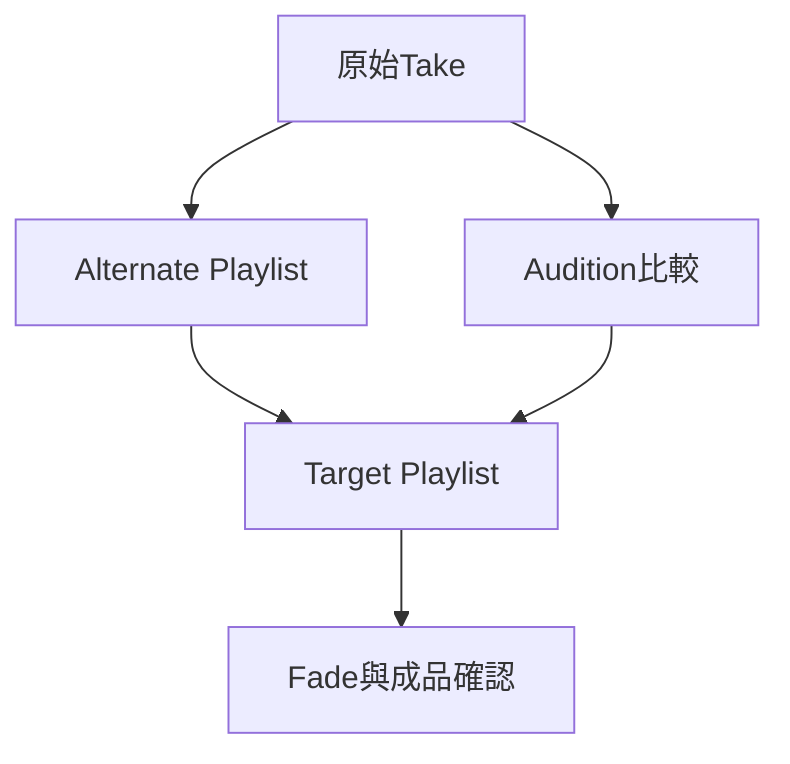

# Ch33a — 用Playlist保留版本與合成Take

> Playlist 保存同一條 Track 上不同素材排列，讓你挑最佳片段時不必破壞原始演奏。

[[Pro_Tools_Reference_Guide_2023.3.pdf#page=763|原書 p. 731–744／PDF p. 763–776]]。內容依 **2023.3** 原文消化重組；英文功能名稱保留。實務連結與原創示意圖用於教學，不是原書逐字翻譯，也不代表現行版本的支援狀態。

## 觀念地圖

![[PT-Ch33-concept.png]]

圖為原創概念示意；示例位置、長度與曲線只用來比較機制，不是原書量測資料或建議處理參數。

## 1. Playlist 不是另一條有獨立效果器的Track

一條 Track 有 main playlist，也可有多份 alternate playlist；Playlist 存的是 Clip 排列。Audio／Aux／Master 等 Track 的 Automation 則有自己的 playlist 結構，不等於你複製一份演奏 Playlist，就連整套混音狀態都複製。MIDI CC 在 MIDI Clip 裡，會跟演奏 Playlist 走，與 Audio Automation 的行為不同。

| 你想保留什麼 | 較適合工具 | 注意 |
|---|---|---|
| 原 take 與另一種剪輯版本 | Duplicate Playlist | 不等於複製所有 Audio file |
| 空白位置錄下一個 take | New Playlist | 原 Playlist 仍在 |
| 完全不同的 Plug-In／路由混音 | 另存 Session 或適當 Track 副本 | Playlist 本身不是完整 mixer snapshot |
| 多軌同一次演奏的 take 編號 | Edit Group 內建立 Playlist | 保持 group 啟用與後綴同步 |

建立 Playlist 預設名稱是 Track 名加`.01`、`.02`等。切換 main playlist 也會更新 Track 顯示名稱；不要以為 Track 被刪掉重建。未被任何 Track 使用的 Playlist 才可從 Other Playlists 指派到另一條 Track，同一份不能同時掛在兩條 Track。

> [!tip] 實務連結
> 人聲可留`Lead.raw`、`Lead.comp`、`Lead.edit`三個清楚階段。先 Duplicate 再 Comp，才能比較不同選擇；「我還記得 Undo 順序」不是可靠版本管理。

## 2. 新增、複製與切換的最小操作組

| 工作 | Mac／操作 | 結果 |
|---|---|---|
| New Playlist | Control+反斜線，或 Playlist selector > New | 第一條 selected Track 新增空白 Playlist |
| Duplicate Playlist | Command+Control+反斜線 | 複製 main playlist |
| 顯示上一／下一份 main playlist | Shift+Up／Down | cursor 所在 Track 切換 Playlist |
| Playlists／Waveform view 切換 | Command+Control-click Playlist selector | 展開／收起 alternate lanes |
| Rename | 雙擊 Track／Playlist 名稱 | 更新對應名稱 |
| Delete Unused Playlist | Playlist selector > Delete Unused | 原書指出不能 Undo，先確認 |

Playlist 本身占的 disk space 很少；別為了省硬碟急著刪 take。真正大的是來源 Audio file，而刪 Playlist 與刪 Audio file 又是不同事情。

多軌鼓錄音以 active Edit Group 一起建立新 Playlist，可保持`.01`等後綴對應；中途加新的 Track 時，Pro Tools 也會用空白 Playlist 補齊較早的 take 編號。這種同步對「整組鼓要切同一次演奏」很重要。

## 3. Comping 是比較片段，再複製到Target

Playlists view 把 alternate lanes 放在 main 下面。一般只有 main 透過 Track output 播放；想聽 alternate，按該 lane 的 Solo，改成由它播放。這個 Solo 只在同一 Track 的 Playlist 間選來源，不會把整首歌其他 Track 靜音。

1. 保留原 main 的 Duplicate，再建立你要合成的 Target。
2. 切到 Playlists view，把需要的 takes 展開；用相同 Timeline loop 聽每一次演奏。
3. 在 alternate lane 選一句／一個字，Solo 比較音準、表情、咬字與銜接。
4. 確定後用 Copy Selection to Target Playlist，保留來源不被挖空。
5. 回到 Target 聽前後句，修剪與 Fade，而不是只聽被挑中的單字。

| 命令族 | 來源 | 目的地 |
|---|---|---|
| Copy To > Target Playlist | 保留 | 目前 Target，同一時間位置；覆寫該處內容 |
| Copy To > New Playlist | 保留 | 新的空白 Target |
| Copy To > Duplicate Playlist | 保留 | 複製目前 Target 後加新片段 |
| Move To 系列 | 從來源移走 | 其餘目的地邏輯類似，須看清 Target |

> [!warning] Main 不一定是 Target
> 預設 main 就是 Target，但 Target 可另指定。若你只看畫面最上方就按 Copy To，可能送到另一份 Playlist。Target 按鈕與 selector 的顏色是檢查線索，下一篇細講。

## 4. 比較與篩選，減少視覺負擔

`Shift+S`可 Solo 含 cursor 的 lane；`Control+P`／`Control+;`上下移 cursor。若 cursor 跨多 lane，Solo 針對最上方符合條件者，操作前先縮小 selection。Alternate lane 可拖動排序與調 height，方便把最佳候選靠在一起。

Filter Lanes 可依「Clip 在 selection 內／外」或 Rating 顯示、隱藏。這只是控制可見度，不等於刪除 take；範圍編輯會影響顯示中的 alternate playlists，未顯示者不受同樣操作。

> [!tip] 實務連結
> 第一次聽 take 先評 Rating，再只顯示高評分或當前句有素材的 lane。視覺變簡單後，判斷應回到完整句子的情緒；不要因為某個字音準最準，就忽略它接不進上下句。

> [!abstract] Takeaway
> 先保留原 Playlist，讓 alternate lane 負責比較、Target 負責收成品。Copy 保留來源，Move 會挖走來源；main 與 Target 需要分開辨認。

## 相關

%% PT-NAV-BEGIN %%

上一篇：[[PT-Ch32b-建立批次調整與保留Fade]]

下一篇：[[PT-Ch33b-Target與Matches的進階工作流]]

按任務閱讀：[[PT-00-工作流程導航]]

%% PT-NAV-END %%

- [[PT-Ch33b-Target與Matches的進階工作流]]
- [[PT-00-功能目錄#Ch32 — Fades and Crossfades]] — 對照相鄰章原文脈絡。
- [[PT-00-功能目錄#Ch34 — Beat Detective]] — 對照相鄰章原文脈絡。
- [[PT-00-索引]] · [[PT-00-快速檢索]] · [[PT-00-Mac快捷鍵]]
- [[PT-00-版本與原文疑義]] — 原書跨頁表述或快捷鍵差異，另行集中核對。

標籤： #pro-tools #audio #editing
