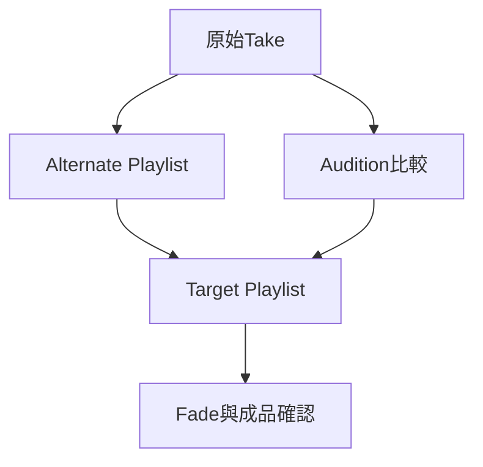

# Ch33b — Target與Matches的進階工作流

> Target 決定成品送去哪裡，Matches 決定哪些其他素材有資格被拿來替換。

[[Pro_Tools_Reference_Guide_2023.3.pdf#page=777|原書 p. 745–758／PDF p. 777–790]]。內容依 **2023.3** 原文消化重組；英文功能名稱保留。實務連結與原創示意圖用於教學，不是原書逐字翻譯，也不代表現行版本的支援狀態。

## 觀念地圖

![[PT-Ch33-concept.png]]

圖為原創概念示意；示例位置、長度與曲線只用來比較機制，不是原書量測資料或建議處理參數。

## 1. Matching Criteria 是候選清單的篩選器

Loop／Punch Recording 會留下對應的 takes，Duplicate Playlist 也可能產生可替代的 Clip；Field Recorder 的多 channel 亦有自己的對應關係。你在 Matches 看不到預期 take，先檢查 criteria，不要急著重新匯入。

| Criteria 群組 | 選項 | 用途 |
|---|---|---|
| Alternates Match，可組合 | Track ID、Track Name、Clip Rating | 找同 Track 來源／同 root name／同評分 |
| In Addition To，互斥 | All、Clip Start、Clip Start and End、Within Selection、None | 再用時間／selection 關係縮小候選 |
| Matching Criteria 保存位置 | Session | 不應推定開另一份工程仍相同 |

Track Name 比對 root name，例如原書`Gtr.L`可匹配`Gtr.L_01`，不等於任意名稱相似的`Guitar.L_01`。多軌同 take 替換通常要兼顧 Track Name 與 Selection Range，避免把不相干的錄音當同一段。

Right-click Clip > Matches，或 Selector 下 Command-click，可叫出替代 take；`Command+Option+Up/Down`循環匹配候選。要讓後錄 take 有相同 User Time Stamp，先用 Memory Location 叫回原 Punch／Loop 範圍，比手拉大概相同的區域穩妥。

## 2. 把隱藏take展開成容易比較的形狀

| 展開方式 | 你會得到 | 使用情境 |
|---|---|---|
| Expand Alternates To New Playlists | 同 Track 下多個 Playlist lanes | 人聲／樂器 Comping |
| Expand Alternates To New Tracks | 分成獨立 Track | 需分開處理或同時比較 |
| Expand alternate channels | 原 Field Recording 其他 channel | 2023.3 相關章標示 Ultimate only |
| By Timecode Only | 同 Timecode 範圍的原 source 素材 | 重建經 Video editor 剪過的 guide track |

Loop Recording 時，原書說明來源可能是包含各輪 pass 的單一 Audio file，Timeline 只顯示最後一輪；不表示其他 pass 消失。可開啟 Operation preference 的 Automatically Create New Playlists When Loop Recording，或事後 Expand Alternates To New Playlists。

> [!note] 不照抄範例裡的 Loop Playback 誤植
> p.735 的「loop record」步驟有把選單寫成 Loop Playback；錄音模式應依 Ch25 的 Loop Recording 操作核對。Loop Playback 與 Loop Recording 不是同一開關，本筆記把兩者分開說明。

Field Recorder 展開依賴同時錄音的 channel、重疊 Timecode 與保留下來的 metadata。原書列 Scene／Take、Shoot Date、Tape／Sound Roll 等匹配條件；不能僅憑「檔名像是同一天」就推定可重建。詳細再接 Ch62。

## 3. Target可獨立於眼前main playlist

從 Playlist selector > Target Playlist 選 main 或另一份 Playlist；在 Playlists view 也可按 lane 的 Target button。Target 在 main 顯示時，selector 為 blue；Target 在別的 alternate 時，selector 為 orange。這個顏色是在提醒你「眼前看的不一定是成品目的地」。

| 工作 | Mac 快捷鍵（2023.3） | 條件 |
|---|---|---|
| 目前 main 設為 Target | Command+Shift+Right | cursor 在該 Playlist |
| 顯示 Target 為 main | Shift+Right | 先有正確 Track 焦點 |
| 在最近兩份 main 間切換 | Shift+Left | 和上下循環全部不同 |
| Copy selection 到 Target | Option+Shift+Up，或 Option+Control+V | 同時間位置貼入 |
| Move selection 到 Target | Option+Shift+T | 不是舊版 Option+Shift+M |
| 以 selection 聽上／下一份素材 | Command+Shift+Up／Down | 範圍內循環 audition |

原書在早期文字步驟與章末 shortcut 總表對某些「新建 Playlist」與 all-track modifier 有不一致。此處僅列跨相關頁一致且清楚的核心組合；進階鍵法以[[PT-00-Mac快捷鍵]]對照官方 Shortcuts guide，找不到一致依據時直接用 menu。

> [!tip] 實務連結
> 多軌鼓 Comping 時，先讓 Edit Group 保持啟用，指定對應 Target 後再一起挑 take。不要為每支麥各自選看似最佳的一次，否則會破壞同一演奏與跨麥時間關係。

## 4. 視覺提示與誤操作排查

| 現象 | 代表什麼 | 檢查 |
|---|---|---|
| 綠色 check 與 Target 名稱短暫出現 | selection 已送到 Target | 回 Target 聽接縫 |
| 藍色 target 提示 | 眼前 main 被設為 Target | 是否選對成品版本 |
| 灰色 target 提示 | 眼前 main 不再是 Target | 下一次 Copy 會送去哪裡 |
| 紅色 not allowed | 嘗試從 Target 送回同 Target 等不允許動作 | 換來源或重設 Target |
| 循環聽 take 回到 home icon | 回到起始 Playlist | 不等於新增一個 take |

刪 Unused Playlist 不能 Undo；重建時還可能失去命名與 take 對應，故不建議在 Comping 過程為了清爽大量刪。若只要減少畫面，用 Filter Lanes 或 hide。

> [!abstract] Takeaway
> Matches 先篩候選，Target 再定目的地。用 group 保存多軌 take 的一致性；看見 orange selector 時，特別確認眼前 main 與 Target 不是同一份。

## 相關

%% PT-NAV-BEGIN %%

上一篇：[[PT-Ch33a-用Playlist保留版本與合成Take]]

下一篇：[[PT-Ch34a-BeatDetective偵測與TempoMap]]

按任務閱讀：[[PT-00-工作流程導航]]

%% PT-NAV-END %%

- [[PT-Ch33a-用Playlist保留版本與合成Take]]
- [[PT-00-功能目錄#Ch32 — Fades and Crossfades]] — 對照相鄰章原文脈絡。
- [[PT-00-功能目錄#Ch34 — Beat Detective]] — 對照相鄰章原文脈絡。
- [[PT-00-索引]] · [[PT-00-快速檢索]] · [[PT-00-Mac快捷鍵]]
- [[PT-00-版本與原文疑義]] — 原書跨頁表述或快捷鍵差異，另行集中核對。

標籤： #pro-tools #audio #editing
