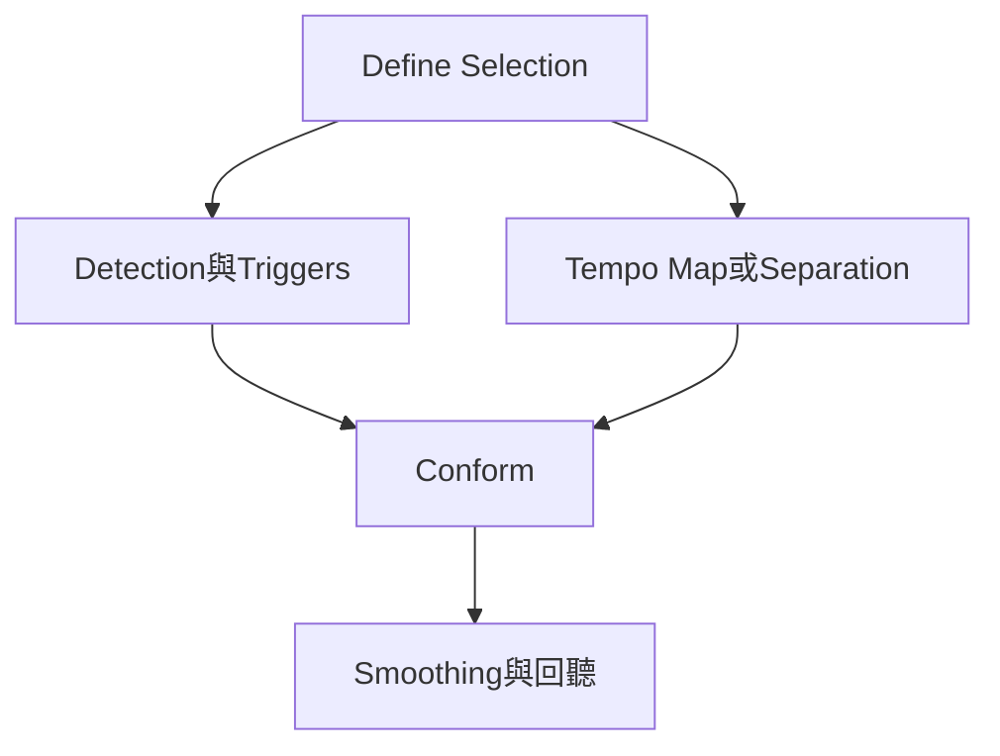

# Ch34a — BeatDetective偵測與TempoMap

> Beat Detective 先把演奏解析成可核對的 beat trigger，再決定是讓格線跟演奏，還是讓演奏跟格線。

[[Pro_Tools_Reference_Guide_2023.3.pdf#page=791|原書 p. 759–772／PDF p. 791–804]]。內容依 **2023.3** 原文消化重組；英文功能名稱保留。實務連結與原創示意圖用於教學，不是原書逐字翻譯，也不代表現行版本的支援狀態。

## 觀念地圖

![[PT-Ch34-concept.png]]

圖為原創概念示意；示例位置、長度與曲線只用來比較機制，不是原書量測資料或建議處理參數。

## 1. 先決定誰要跟誰

常見兩種任務看起來都叫「對拍」：一種是保留現場演奏，讓 Session tempo map 跟它；另一種是 Session 已有固定 Tempo，要把鬆散的 Audio 剪齊。前者用 Bar|Beat Marker Generation；後者用 Clip Separation 與 Clip Conform。不要為了修一個彈早的音，先把整首 tempo map 改掉。

| Operation | 產物／作用 | 適用資料 |
|---|---|---|
| Bar\|Beat Marker Generation | 從演奏建立 Tempo map | Audio／MIDI |
| Groove Template Extraction | 擷取 timing 與 dynamics 成 DigiGroove | Audio／MIDI |
| Clip Separation | 依 trigger 切 Audio | Audio only |
| Clip Conform | 移動切好的 Clip 對 Grid／Groove | Audio only |
| Edit Smoothing | 填剪輯後空隙並可加 Crossfade | Audio only |

開啟：`Event > Beat Detective`，Mac `Command+numeric keypad 8`。它適合 attack 清楚的鼓、Bass、節奏吉他；legato 弦樂或柔和人聲比較難從瞬態判拍，不能把 Sensitivity 拉高就當正確。

> [!tip] 實務連結
> 無 click 的現場演奏若要加 MIDI，先建 tempo map，讓新增素材跟著樂手；固定 click 錄好的鼓只要修 timing，就保留原 map，切 Clip 再 Conform。

## 2. Define Selection決定分析的數學座標

先選一段起訖在明確拍點的 Audio；第一拍要從 attack 開始。手動輸入 Time Signature 與 Start／End Bar|Beat，或在素材已對上 Session 拍點時用 Capture Selection。原書四小節例子是`1|1`到`5|1`，不是`1|1`到`4|1`；後者只有三小節間距。

| 欄位 | 真正意義 | 常見錯誤 |
|---|---|---|
| Start／End Bar\|Beat | 此段起訖應對應哪些拍 | 把第 4 小節末寫成第 4 小節頭 |
| Time Signature | 當下拍號 | 含變拍段落卻當單一 meter 分析 |
| Contains | 段落最細的節奏分割與 triplet | 太粗使內部節奏落到同格 |
| Capture Selection | 擷取已對上 Session 的範圍 | 原素材 Tempo 不合也直接 Capture |
| Tap End B\|B | 依 tap 估算不確定的終點 | 估完不回聽、不修到正確 barline |

選取段內不應含 tempo／meter 變化；遇到改拍或演奏變化大，拆成較小範圍。每次改 selection 或 tempo map，都要重新 Define／Capture；原書指出 Selection definition 不隨 Session 重新開啟保留，不能靠上次印象接著切。

## 3. Analysis、Resolution、Sensitivity的分工

| 控制 | 管什麼 | 調整方向 |
|---|---|---|
| High Emphasis | 偏高頻、非諧波內容 | Hi-hat／cymbal |
| Low Emphasis | 低頻與較諧波性素材 | Kick／Bass／部分 Piano、Rhythm Guitar |
| Enhanced Resolution | 較廣泛的偵測 | 完整 mix／loop 等 |
| Resolution | 要 bars、beats 還是 sub-beats | 決定保留的節奏層級 |
| Sensitivity | 哪些瞬態夠顯著而被保留 | 提高可見較弱 attack，也可能多出假 trigger |

三種粗細的 trigger 表示 bar、beat、sub-beat；Show Trigger Time 顯示推定拍位。最關鍵不是「有沒有一條線」，而是「這條線代表的拍是不是正確」。一個搶拍音若被指到前一個 subdivision，後面 Conform 就可能移到錯拍。

## 4. 人工校正trigger，軟體才知道你的意圖

| Mac 操作／工具 | 用途 | 補充 |
|---|---|---|
| Grabber 拖 trigger | 修實際位置 | 對 attack 位置微調 |
| Option-click trigger | 刪假 trigger | 不等於刪 Audio |
| 在空白拍點 click | 插新 trigger | 太靠近既有 trigger 可能變成搬舊的 |
| Command-click trigger | Promote | 降 Sensitivity 仍保留，Sensitivity=0 除外 |
| 雙擊 trigger | Identify Trigger 拍位 | 修它是第幾小節第幾拍 |
| Scroll Next／Option-click | 下一／上一個 trigger | zoom 很近時逐一驗證 |

Promote 後若重按 Analyze，會回到新的分析結果，不能假設手工修正永遠保留。先讓必要 trigger 穩定，再進下一階段，遠比切完才發現整句錯一拍好救。

> [!warning] Collection 不會把每支麥各自拉到零時差
> 正常跨軌偵測會把很接近的 attack 視為同一事件並保留較早者。Collection 是逐軌取得較好的 trigger 集合，再把同一組切點套到整組 Track；目的不是抹去 Overhead 的自然延遲，下一篇會展開。

## 5. 建Tempo map或Groove時的額外檢查

Bar|Beat Markers 從 trigger 生成，讓其他 Audio／MIDI 對上演奏。Session 有 tick-based 素材時，Realign Session 讓你選 Preserve Tick Position（保拍位，絕對時間可改）或 Preserve Sample Position（保原絕對時間），先想清楚再 Generate。

DigiGroove 同時保存節奏偏移與 dynamic 資訊，解析度為 960 ppq；Audio 的強弱可轉成 MIDI velocity。原書對照 0 dBFS→127、−6 dBFS→64、−12 dBFS→32、−48 dBFS→1，是其轉換例，不是宣稱任何音源的 velocity 都與響度線性。

Groove Clipboard 關閉 Session 後會失去；要跨工程重用則 Save To Disk。Mac 模板位置依原書為`Applications/Avid/Pro Tools/Grooves`。擷取要用完整小節並正確包含最細 subdivision；若只存八分 Groove 卻套到十六分素材，可能把不同音映到同一位置。Groove 擷取／套用範圍也應避免已混入 Bar|Beat Markers 而影響準確度。

> [!abstract] Takeaway
> 先選對任務方向，再校準 selection 與 trigger。Tempo map 改格線，Conform 改 Clip 位置；trigger 位置正確卻拍位標錯，一樣會剪壞。

## 相關

%% PT-NAV-BEGIN %%

上一篇：[[PT-Ch33b-Target與Matches的進階工作流]]

下一篇：[[PT-Ch34b-多軌鼓對拍與接縫平滑]]

按任務閱讀：[[PT-00-工作流程導航]]

%% PT-NAV-END %%

- [[PT-Ch34b-多軌鼓對拍與接縫平滑]]
- [[PT-00-功能目錄#Ch33 — Playlists]] — 對照相鄰章原文脈絡。
- [[PT-00-功能目錄#Ch35 — MIDI Editing]] — 對照相鄰章原文脈絡。
- [[PT-00-索引]] · [[PT-00-快速檢索]] · [[PT-00-Mac快捷鍵]]

標籤： #pro-tools #audio #editing
