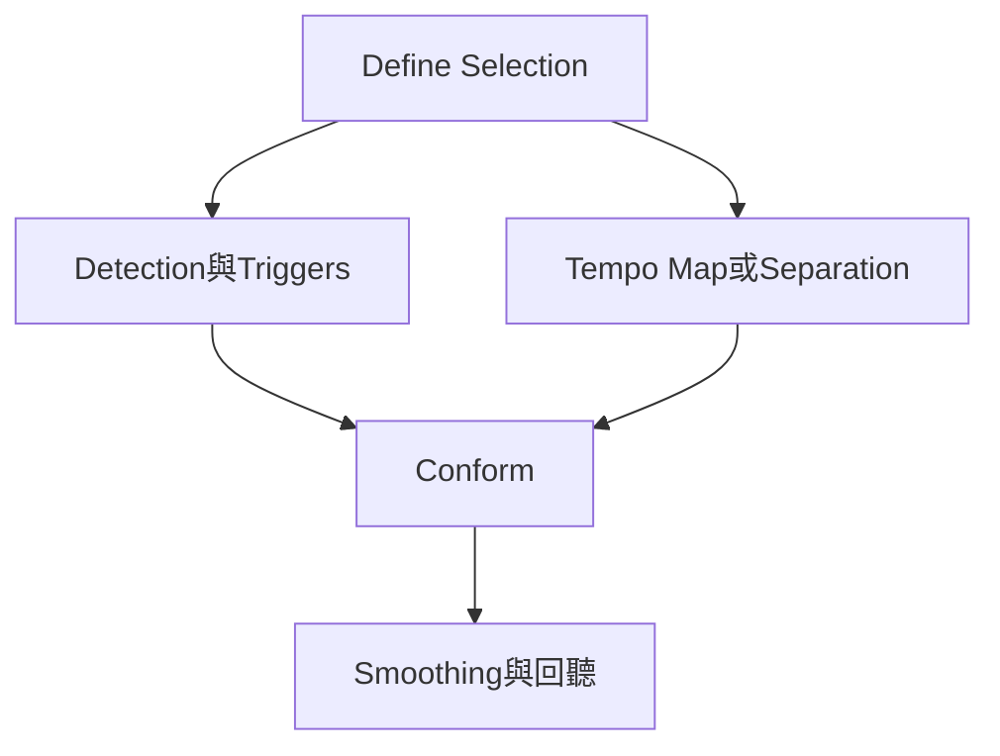

# Ch34b — 多軌鼓對拍與接縫平滑

> 先收集可靠的 attack，再把相同切點與位移套到整組鼓，才能兼顧節奏與跨麥關係。

[[Pro_Tools_Reference_Guide_2023.3.pdf#page=805|原書 p. 773–781／PDF p. 805–813]]。內容依 **2023.3** 原文消化重組；英文功能名稱保留。實務連結與原創示意圖用於教學，不是原書逐字翻譯，也不代表現行版本的支援狀態。

## 觀念地圖

![[PT-Ch34-concept.png]]

圖為原創概念示意；示例位置、長度與曲線只用來比較機制，不是原書量測資料或建議處理參數。

## 1. Separate以前，先保留原版

複製鼓組 Playlists 並保持正確 Edit Group。分析時可只用 Kick、Snare 等較清楚的近麥，真正 Separate 時則擴充 selection 到所有應一起動的鼓麥。這樣切點和位移一致，原本 Room／Overhead 相對近麥的延遲仍可留下。

| 階段 | 主要檢查 | 沒檢查的代價 |
|---|---|---|
| Selection | 每軌同一時間範圍、正確 bars/beats | 整組被錯誤指拍 |
| Detection | 真 attack 都有 trigger，假 trigger 已刪 | 不必要碎片或漏打 |
| Separation | 全部相關鼓麥都在範圍內 | 部分麥仍留在舊位置 |
| Conform | Grid／Groove、強度與排除範圍 | 機械化或移到錯拍 |
| Smoothing | gap、重複 attack、cymbal 尾音 | 節奏準但接縫破碎 |

`Clip Separation > Trigger Pad`範圍 0–50 ms，把分離點放在 trigger 之前；sync point 仍代表 attack。之後 Conform 用 sync point 對拍，讓 attack 前有一點空間，不必把每段從波峰最尖處硬切。

> [!tip] 實務連結
> 先用短段驗證 Trigger Pad 與 Crossfade 是否安全，再處理下一段。過大的 pad 也不是保險，可能讓剪出的段落包含上一個 attack 的尾部；要依素材回聽。

## 2. Standard與Groove Conform怎麼選

| 控制 | 作用 | 原書提供的起點／提醒 |
|---|---|---|
| Standard | 依 Session tempo map 對齊 | 不等於必須 100% |
| Strength | 往目標拍位移動多少 | 100%精準落目標；原書示例 85–88%作保留 feel 起點 |
| Exclude Within | 決定貼近 Grid 的哪些偏移先不修 | 原書示例 10–15%用於保留部分原 feel |
| Swing | 以八分／十六分改 swing feel | 0%無，100%為其 triplet feel 定義 |
| Groove Timing | 往 Groove 模板移動多少 | 100%到模板；200%把差異加倍 |
| Pre-Process Using Standard Conform | 先標準對齊再套 Groove | 原演奏散亂或重 swing 模板可試聽比較 |

不要把不同軟體的 Swing 百分比當同一尺度。這裡的 100%有原書自己的定義，也不是「所有音都變成三連音」。套 Groove 時還要確認模板本身的 subdivision 足夠，否則不同行為的 note 可能擠到同一落點。

Standard Conform 可以處理原本 straight 或 swing 的 Clip，但成功前提仍是 Clip start／sync point 與要對的 attack 有正確關係；隨便剪一刀的 Clip 不保證能被準確理解。

## 3. Collection mode：各麥分析，整組剪輯

同一 Sensitivity 難同時適合 Kick、Snare 與 Hat：為抓弱 Hat 把 Sensitivity 拉高，其他 Track 可能出現大量 leakage trigger；只分析 Overhead，又可能因聲音到達較晚而切到近麥 attack 之後。

| Collection 控制 | 作用 | 建議檢查 |
|---|---|---|
| Normal | 目前 Track 的 Detection 設定 | 先把這支麥偵測好 |
| Add All | 把目前所有 trigger 加入 collection | 第一支可靠近麥可作基底 |
| Add Unique | 只加已有集合之外的新 trigger | 避免 leakage 近重複 |
| Clear All | 清空 collection | 開始新任務前確認是否沿用舊集合 |
| 彩色 trigger | 辨認各輪加入來源 | 最後操作必須從 Collection mode 執行 |

流程：選 Kick 短段→Normal 分析→Collection Add All→回 Normal，在相同時間範圍改選 Snare→調偵測→Collection Add Unique→必要時加 Hat／Toms→擴選所有鼓麥→在 Collection mode Separate。接著保持整組 selected 再 Conform。

若新 trigger 與已有 trigger 很接近，系統保留較早者，避免把同一擊當好幾擊；這不是把每支麥各自時間校正。Collection trigger 會隨 Session 保存，重新開工程還在，與 Selection definition 的保存行為不同。

> [!warning] 不要分析近麥，卻忘了把 Room／Overhead 納入 Separate
> 最危險的失敗不是完全無聲，而是近麥已對拍、遠麥仍留在原時間，瞬態與相位關係被破壞。把 Track 完整可見、檢查 selection 範圍，比反覆換 Detection algorithm 更重要。

## 4. Edit Smoothing填的是來源餘量，不是合成新Room Tone

Conform 移動片段後會留下 gap。Fill Gaps 以 Trim 露出來源尾部；Fill And Crossfade 再於 Clip start 前加 pre-fade。它會用已有 Audio，不能保證任何節奏位移都能無痕填好。若露出下一擊或 fade 跨到 attack，可能聽到重複敲擊、尾音跳動或薄掉的鼓。

| 症狀 | 優先回查 | 下一步 |
|---|---|---|
| 出現 double hit | Trigger、Pad、Fill 露出的來源 | Undo，縮小問題段、修切點 |
| 鼓突然變薄／梳狀 | 某些麥沒同切同移 | 檢查 group、visibility、selection |
| Cymbal 被切斷 | gap 與 Crossfade 位置／長度 | 聽 Overhead／Room，手調交接 |
| 節奏整段錯拍 | Selection Bar\|Beat 與 Identify Trigger | 回 Detection 修拍位再 Separate |
| 操作變慢 | 長段、多軌、Undo 與大量碎 Clip | 用 4／8 小節等較短範圍，完成後整理 |

Edit Smoothing 必要時會在原 attack 位置建 sync point，讓露出來源後仍可再次 Conform。確定結果後可 Consolidate 降低 edit density；若還要改 Tempo／編排，可先用 Clip Group 管理碎段，保留原 Playlist 方便回頭。

> [!abstract] Takeaway
> Collection 是建立共同 trigger 集合，不是每麥各自對齊。全麥同切同移後，回聽 Edit Smoothing，尤其要找 double hit、cymbal 破口與漏掉的 group member。

## 相關

%% PT-NAV-BEGIN %%

上一篇：[[PT-Ch34a-BeatDetective偵測與TempoMap]]

下一篇：[[PT-Ch35a-MIDI音符輸入與選取]]

按任務閱讀：[[PT-00-工作流程導航]]

%% PT-NAV-END %%

- [[PT-Ch34a-BeatDetective偵測與TempoMap]]
- [[PT-00-功能目錄#Ch33 — Playlists]] — 對照相鄰章原文脈絡。
- [[PT-00-功能目錄#Ch35 — MIDI Editing]] — 對照相鄰章原文脈絡。
- [[PT-00-索引]] · [[PT-00-快速檢索]] · [[PT-00-Mac快捷鍵]]

標籤： #pro-tools #audio #editing
