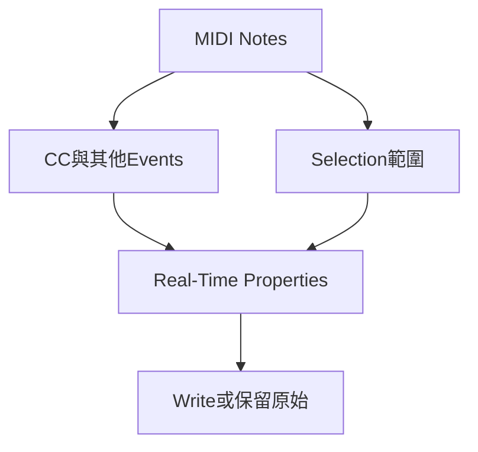

# Ch35a — MIDI音符輸入與選取

> 編輯 MIDI 時，要分開決定音高、開始時間、長度與 Velocity，才能改得準又保留表情。

[[Pro_Tools_Reference_Guide_2023.3.pdf#page=817|原書 p. 785–802／PDF p. 817–834]]。內容依 **2023.3** 原文消化重組；英文功能名稱保留。實務連結與原創示意圖用於教學，不是原書逐字翻譯，也不代表現行版本的支援狀態。

## 觀念地圖

![[PT-Ch35-concept.png]]

圖為原創概念示意；示例位置、長度與曲線只用來比較機制，不是原書量測資料或建議處理參數。

## 1. Grid不是Note Duration

MIDI note 沒有一段已錄好的 waveform，而是 Note On／Off 等事件。Piano Roll 中的橫向位置是開始時間，長度是 duration，縱向位置是 pitch；Velocity 又是獨立值，會依音源設計改變音量與音色，並非 Audio Fader。

| 控制 | 決定什麼 | 例子 |
|---|---|---|
| Grid Value | note 開始位置吸到哪種格線 | 八分、十六分、triplet |
| Default Note Duration | 新插入 note 預設多長 | Grid 十六分但 note 可設八分 |
| Default Note On Velocity | 新 note 預設力度 | 不等於 Track output gain |
| Play MIDI Notes When Editing | 插入／移動時是否聽見 note | 可即時檢查 pitch 與 timbre |
| Mirrored MIDI Editing | 同一 MIDI Clip 其他副本是否跟著改 | 重複 loop 需特別確認 |

各 Editor 可有獨立 Grid、Default Duration 與 Velocity。若用 Line 等 Pencil shape 連續畫 note，Default Duration 大於 Grid 時，為避免重疊，插入的 note 會被縮到 Grid 長度；不是所有工具模式都能照你設定的長音直接重疊。

## 2. Pencil shape不只決定線條，也決定一串note的力度

| Shape | 插入同音高連續 note 時 | 畫 CC 時 |
|---|---|---|
| Free Hand | 一次一顆；可拖 pitch／duration | 自由描繪，依解析度形成事件 |
| Line | 相同 Velocity 的一串 note | 直線漸變 |
| Triangle | Velocity 在 Default 與 127 間三角變化 | 三角週期 |
| Square | Velocity 在 Default 與 127 間交替 | 方波式交替 |
| Random | Default 與 127 間隨機 Velocity | 隨機值 |

Parabolic、S-Curve 是 Tempo Editor 的 shape，不能把它們當任意 MIDI CC 曲線。新手常以為換 Random 只是游標圖案不同；實際上，它可能在同一個 pitch 連插很多顆 note，並改 Velocity。

> [!tip] 實務連結
> 寫鼓的先後強弱，可先用 Line 得到一致節奏，再手動改重拍與 ghost note；Random 適合試變化，卻不會自動理解樂句。保留一版原節奏，才好比較「人性化」是否真的更像演奏。

## 3. 選取方式決定CC會不會一起動

| 選法 | 選到的資料 | 適合工作 |
|---|---|---|
| Grabber 在空白處框選 notes | 接觸框線的 notes，屬 Object selection | 只搬 note，保留 pedal 等 CC |
| Selector 拖時間 | Note On 在範圍內的 note，並含底層 CC／Automation | 整段演奏一起搬 |
| Option-drag Selector | Note Selector，僅 notes／velocities | 在時間範圍內改 note 而不碰其他 events |
| 點 mini-keyboard 音高 | 選該 pitch 所有 notes 並 audition | 整批選 Snare 或 Bass 音 |
| Option-click mini-keyboard | 只 audition 不選 | 比對音源對應音 |

一顆長音只有尾巴跨進 selection，Selector 不一定把它當完整 note 選到；Grabber 框選碰到任一部分則可能選入。刪除前看 selected 狀態，別只看「畫面有被灰色範圍蓋到」。

Mirrored MIDI Editing 開啟時，改同一 Clip 的 notes 會套到所有該 Clip 副本；按鈕閃紅是提醒。關閉後編 loop note 可能 flatten 該 loop，編 Clip Group 也可能拆開 group。要保留母版，先 Duplicate Playlist，再確認是否想同步改所有循環。

## 4. 移動、移調、Trim與Velocity各自有方向

Grabber／Pencil 拖 note 可改 time 或 pitch；Shift 拖能約束單一方向。Option-drag 建立副本，適合做和聲或改第二次樂句。Relative Grid 保留錄入時的 microtiming，Absolute Grid 則吸到格線。

| Mac 操作 | 結果 | 前提 |
|---|---|---|
| note 選中，Up／Down | 上下半音 | MIDI Notes／Velocity 或 MIDI Editor 有焦點 |
| Shift+Up／Down | 上下八度 | 同上，不是 Track Playlist 切換情境 |
| Control+Up／Down | 依 Key marker 作 in-key 移動 | Pitched／Key 設定要正確 |
| Option+Left／Right | 依 Grid 縮短／拉長 Note Off | note editing 焦點 |
| Command+Up／Down | Velocity 增減 5 | MIDI note selection |
| Command+Shift+Up／Down | Velocity 增減 15 | 同上，不能套用 Waveform comping 語意 |

Velocity lane 可直接拖 stalk 頂端，Line Pencil 可做 crescendo；Trim 可一起調 selected notes 力度，保留相對關係。若和弦 notes 同時開始，stalk 疊在一起，可 Command-drag 實際 note 做 Velocity Trim，避免誤改另一顆。

## 5. 分離與合併note，不等於分離Clip

在 Notes view／MIDI Editor，Separate At Selection 切的是 notes，不新增 MIDI Clip；在 Clips view 切的是 Clip 外框。`Command+E`因此不能只背成「切 Clip」。Consolidate 可把連續、同 pitch 的 notes 併成一顆；`Option+Shift+3`在此與 Audio 寫新 file 的語意又不同。

| 需求 | 方法 | 留意 |
|---|---|---|
| 切開一顆長 note | Notes view 中 Separate，或 Control+Shift-click | 檢查有無形成重複 Note On |
| 合併連續同 pitch notes | Edit > Consolidate | 不是合併不同 pitch 成和弦 |
| 先停用幾顆不想刪 | Edit > Mute Notes／Command+M | 留待 A/B 比較 |
| 精確輸入 note 屬性 | Event Edit area | 多 note 顯示 delta，pitch／Velocity 輸入是相對增減 |
| 整個 MIDI Clip 拉快／拉慢 | Clips view 用 TCE Trim | 會按比例縮放內部 MIDI，不是只剪尾 |

> [!warning] MIDI 刪除也要先確認 Selection
> 選完整 time range 後 Clear 可能連底層 Controller 一起刪。只想去掉一個 note 時，用 Object／Note Selector 或 Pencil 的 Option-click Eraser，更容易保持其他表情資料完整。

> [!abstract] Takeaway
> Grid 管落點，Duration 管長度，Velocity 管力度。先選對 note-only 或 time range，再確認 Mirrored MIDI Editing；相同快捷鍵會依焦點改變語意。

## 相關

%% PT-NAV-BEGIN %%

上一篇：[[PT-Ch34b-多軌鼓對拍與接縫平滑]]

下一篇：[[PT-Ch35b-Controller與外部MIDI排查]]

按任務閱讀：[[PT-00-工作流程導航]]

%% PT-NAV-END %%

- [[PT-Ch35b-Controller與外部MIDI排查]]
- [[PT-Ch35c-Quantize與RealTimeProperties]]
- [[PT-00-功能目錄#Ch34 — Beat Detective]] — 對照相鄰章原文脈絡。
- [[PT-00-功能目錄#Ch36 — MIDI Editors]] — 對照相鄰章原文脈絡。
- [[PT-00-索引]] · [[PT-00-快速檢索]] · [[PT-00-Mac快捷鍵]]

標籤： #pro-tools #audio #midi
