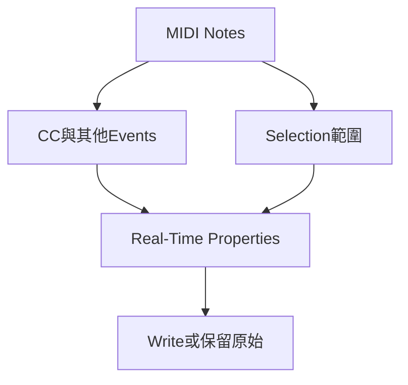

# Ch35b — Controller與外部MIDI排查

> MIDI 不只有音符：pedal、Pitch Bend、音色切換與 chasing 決定演奏能否被正確重播。

[[Pro_Tools_Reference_Guide_2023.3.pdf#page=835|原書 p. 803–819／PDF p. 835–851]]。內容依 **2023.3** 原文消化重組；英文功能名稱保留。實務連結與原創示意圖用於教學，不是原書逐字翻譯，也不代表現行版本的支援狀態。

## 觀念地圖

![[PT-Ch35-concept.png]]

圖為原創概念示意；示例位置、長度與曲線只用來比較機制，不是原書量測資料或建議處理參數。

## 1. CC看起來是線，實際上一顆一顆事件

MIDI Controller lane 以 breakpoints 顯示連續控制，但每個點代表獨立 event，不是 Audio Automation 那種可視為連續 vector 的同一類資料。畫曲線時，解析度越密，事件越多；這不必然更好，特別是外部硬體連線與接收設備有處理限制。

| 資料 | 本章處理方式 | 特別提醒 |
|---|---|---|
| Volume、Pan | CC7、CC10，並受 MIDI Automation mode 管理 | 與 Instrument 的 Audio Volume／Pan 分開 |
| Pitch Bend | 可畫、移動、複製 | 影響幅度依音源 bend range |
| Mod Wheel／Sustain 等 CC | 用 Controller number 辨認 | 名稱不完整時仍看 CC 編號 |
| Mono Aftertouch | 可在 Edit window 控制 | Polyphonic Aftertouch 改到 MIDI Event List 看 |
| Program／Bank Change | Patch Select／Program Change events | 外部 MIDI 音源用法需看設備文件 |
| System Exclusive | 可錄、搬、複製、刪 | 不能在 Pro Tools 直接編其 payload 內容 |

`Preferences > MIDI > Pencil Tool Resolution When Drawing Controller Data`可設 1–100 ms。沒有看到想畫的 CC 時，用 Controller selector > Add/Remove Controller，把它加入 Automated MIDI Controllers；外部錄到的 CC 會自動加入。

> [!tip] 實務連結
> 管弦樂音源常同時用 Velocity、Mod Wheel 和 Expression，先依音源文件確認映射。把一條看起來漂亮的 curve 複製到另一個 CC，不表示它就有一樣的音樂效果；控制對象不同，尺度也不同。

## 2. MIDI Volume與Audio Volume不是同一個旋鈕

Instrument Track 同時有 MIDI 端與 Audio 端，兩者都可能出現 Volume、Pan、Mute 相關控制。改 MIDI Volume 是送訊息給音源，改 Audio Volume 則調音源輸出後的聲音。若某個音源不回應特定 CC，畫了線卻聽不到變化，不能直接推定 Automation 壞了。

CC7／CC10 在 Pro Tools 有 Automation 特別待遇；其他 CC 仍會播放，不一定隨相同 suspend 狀態一起停止。錄製新演奏時，若要保留原 Volume／Pan 資料，原書建議 MIDI Merge，避免覆蓋既有資料。

| 症狀 | 可能原因 | 優先檢查 |
|---|---|---|
| 改 Volume 線卻沒變 | 改錯 MIDI／Audio 層或音源不回應 | Lane 類型、音源 CC mapping |
| 音符已結束但聲音延續 | Sustain Pedal 仍開或 Note Off 問題 | CC64、note duration、stuck notes |
| 回到開頭音色／力度怪 | 開頭沒有真正 Controller event | 寫明確初值，不只看預設線位置 |
| Pitch Bend 維持在偏移 | 停播前最後 bend 值被保留 | 起始 reset event 與 chasing |

## 3. Program與Bank Change是設備協定，不是通用預設列表

MIDI Program Change 範圍 0–127，很多設備又分 Bank。Bank Select 可能用 CC0、CC32 或兩者組合，必須查該設備規格。原書的該節把 Program Change 列為外部 MIDI 設備用途，並說明 Pro Tools Instrument plug-in 不按此機制回應；不要把每個軟音源 preset browser 當同一規則。

| 工作 | 操作 | 檢查 |
|---|---|---|
| 設 Track 預設 program | Patch Select button | 播放時送出，但不出現在 Clip event 圖上 |
| 中途換 program | Program Change view 用 Pencil 插入 | 放在沒有 note 響的空檔，避免中斷 |
| 匯入外部音源名稱 | Patch Select > Change 載入.midnam | MIDI output 應指正確 device |
| 清掉預設 program | Patch Select 選 None | 不等於刪掉 Track 內已錄 Program event |
| 自動巡聽 patch | Increment Patch，指定秒數 | 聽完關閉，選定所需 patch |

Mac 原書.midnam 路徑為`/Library/Audio/MIDI Patch Names/Avid`。Sysex 可用 MIDI Track 錄設備 bulk dump，之後整塊搬移／複製；不能靠雙擊把設備專屬內容當普通參數改。

## 4. Chasing讓中途播放接上狀態，也可能讓loop失步

Note Chasing 讓一顆長音即使 Note On 在目前 cursor 之前，從中間播仍聽得到。新 MIDI／Instrument Track 預設開啟；但若一顆 note 是在觸發「四小節 loop sample」，從第 3 小節開始追發 Note On，可能使 loop 從頭才開始，造成不同步。此時可在 Playlist selector 關閉 Note Chasing。

Controller 與 Program Chasing 會找回之前相關值。畫面預設線在 0 卻沒有真正 event 時，並不保證送出 0；例如最後一次 Mod Wheel=90，再從前面播，可能仍維持 90 直到遇到新 event。可在起點建立明確 breakpoint 作初值。

> [!tip] 實務連結
> MIDI 模板開始處加入所需 Sustain off、bend 回中心、Expression 初值，比期待每個音源自動 reset 穩定。這是依原書 chasing 原理延伸的工程習慣；實際 CC 與初值依音源需要決定。

## 5. Offset是播放補償，不是把畫面note剪到前面

Global MIDI Playback Offset 與個別 MIDI Track Offsets 都可設−10,000 到 10,000 samples；負值提前，正值延後，改 Playback 而不改 Edit window 顯示位置。外部硬體反應時間可把 Audio 錄回來，對照 MIDI Note On 與錄回 attack 的 sample 差估計。不要只把整個 H/W Buffer 值盲目當任何硬體的延遲。

卡住的 note 可用`Event > All MIDI Notes Off`，Mac `Command+Shift+.`。重複同 pitch notes 則有 Remove Duplicate Notes：原書以開始於前 note 最初 25%時長內、或八分音符內（取較短者）的規則判斷重複；它不是無條件刪所有重疊 notes，處理完仍應回聽。

> [!abstract] Takeaway
> 先辨認 MIDI Controller 與 Audio Automation。中途播放依賴 Chasing，起始值要有真正 event；Offset 改的是 Playback 時序，外部設備需量測而非憑感覺補。

## 相關

%% PT-NAV-BEGIN %%

上一篇：[[PT-Ch35a-MIDI音符輸入與選取]]

下一篇：[[PT-Ch35c-Quantize與RealTimeProperties]]

按任務閱讀：[[PT-00-工作流程導航]]

%% PT-NAV-END %%

- [[PT-Ch35a-MIDI音符輸入與選取]]
- [[PT-Ch35c-Quantize與RealTimeProperties]]
- [[PT-00-功能目錄#Ch34 — Beat Detective]] — 對照相鄰章原文脈絡。
- [[PT-00-功能目錄#Ch36 — MIDI Editors]] — 對照相鄰章原文脈絡。
- [[PT-00-索引]] · [[PT-00-快速檢索]] · [[PT-00-Mac快捷鍵]]

標籤： #pro-tools #audio #midi
