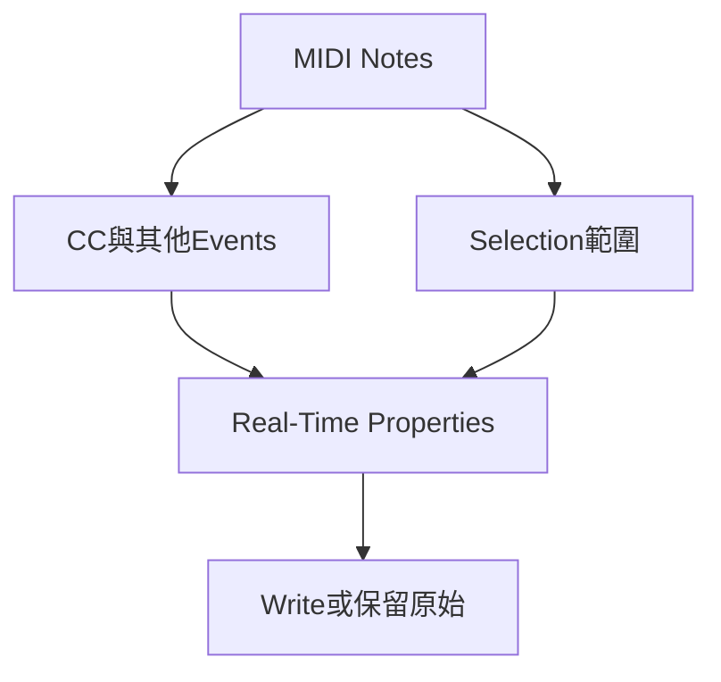

# Ch35c — Quantize與RealTimeProperties

> 先用 Real-Time Properties 試出音樂方向，再決定是否把改動寫進 MIDI 資料。

[[Pro_Tools_Reference_Guide_2023.3.pdf#page=851|原書 p. 819–826／PDF p. 851–858]]。內容依 **2023.3** 原文消化重組；英文功能名稱保留。實務連結與原創示意圖用於教學，不是原書逐字翻譯，也不代表現行版本的支援狀態。

## 觀念地圖

![[PT-Ch35-concept.png]]

圖為原創概念示意；示例位置、長度與曲線只用來比較機制，不是原書量測資料或建議處理參數。

## 1. 相同「量化」，發生的時間與層次不同

| 做法 | 什麼時候影響 | 適合用途 |
|---|---|---|
| Input Quantize | 錄入階段 | 確定希望輸入就對齊時 |
| Event Operations > Quantize | 對已選資料套用處理 | 已決定要改目前 notes |
| Clip > MIDI Quantize | 直接使用目前 Event Operations Quantize 設定 | 不必每次重開對話框 |
| MIDI Real-Time Quantize | Playback 時套規則，未寫入前可調 | A/B 比較、保留原 performance |
| Clip > Quantize to Grid | 移整個 Clip 的 start／sync point | 不是本篇的逐 note 量化 |

`Command+Option+0`執行 MIDI Quantize；`Command+0`則是 Clip Quantize to Grid。少了 Option 就可能改成另一層級，這正是快捷鍵要和功能名一起記的理由。

> [!tip] 實務連結
> 一段 Keyboard 演奏只是整句晚進，不一定需要逐 note Quantize；先試 Clip 位置或 Delay。若每顆 note 的鬆緊不同，再比較 Real-Time Quantize 的 Strength，避免一次把樂句呼吸全部拉直。

## 2. 五種Real-Time Properties

從`Event > MIDI Real-Time Properties`開浮動視窗；Edit window 也可顯示 Real-Time Properties column。欄位版只對 Track，Clip-level 屬性需用浮動視窗與 Apply To。按 property name 啟用，值改了但未啟用則不會依你想像作用。

| Property | 主要控制 | 常見用途／限制 |
|---|---|---|
| Quantize | Grid 或 Groove、Swing、Strength、Include、Random | Playback 對拍；不作用於 MIDI Input／Thru |
| Duration | Set／Add／Subtract／Scale／Legato Gap／Overlap | 改 staccato／legato；不作用於 Input／Thru |
| Delay | 提早／延後，以 ticks 或 ms 設定 | 全句位置微調；上限依原書 2000 ms 或 999 ticks |
| Velocity | Dynamic 比例、固定 offset、Min／Max | 改力度層次；Record-enabled 時可處理 Input／Thru |
| Transpose | By 音程、To 固定 pitch、In key scale steps | 變調或把素材映到音高；可處理 Input／Thru |

Velocity 的 Dynamics 是圍繞中間 Velocity64 縮放，不能簡化成「所有 Velocity 直接乘百分比」。Quantize 視窗還有 Tuplet 比例、Grid Offset 等展開參數；Quantity 越多不表示必須全部開啟，先調一個聽得出差異的控制。

## 3. Duration的六種意思

| Mode | 計算意圖 | 音樂感受 |
|---|---|---|
| Set | 每顆設指定長度 | 統一節奏音型 |
| Add／Subtract | 每顆加／減固定長度 | 一起稍微更連／更短 |
| Scale | 各 note 按比例改長度 | 保留原長短比例 |
| Legato/Gap | 延到下一顆前，再留固定 gap | 一致的斷奏距離 |
| Legato/Overlap | 延到下一顆並再重疊 | 觸發音源 legato／連音 |

Min／Max Duration 只在展開設定可見，可避免極短或極長值。Legato／Overlap 不是把音源本身變成真正 legato 樂器；它只是調 note 交疊條件，是否切換 transition 還看音源設計。

## 4. Track與Clip的優先權，決定你聽到哪一套

Track-based 設定在 Clip 角落以`T`提示；Clip-based 以`R`提示。Clip 有自己的 Properties 時，優先於 Track 層，而不是把兩套默默相加。複製／移動 Clip 會帶著 Clip properties，適合同一 Track 某個樂句特別處理。

| 現象 | 原因 | 解法 |
|---|---|---|
| 改 Track Quantize 但某段沒變 | 該 Clip 有自己的 R 層設定 | 檢查 Clip Apply To 與 Clear Clip Properties |
| 聽起來已量化，但 note 圖還鬆 | 未顯示 Properties 後的結果 | Preferences > MIDI > Display Events as Modified by Real-Time Properties |
| note 圖已對齊但未真正改寫 | 顯示選項開啟 | 不等於已 Write to Track／Clip |
| 換 Playlist 後 Properties 不同 | Track 層設定實際存在 Playlist | 比較 Playlist 狀態 |

## 5. Write之前，先保留一份未寫入版本

試聽滿意後，選 Track／Clip，在 Real-Time Properties window 選正確 Apply To，再按 Write to Track／Write to Clip。這會把效果套進當前 MIDI 資料，並讓對應 Properties 回到預設顯示，避免重複套同一規則。

1. Duplicate Playlist 保存原 performance 與目前試聽狀態。
2. 確認 Apply To，不把整 Track 當成單一 Clip 處理。
3. 開關 Property A/B，聽 release、groove 與力度是否合理。
4. Write，重新播放並核對 note 顯示與 Event List。
5. 若只是某 Clip 要回歸 Track 設定，用 Clear Clip Properties，不必把整條 Track 重錄。

> [!warning] 「看起來已改」不等於「已寫進資料」
> Display Events as Modified 只是顯示層。跨工程匯出、交付前，先決定要保留原始 performance 還是提交處理後 MIDI，再用實際輸出驗證；不要只截 Piano Roll 就判定完成。

> [!abstract] Takeaway
> Real-Time Properties 先試聽、Write 才改寫。Clip 設定優先於 Track，顯示已量化也不代表資料已提交；交付前確認你要的是原始還是處理後的 MIDI。

## 相關

%% PT-NAV-BEGIN %%

上一篇：[[PT-Ch35b-Controller與外部MIDI排查]]

下一篇：[[PT-Ch36-MIDIEditor多軌編輯工作台]]

按任務閱讀：[[PT-00-工作流程導航]]

%% PT-NAV-END %%

- [[PT-Ch35a-MIDI音符輸入與選取]]
- [[PT-Ch35b-Controller與外部MIDI排查]]
- [[PT-00-功能目錄#Ch34 — Beat Detective]] — 對照相鄰章原文脈絡。
- [[PT-00-功能目錄#Ch36 — MIDI Editors]] — 對照相鄰章原文脈絡。
- [[PT-00-索引]] · [[PT-00-快速檢索]] · [[PT-00-Mac快捷鍵]]

標籤： #pro-tools #audio #midi
