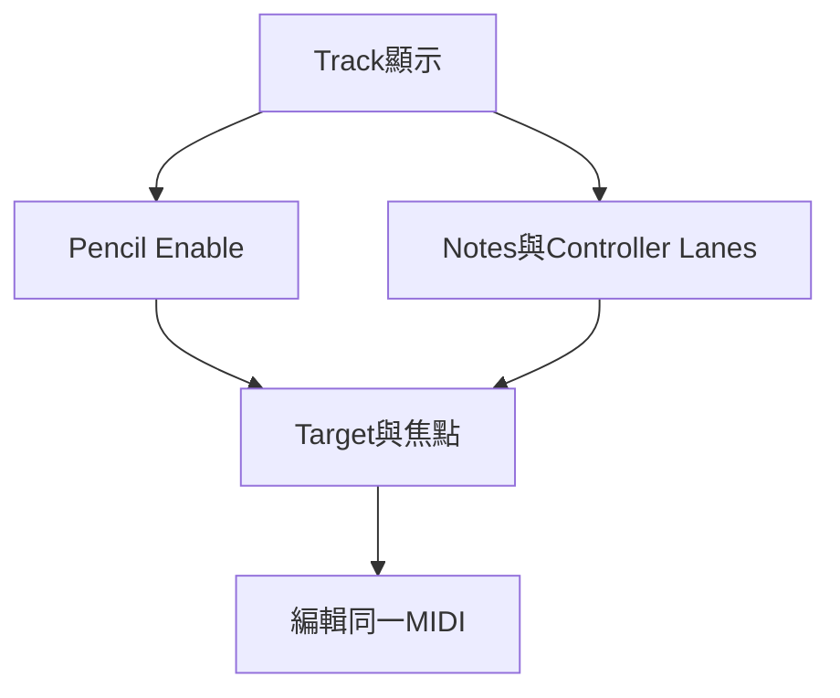

# Ch36 — MIDIEditor多軌編輯工作台

> MIDI Editor 可以把多條 Track 疊在同一個 Piano Roll；看得到、能修改、會被插入新 note，是三個不同狀態。

[[Pro_Tools_Reference_Guide_2023.3.pdf#page=859|原書 p. 827–845／PDF p. 859–877]]。內容依 **2023.3** 原文消化重組；英文功能名稱保留。實務連結與原創示意圖用於教學，不是原書逐字翻譯，也不代表現行版本的支援狀態。

## 觀念地圖

![[PT-Ch36-concept.png]]

圖為原創概念示意；示例位置、長度與曲線只用來比較機制，不是原書量測資料或建議處理參數。

## 1. 用獨立Editor專注編曲

`Window > MIDI Editor`或 Mac `Control+=`開啟 Editor；也可 Right-click MIDI Clip／Track 選 Open In MIDI Editor 或 Open in Docked MIDI Editor。若 Preferences 將雙擊 Clip 指定到 MIDI Editor，也能雙擊進入。這些入口不同，但都在編同一份 MIDI 資料，不是自動建立副本。

取消既有 Editor 的 Target 再開另一個，可並排比較不同 Track；只有一個 MIDI Editor 能被 Targeted。Targeted Editor 跟著 Edit window 的 Timeline 位置與 selection 走；Untargeted Editor 則適合固定看另一段。前景視窗才取得 Commands Keyboard Focus，與 Target 是否亮著不是同一件事。

| 狀態 | 決定什麼 | 常見誤會 |
|---|---|---|
| Shown in Tracks List | 哪些 Track 出現在 Editor | 顯示不等於每次 Pencil 都寫入 |
| Pencil-enabled | 新 note 寫到哪些 Track | 可多 Track 同時啟用，不只一條 |
| Target | Editor 是否跟隨 Edit window 位置／selection | 不是 Record Enable |
| Front-most window | 鍵盤焦點與 control surface focus | 不是 Target 唯一決定 |

> [!tip] 實務連結
> 把 Bass 與 Kick 疊在同一 Editor，可直接看重拍是否互相配合。真正要寫 Bass 時，只 Pencil-enable Bass，避免一個動作在 Kick 也塞入新 note。

## 2. 哪些設定獨立，哪些會連動

每個 MIDI Editor 可獨立設 Edit mode、tools、Grid／Nudge 顯示與視窗 rolling，因此 Edit window 為 Slip、MIDI Editor 為 Grid 並不矛盾。部分全局開關卻會一起變，這些最容易讓你覺得「我只改這個視窗，另一邊怎麼也變了」。

| 類型 | 獨立／共用 | 操作提醒 |
|---|---|---|
| Edit Tool、Edit Mode、視窗配置 | 各 Editor 可獨立 | 查看目前這個 toolbar |
| Play MIDI Notes When Editing | Global | 一處開關會影響其他 Editor |
| Link Timeline and Edit Selection | Global | 不要以為一窗 unlink、另一窗 linked |
| Mirrored MIDI Editing | Global | 可波及同 Clip 其他副本 |
| Quantize controls | 與 Event Operations 等相關控制同步 | 不是每 Editor 一套量化演算法 |
| Track 排序 | Global | 一窗重排 Track，其他視窗也受影響 |
| 哪些 Track 顯示 | 各 Editor 可獨立 | 適合分部工作台 |

Record-enable、Solo、Mute 按鈕對「本 Editor 顯示的所有 Track」作用，會反映到其他視窗中的真實 Track 狀態。Mixed state 表示只有部分顯示 Track 被啟用；不是每顆按鈕另有一層不影響 Session 的監聽。

## 3. 多軌疊圖與Pencil寫入的安全操作

Notes pane 可疊多條 MIDI／Instrument Track，Velocity 也疊在同一 lane；其餘 CC／Automation 則依類型保留每 Track 各自的 lane。Auxiliary Input 可顯示 Automation，但沒有 MIDI notes 可供 Pencil 寫入。

1. 在 Tracks List 只顯示要比較的 Track。
2. 選 Color Code MIDI Notes By Track，先分清各聲部。
3. 用 Track Edit selector 或 Tracks List 的 Pencil column 指定寫入 Track。
4. 插一顆測試 note，確認只出現在預期聲部；再繼續寫。
5. 改 Velocity 時可暫切 Color Code By Velocity，完成後回 Track 色碼看整體配置。

| 色碼方式 | 看什麼 | 限制 |
|---|---|---|
| By Track | 各聲部來源 | 原書為 16 固定色按 Track 順序暫時分配 |
| By Velocity | 力度深淺 | 同為紅色系，易失去聲部辨識 |
| Neither | Follow 一般 Track Color Coding | 以 Preferences 中的顯示設定為準 |

Shift-click Pencil column 可啟用連續多 Track；Command-click 可挑不連續 Track；Option-click 可啟用全部。插入 notes 會寫入所有 Pencil-enabled Track，這很適合 doubling，也很適合製造難找的誤植。

> [!warning] Merge 與 Paste 要分開
> 一般 Paste 會覆寫同位置既有 MIDI；Merge 把新資料和原資料疊加。加和聲或補鼓點，通常先確認你需要哪一種，別因為 Piano Roll 看起來空就推定底層沒有 CC 或 notes。

## 4. Notation與Controller lanes各有用途

Notation view 把各 Track 變成獨立 Staff，不再 superimpose；與 Score Editor 相似但保留連續 Timeline 以及下方 Velocity／CC／Automation lanes。Notation view 自動使用 Grid 且不能改成其他 Edit mode。Double Bar 位置在 Session 最後 MIDI Clip／event；關閉後可顯示額外空小節，方便繼續輸入。

| 需求 | 選擇 | 理由 |
|---|---|---|
| 看和弦音與聲部重疊 | Superimposed Notes | 同時間／pitch 清楚可比 |
| 以譜面思考但同時改表情 CC | MIDI Editor Notation view | 譜面與 Controller lanes 同窗 |
| 設定列印版面 | Score Editor | 有 Page 與 Score Setup |
| 查某個 CC 的確切事件值 | MIDI Event List | 文字數字比圖形精準 |

## 5. 縮放與捲動要配合當下工作

toolbar 的 MIDI zoom 控制 note 垂直比例；右下 Vertical Zoom 主要按比例改 Controller／Automation lane heights，別與 pitch 範圍混淆。Scrolling 可選 No Scrolling、After Playback、Page、Continuous 等；Center Playhead 依原書有版本限制。Follow Edit Window 可共享捲動策略，Keep Window On Top 則只管視窗前後層級。

> [!tip] 實務連結
> 配器時可留一個 Untargeted Editor 固定看副歌和聲，另一個 Targeted Editor 跟主 Edit window 跳段落。把每窗任務分清，比到處打開 Editor 卻忘了哪一個在收鍵盤快捷鍵更有效率。

> [!abstract] Takeaway
> Shown、Pencil-enabled、Target、keyboard focus 分開管理。MIDI Editor 並非獨立 MIDI 副本，多窗編輯共享資料；插入前先核對真正寫入的 Track。

## 相關

%% PT-NAV-BEGIN %%

上一篇：[[PT-Ch35c-Quantize與RealTimeProperties]]

下一篇：[[PT-Ch37-ScoreEditor譜面與列印]]

按任務閱讀：[[PT-00-工作流程導航]]

%% PT-NAV-END %%

- [[PT-00-功能目錄#Ch35 — MIDI Editing]] — 對照相鄰章原文脈絡。
- [[PT-00-功能目錄#Ch37 — Score Editor]] — 對照相鄰章原文脈絡。
- [[PT-00-索引]] · [[PT-00-快速檢索]] · [[PT-00-Mac快捷鍵]]

標籤： #pro-tools #audio #midi
