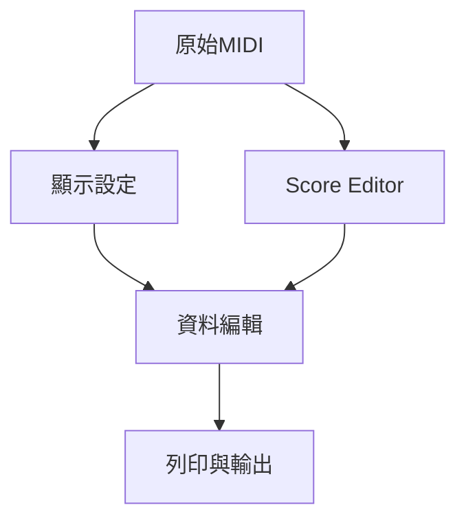

# Ch37 — ScoreEditor譜面與列印

> 譜面是 MIDI 的另一種呈現：可以只改讀譜外觀，也可以真的改音符，兩者要刻意區分。

[[Pro_Tools_Reference_Guide_2023.3.pdf#page=879|原書 p. 847–868／PDF p. 879–900]]。內容依 **2023.3** 原文消化重組；英文功能名稱保留。實務連結與原創示意圖用於教學，不是原書逐字翻譯，也不代表現行版本的支援狀態。

## 觀念地圖

![[PT-Ch37-concept.png]]

圖為原創概念示意；示例位置、長度與曲線只用來比較機制，不是原書量測資料或建議處理參數。

## 1. 譜面與Piano Roll讀的是同一份MIDI

`Window > Score Editor`或 Mac `Option+Control+=`開 Score Editor。錄製、匯入、Pencil 或 Step Input 建立的 MIDI 會即時轉成 notation；在此搬 note、改 pitch 或 duration，其他 Editor 也會更新，因為不是另一份樂譜資料。

Score Editor 的 Note Selector 是 note-only selection，不會把 Program Change 或 CC 一起選到。這對改旋律很方便；要同時處理整段 pedal 等表情，仍應回 MIDI Editor／Clips view 用適當 time range。

| 工具 | 譜面用途 | 記憶方式 |
|---|---|---|
| Zoomer F5 | 局部看清 notation | 不改聲音 |
| Trim F6 | note duration | 會改實際 MIDI |
| Note Selector F7 | 選 notes／velocities | 不是整段所有 MIDI events |
| Grabber F8 | 選／搬 notes、改 pitch | 改資料，不只是排版 |
| Pencil F10 | 插入 notes，可用不同 shape | Grid 管 Note On，Default Duration 管長度 |

> [!tip] 實務連結
> 若要讓演奏讀起來更簡潔，先試 Display Quantization，別急著把每顆 note 真的 Quantize。保留人味與印出易讀譜面可以同時做到。

## 2. Display Quantization只改讀譜方式

`Notation Display Track Settings`可從 Tracks List menu、Right-click，或雙擊 Clef 開啟；每 Track 可設 Clef、Display Transposition 與 Attributes。這些顯示參數的目的，是讓原本略微早晚、長短不整齊的演奏，用讀譜者可理解的值表示。

| 設定 | 改變什麼 | 不要誤解成 |
|---|---|---|
| Clef | Grand Staff／Treble／Bass／Alto／Tenor | 自動改樂器音色 |
| Display Quantization | 顯示的 note value 取整尺度 | 改實際 Note On／duration |
| Straighten Swing | swung notes 顯示成 straight notation | Playback 取消 swing |
| Allow Note Overlap | 用 tie 表達不同起點重疊的完整長度 | 支援所有專業多聲部排譜能力 |
| Split Point | Grand Staff 上下 Staff 分界 | 真正拆成兩條 MIDI Track |
| Display Transposition | 移調樂器的讀譜 pitch | 對音訊做 pitch shift |

Grand Staff 的 Split Point 可 Automatic 或 Fixed；Fixed 用指定 pitch 分手，Automatic 依 logical grouping 判斷。Follow Globals 讓各 Track 沿用全局 Attributes；某一樂器需特殊顯示時再取消，減少每軌重做。

原書例子 Bass Clarinet 選 B-flat 並 Octave +1，使寫譜與 concert pitch 相差 major ninth；這是讀譜轉調設定，不能用「全部 note 往上移」取代，否則 Playback 也跟著錯。

## 3. 輸入與修改：先訂Grid再下筆

以 Free Hand Pencil 插一顆 note，Default Note Duration 決定預設值；拖曳可加長。Line／Triangle／Square／Random 可連續輸入同 pitch notes，Velocity 規則接 Ch35。Grid 小於 Default Duration 時，連續插入會受 Grid 長度限制，不會任意重疊。

Rests 由系統依 notes 自動補，不可直接手插或搬動。想讓某拍出現 rest，要改實際 note 位置／duration 或顯示量化方式，而不是用 Grabber 拖 rest。

| 想改的東西 | 應該去哪裡 | 檢查 |
|---|---|---|
| 演奏真的早一拍 | MIDI note 時間 | Playback 也會改 |
| 只是譜面顯示太碎 | Display Quantization | Playback 保留 |
| 變更調號／音名拼寫 | Key Change | Edit Pitched Tracks 是否啟用 |
| 變更拍號 | Meter Change | 原 notes 不必移，但 barline 重畫 |
| 標示和弦供樂手看 | Chord Symbol | 不自動產生伴奏 notes |

## 4. Key、Meter與Chord不是三種自動編曲

Key Signature 影響 enharmonic spelling；原書 MIDI note 58 在 F major 寫 B-flat，在 B major 寫 A-sharp。若 Key Change 開啟 Edit Pitched Tracks，才可能依設定真的 Transpose／Constrain MIDI，不能把改調號一概說成只改外觀。

Meter 改每小節框架與 click 計數。6/8 可選 dotted-quarter click 變成每小節兩拍，而不是必須八分音符六拍。需要插在完整 barline 時選 Snap To Bar，避免產生 partial measure。

Chord Change 分 Root、Quality、Bass 與 Chord Diagram；Slash Bass 不是改和弦根音的同一欄。Chord Symbol 不改 MIDI 資料，Standard MIDI File 也不保存這些 symbol；匯出 Sibelius 則可保留。Chord Diagram 是吉他和弦指法圖，不能把它誤寫成完整六線譜編輯器。

## 5. Score Setup決定給人看的成品

| 面向 | 設定 | 交付前看什麼 |
|---|---|---|
| 標題資訊 | Title、Composer | 首頁是否正確 |
| 顯示內容 | Bar／Page Numbers、Track Names、Chord Symbols／Diagrams | 演奏者需要哪些資訊 |
| 版面 | A4 等 Page Size、Portrait／Landscape、Margins | 有無被裁切 |
| 間距 | Between Staves／Systems、Title 下、Chord 下 | 不同 Staff 是否容易追讀 |
| 範圍 | Tracks List Show／Hide | 只列印目前顯示的 Track |
| 最後小節 | Double Bar | 避免多餘空白小節 |

`File > Print Score`（Mac `Command+P`）依 Score Editor 顯示列印。要更精細排譜，可`File > Export > To Sibelius`存`.sib`，或 Send to Sibelius；原書指出需要相容 Sibelius 版本，這是 2023.3 文件規則，非當前軟體支援聲明。

> [!warning] 同一快捷鍵在別的前景視窗可能不是列印
> 例如 MIDI Event List 中的 Command+P 是插 Program Change。操作前先確認 Score Editor 在前景，並以 menu 名稱核對功能。

> [!abstract] Takeaway
> 先區分 display 與 MIDI 資料編輯。譜面乾淨不必以犧牲原演奏為代價；列印前檢查顯示 Track、轉調、barline 與版面，再聽實際 Playback。

## 相關

%% PT-NAV-BEGIN %%

上一篇：[[PT-Ch36-MIDIEditor多軌編輯工作台]]

下一篇：[[PT-Ch38-MIDIEventList精確檢查]]

按任務閱讀：[[PT-00-工作流程導航]]

%% PT-NAV-END %%

- [[PT-00-功能目錄#Ch36 — MIDI Editors]] — 對照相鄰章原文脈絡。
- [[PT-00-功能目錄#Ch38 — MIDI Event List]] — 對照相鄰章原文脈絡。
- [[PT-00-索引]] · [[PT-00-快速檢索]] · [[PT-00-Mac快捷鍵]]

標籤： #pro-tools #audio #midi
