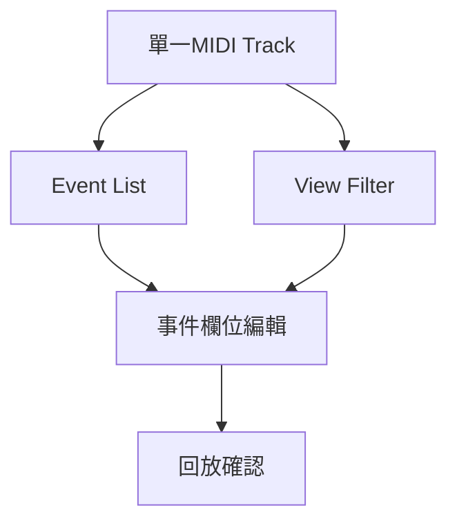

# Ch38 — MIDIEventList精確檢查

> 當 Piano Roll 看不清疊在一起的事件時，用 Event List 把每個時間、值與事件類型攤開。

[[Pro_Tools_Reference_Guide_2023.3.pdf#page=901|原書 p. 869–876／PDF p. 901–908]]。內容依 **2023.3** 原文消化重組；英文功能名稱保留。實務連結與原創示意圖用於教學，不是原書逐字翻譯，也不代表現行版本的支援狀態。

## 觀念地圖

![[PT-Ch38-concept.png]]

圖為原創概念示意；示例位置、長度與曲線只用來比較機制，不是原書量測資料或建議處理參數。

## 1. Event List適合回答精確問題

`Window > MIDI Event List`，Mac `Option+=`開啟。它一次看一條 MIDI／Instrument Track；Track selector 切換來源，Target 決定是否跟隨其他 Editor 的 Edit selection。和 MIDI Editor 疊多軌比較不同，這裡重點是一個 Track 中每筆 event 的精確屬性。

| 欄位 | 內容 | 常用檢查 |
|---|---|---|
| Start | 依 Main Time Scale 顯示開始位置，可加 Sub Counter | 到底早／晚多少 ticks 或 samples |
| Event | 類型與相關值，如 pitch、velocity、CC number | 看不見的 Program Change／CC |
| Length/Info | note 長度或 end，CC／program 名稱等 | note 是否在正確地方結束 |
| Number of Events | 本 Track 事件數 | 插入／篩選前後的參考 |

它能顯示與插入 Polyphonic Aftertouch，這是一般 Edit window Controller view 做不到的。MIDI Track 的 Mute Automation 不在 Event List；因它不是 MIDI message。Sysex 可以列出及搬動，但其專屬 payload 不能在此直接編輯。

> [!tip] 實務連結
> 外部硬體換錯 Bank、某顆音不放開、同一時間似乎有兩次觸發，可先看 Event List。圖形 editor 的線條漂亮，仍可能藏著錯的 CC number 或重複 note。

## 2. View Filter保護不想碰的事件

View Filter 可選 All、Only、All Except。Only 勾選者才顯示；All Except 反過來隱藏勾選者。被隱藏的 event 仍會 Playback，只是不能從這份被過濾的清單選來刪或編輯。

| 需求 | Filter 選擇 | 效果 |
|---|---|---|
| 只查 Sustain／某類 CC | Only 相應 Controller 類型 | 專注可疑資料 |
| 暫時不管 Aftertouch 與 Sysex | All Except 勾這些類型 | 其他資料仍可操作 |
| 想確定全部 events | All | 避免誤以為隱藏就是不存在 |
| 插入原本被 filter 掉的類型 | 系統會使該類型不再被 filter | 檢查 filter 是否已改 |

`Command+F`在 Event List 前景開 View Filter；不是 Edit window 的 Fades。這正是本套快捷鍵要記錄「在哪個視窗」的原因。

## 3. 用鍵盤前進，再在欄位內編值

| Mac 操作 | Event List 中的意思 | 條件 |
|---|---|---|
| Tab／Down | 下一個 event | 可在欄位編輯前後用 |
| Option+Tab／Up | 上一個 event | 加 Shift 可擴 Selection |
| Left／Right | 欄位間移動 | 某 edit field 已選取 |
| Command+G | Go To 特定位置 | 選 Time Scale 與時間 |
| Command+Enter | 編已選 event | 或直接雙擊欄位 |
| Escape | 取消當前輸入 | 不提交新值 |

數個 event 同時開始時，Start 位置只在最上方明確顯示，其餘 dimmed 不是無效 event；雙擊仍可改。需要對時可打開 Show Sub Counter，同時參考 Bars|Beats 與另一種時間尺度。

## 4. 插入Note、CC與Program Change

先確定事件要插在 Edit 位置還是 Playback 位置，再挑類型。Note 需輸入 pitch、attack／release velocity 與 length；Controller 需 number 與 value；Program Change 另有 Bank Select CC0／CC32 欄位，不能只填 program number 就假設每台設備都對。

| 插入類型 | Mac 快捷鍵 | 主要參數 |
|---|---|---|
| Note | Command+N | location、pitch、Note On／Off velocity、length |
| Controller | Command+L | location、CC number、value |
| Program Change | Command+P | location、program、Bank Select |
| Another 同類事件 | Command+M | 依最近插入的 event 類型 |

numeric keypad Enter 可提交並留在 Entry mode，方便連輸；主鍵盤 Return 提交並離開。這兩個鍵在 Mac 不是所有情境都等價，沒有 numeric keypad 可用 menu 與 Return 完成，不必先猜映射。

> [!warning] Command+M 在此不是 Mute Notes
> 它是 Insert Another 同類事件；若焦點還停在 Entry mode，更要先看欄位。離開欄位編輯再執行別的快捷鍵，能降低連續誤植。

## 5. Copy／Paste與刪除前的最後檢查

連續選取可拖或 Shift-click，不連續選取用 Command-click。`Option-click`某 event 可刪；大量刪除前先用 Filter 只留下目標類型。Copy 後 Paste 會替換目的位置已有 events，想疊加則用 Merge Paste Special。

| Display／Insert 選項 | 決定什麼 | 使用時機 |
|---|---|---|
| Show Note Length／End Time | Length/Info 顯示長度或終點 | 查節奏或查 Note Off |
| Insert At Edit Location | 新 event 跟 Edit cursor | 精準預先輸入 |
| Insert At Playback Location | 播放中即時插入 | 邊聽邊標事件 |
| Insert At Playback Location With Grid | 即時插入再吸 Grid | 需要節奏化落點 |
| Keep Window On Top | 視窗層級 | 一邊比對其他 Editor |

Ch35 的 Real-Time Properties 會在清單以 T／R 標示，Display Events as Modified by Real-Time Properties 開關影響是否看處理後結果。看到 Event List 時間已對齊，也不必然代表已 Write 到原始 MIDI。

> [!abstract] Takeaway
> Event List 把 MIDI 事件變成可核對的數字。Filter 不會停止 Playback；編輯欄位、前景視窗與主鍵盤 Return／numeric Enter，都是快捷鍵語意的一部分。

## 相關

%% PT-NAV-BEGIN %%

上一篇：[[PT-Ch37-ScoreEditor譜面與列印]]

下一篇：[[PT-Ch39a-時間基準與Track錨定]]

按任務閱讀：[[PT-00-工作流程導航]]

%% PT-NAV-END %%

- [[PT-00-功能目錄#Ch37 — Score Editor]] — 對照相鄰章原文脈絡。
- [[PT-00-功能目錄#Ch39 — Time, Tempo, Meter, Key, and Chords]] — 對照相鄰章原文脈絡。
- [[PT-00-索引]] · [[PT-00-快速檢索]] · [[PT-00-Mac快捷鍵]]

標籤： #pro-tools #audio #midi
