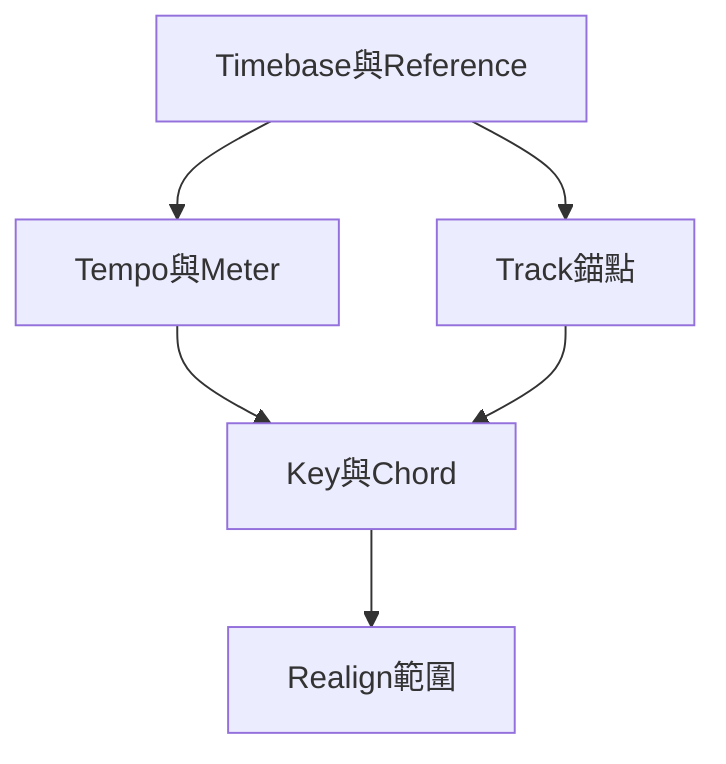

# Ch39a — 時間基準與Track錨定

> 切換顯示尺規只改你怎麼量時間，切換 Track timebase 才改素材在 Tempo 變動時如何定位。

[[Pro_Tools_Reference_Guide_2023.3.pdf#page=911|原書 p. 879–886／PDF p. 911–918]]。內容依 **2023.3** 原文消化重組；英文功能名稱保留。實務連結與原創示意圖用於教學，不是原書逐字翻譯，也不代表現行版本的支援狀態。

## 觀念地圖

![[PT-Ch39-concept.png]]

圖為原創概念示意；示例位置、長度與曲線只用來比較機制，不是原書量測資料或建議處理參數。

## 1. 一條Timeline，可以用兩套座標描述

聲音可以鎖在某個絕對時間，例如影片第 32 秒，也可以鎖在音樂位置，例如第 9 小節第 1 拍。Tempo 變動後，第 9 小節可能不再是原來的秒數，因此「位置不動」必須先說清楚是以哪套座標為準。

Timebase rulers 是觀察時間的尺；Conductor rulers 則描述 Tempo、Meter、Key、Chord 等音樂結構。顯示 Bars|Beats 並不會把所有 Audio 自動變成 tick-based；一條 Track 的 timebase 需在 Track 控制另外設定。

| Ruler | 觀察的座標 | 典型用途 |
|---|---|---|
| Bars\|Beats | 相對音樂位置 | 編曲、音符格線與 click |
| Minutes:Seconds | 絕對時間 | 對白、長度與交付 |
| Timecode | 依 Session frame rate 的 frame 位置 | 影像同步 |
| Timecode 2 | 第二套 frame rate 參考 | 只能作對照，不能設 Main Time Scale 或用其 Spot |
| Feet+Frames | 以 35 mm film 為基準 | 電影後期 |
| Samples | 以 sample rate 為基準的精密座標 | 找 click、量測延遲 |

`View > Rulers`決定顯示哪些尺，拖 ruler 名稱可重排。Main Time Scale 決定 Main Counter、Start／End／Length、pre/post-roll 與通常的 Grid／Nudge 格式；Grid／Nudge 可另設不跟隨。Sub Counter 只提供第二套參考，切換 Main 與現有 Sub 的 Time Scale 時兩者可互換。

> [!tip] 實務連結
> 音樂主案以 Bars|Beats 編曲，同時留 Minutes:Seconds 當 Sub Counter，可以一邊安排 16 小節段落、一邊確認影片實際長度。這不需要把所有 Track 都切成同一 timebase。

## 2. Sample-Based與Tick-Based，重點是錨點

| Track 情境 | Tempo 改變時的定位 | Duration 會不會跟著變 |
|---|---|---|
| Sample-based Audio | 固定 sample 位置 | 一般不因 Tempo 改變 |
| Tick-based Audio，未開 Elastic Audio | Clip start 或 sync point 維持拍位 | 來源 Audio 長度不變 |
| Tick-based Elastic Audio | Clip 與音樂時間一起符合 Tempo | 依 Elastic Audio 伸縮 |
| Tick-based MIDI／Instrument | note 拍位固定，秒數可變 | note 相對拍值維持，絕對時長改變 |
| Sample-based MIDI／Instrument | MIDI 事件固定在絕對 sample 座標 | 不隨 Tempo 重排成新拍位 |

Audio 預設 sample-based，MIDI／Instrument 預設 tick-based。Track Height 至少 Medium 可直接看 Timebase selector；較小高度可由 Track Height menu 的 Track Timebase submenu 切換。Edit Group 啟用時，改一條 Audio Track 的 timebase 可能連同 group 成員一起改，要確認是不是你想要的範圍。

Alternate Playlists 也有 timebase。Selection Changes Alternate Playlists 選項決定切 timebase 時是否一併改其 alternate；不能只看目前 main 就假設其他 take 已同樣更新。

> [!warning] Tick-based Audio 不等於自動 time-stretch
> 沒開 Elastic Audio 的 tick-based Clip，改 Tempo 通常只移起點／sync point，內容本身並不變快。Tempo 加快後鄰接 Clip 可能互相蓋住，放慢則可能留 gap；這正是 Ch34 切片與 Ch45 Elastic Audio 兩條工作流的差異。

## 3. MIDI的tick顯示與sample精度

原書列出 Pro Tools 內部 MIDI 解析度為 960,000 ppq，而 Bars|Beats 的顯示解析度是每 quarter note 960 ticks。做 note length 或 Grid 設定時，通常接觸的是後者，不要把兩個數字混在一起。

| Note Value | Normal ticks | Dotted ticks | Triplet ticks |
|---|---:|---:|---:|
| Half note | 1920 | 2880 | 1280 |
| Quarter note | 960 | 1440 | 640 |
| Eighth note | 480 | 720 | 320 |
| Sixteenth note | 240 | 360 | 160 |
| Thirty-second note | 120 | 180 | 80 |
| Sixty-fourth note | 60 | 90 | 40 |

這張表是原書 p.883 的工作尺度。Audio 仍落在離散 sample 上，音樂拍點換算成 sample 時可能需要 rounding，於是重複 loop 或複製長段可能看到一兩 tick 誤差。要求拍值整齊時，用 Selector 配 Grid，或直接輸入 selection Start／End；不要只 Grab 整段再假設來源檔長度正好等於整小節。

> [!tip] 實務連結
> 素材若來自無 click 演奏，Clip 看起來像四小節，不等於真的四小節。先用 Identify Beat 建立對應關係，再決定是跟演奏建 map 還是伸縮素材；別靠小數秒猜拍值。

## 4. Song Start Marker不是普通Marker

Song Start Marker 定義 Bar|Beat 素材的初始 Tempo，新 Session 預設 120 BPM；它可以移動但不能刪除。一般拖它會牽涉音樂資料位置；只想改 Marker、不移 tick-based 資料時，原書提供 Control+Shift 拖曳，並限制以完整 bar 增量移動。

更精確的需求用 Time Operations > Move Song Start；若只是想讓 bar 編號從別的數字算起，用 Renumber Bars，兩者不能互相代替。普通 Marker 與 Selection Memory Location 則可選 Bar|Beat 或 Absolute reference，見 Ch40。

| 你真的想改什麼 | 對應功能 | 不應誤用 |
|---|---|---|
| 計時顯示單位 | Main／Sub Time Scale | Track Timebase |
| Tempo 改後素材怎麼走 | Track Timebase | 單純換 ruler |
| 音樂起點的時間位置 | Move Song Start | Renumber Bars |
| bar 標號，聲音不搬 | Renumber Bars | Insert／Cut Time |

> [!abstract] Takeaway
> Ruler 是尺，timebase 是錨。Tick-based Audio 沒有 Elastic Audio 時只跟著移起點，來源長度仍固定；先辨認這點，再修改 Tempo。

## 相關

%% PT-NAV-BEGIN %%

上一篇：[[PT-Ch38-MIDIEventList精確檢查]]

下一篇：[[PT-Ch39b-Tempo曲線與IdentifyBeat]]

按任務閱讀：[[PT-00-工作流程導航]]

%% PT-NAV-END %%

- [[PT-Ch39b-Tempo曲線與IdentifyBeat]]
- [[PT-Ch39c-Meter時間操作與KeyChord]]
- [[PT-00-功能目錄#Ch38 — MIDI Event List]] — 對照相鄰章原文脈絡。
- [[PT-00-功能目錄#Ch40 — Memory Locations]] — 對照相鄰章原文脈絡。
- [[PT-00-索引]] · [[PT-00-快速檢索]] · [[PT-00-Mac快捷鍵]]
- [[PT-00-版本與原文疑義]] — 原書跨頁表述或快捷鍵差異，另行集中核對。

標籤： #pro-tools #audio #editing
