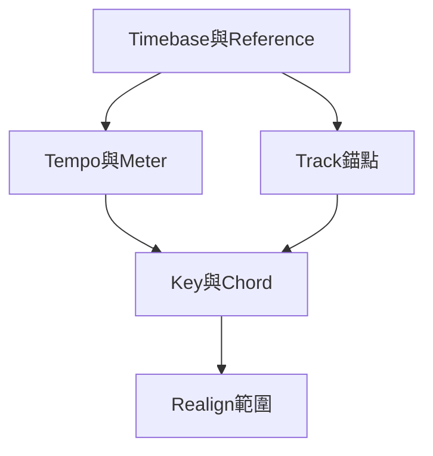

# Ch39b — Tempo曲線與IdentifyBeat

> Tempo map 可以塑造音樂，也可以追隨演奏；先選對表示法，再畫曲線或標拍。

[[Pro_Tools_Reference_Guide_2023.3.pdf#page=919|原書 p. 887–907／PDF p. 919–939]]。內容依 **2023.3** 原文消化重組；英文功能名稱保留。實務連結與原創示意圖用於教學，不是原書逐字翻譯，也不代表現行版本的支援狀態。

## 觀念地圖

![[PT-Ch39-concept.png]]

圖為原創概念示意；示例位置、長度與曲線只用來比較機制，不是原書量測資料或建議處理參數。

## 1. Manual Tempo與Tempo Ruler的分界

Transport 的 Tempo Ruler Enable（Conductor）關閉時，Session 使用 Manual Tempo，忽略 Tempo ruler 裡的 events。若你明明畫了 ritardando 卻聽不到，先確認不是停在 Manual Tempo。Tempo Operations 也不能在 Manual Tempo mode 使用。

要 Tap Tempo，可關閉 Conductor，選 Transport 的 Tempo field 後連續按 T；外部 MIDI keyboard 則需先開 Preferences 的 Use MIDI to Tap Tempo。系統以最近八次或更少 tap 平均，不是把任何輸入鍵都當 tap。要把結果作為整首初始 Tempo，可編 Song Start Marker。

| 動作 | 入口 | 影響 |
|---|---|---|
| 新 Tempo event | Tempo ruler 的 Add Tempo Change | 指定 location、BPM 與 beat note |
| 改既有 event | 雙擊綠色 triangle | 改 location 或 BPM |
| 移動 event | 拖 triangle | Grid 開啟時依目前 Grid 吸附 |
| 刪 event | Option-click | 先確認不是 Song Start Marker |
| 選整段 Tempo | Selector 在 Tempo ruler 拖選 | 可 Copy／Paste／Clear |

> [!tip] 實務連結
> 先在對的音樂位置建兩個明確 Tempo，再決定中間是瞬間跳變還是漸變。不要因一條看起來平滑的 curve 就假設樂手能舒服跟奏，實際 click 和素材都要聽。

## 2. Graphic Tempo Editor：beat note、density與shape

展開 Tempo ruler 下的 Tempo Editor，可用 Grabber 改 event 值或時間、Trim 整段縮放、Pencil 畫新 curve。Free Hand、Line、Parabolic 與 S-Curve 適用此處；Triangle／Square／Random 不適用 Tempo events。

| 參數 | 管什麼 | 例子 |
|---|---|---|
| Tempo Resolution | BPM 以哪個 note value 為一拍 | 4/4 常 quarter，6/8 常 dotted-quarter |
| Follow Metronome Click | Resolution 跟 Meter 裡的 click 值 | 減少不同 meter 間手動同步 |
| Tempo Edit Density | curve 分成多少離散 Tempo events | 太密不等於更有音樂感 |
| Curve Adjustment handles | 新畫 curve 的形狀與範圍 | 換工具／執行新命令後不再保留此編輯階段 |

Pencil 畫的其實是一串依 density 排列的 Tempo events，不是連續類比曲線。畫後的藍色 handles 可再調；按 Control 調 handle 可延後 Track data 即時跟著變，放開滑鼠再套。Grabber 可逐點修；Trim 向上／下改整段 BPM，選取邊界的特殊 handle 也能調變化速率或伸縮變化所占時間。

## 3. Linear Sample／Tick Display只是畫面基準

| Display mode | 畫面上保持固定尺度的東西 | 常用角度 |
|---|---|---|
| Linear Sample Display | 絕對時間 | 對現有錄音／影片建立 Tempo map |
| Linear Tick Display | 音樂小節與拍 | 以 MIDI／Elastic Audio 思考變速編曲 |

這是顯示座標，不是另一個 Track timebase 開關。Tempo 變了，兩套尺規不可能同時都維持原像素間距；所以有一套看起來被拉長／縮短，並不直接表示 Audio 被破壞。原書 p.899 對 draw tempo 的推薦與前文脈絡有容易混淆之處，本篇以「先選你要看固定哪套座標」解釋，不把推薦句當普遍鐵律。

## 4. Tempo Operations：可重現的曲線與指定長度

`Event > Tempo Operations`選頁面；Mac `Option+numeric keypad 2`開最近使用頁。設定 selection、start/end Tempo 等後 Apply。Advanced 提供 Main／Sub Time Scale 對照、計算終點或 Tempo 與額外控制。

| Page | 核心用途 | 特別控制 |
|---|---|---|
| Constant | 選定區間固定 Tempo | 可反算指定長度所需 Tempo |
| Linear | 均勻加速／減速 | start/end Tempo 與範圍 |
| Parabolic | 前段或後段變速較快 | Curvature |
| S-Curve | 兩端與中段的變化分配 | Curvature、Mid Point、Mid Tempo |
| Scale | 依比例改既有 Tempo | 可均勻或偏重頭／尾 |
| Stretch | 既有 Tempo events 鋪到新時間範圍 | 新 start/end 與 Stretch 百分比 |

Preserve Tempo after Selection 勾起時，selection 後保留原本 Tempo；未勾時，新最後 Tempo 可能一路延續到下一個 event 或 Session 尾。只想做過門 ritardando 卻整個副歌變慢，常是忘了這個邊界。

> [!tip] 實務連結
> 廣告或片頭需要指定秒數結束，可用 Advanced 的 end time／calculate 功能找合適 Tempo；樂曲結尾要自然收慢，則先選好 ritardando 區間與最後 Tempo，再聽 click 是否合理。

## 5. Identify Beat：把現有Audio位置標成音樂座標

Identify Beat 不是把 Audio 拉齊，而是告訴 Pro Tools「這個 Audio 範圍代表哪幾小節」。它用 range 與 meter 計算 Tempo，於起訖插入 Bar|Beat Markers，並更新 Meter 資訊；selection 內既有 Tempo／Meter events 會被替換，先備份 map。

以原書的一小節 loop 為例：用 Samples Time Scale 選準一小節 Audio，`Event > Identify Beat`，填`1|1|000`到`2|1|000`與正確 Time Signature。若 Tempo 每小節都變，單次操作只計出整段一個平均 Tempo，應分段或逐 beat 建 Marker；需要偵測 sub-beat 律動則用 Beat Detective。

| 對象 | 固定座標／拖動後反應 | 選擇理由 |
|---|---|---|
| Tempo Event（綠） | tick-based；拖位置不改其 BPM | 先有音樂 map，再安排變速 |
| Bar\|Beat Marker（藍） | sample-based；拖位置保留其 bar/beat 並重算相鄰 Tempo | map 跟著現有 Audio attack |

兩者不能在同一 map 混用；轉換時整套表示法會轉換，且可能 sample rounding。較長而正確的整段 selection 有助降低 rounding 影響，但不能為了長度把不同 Tempo 誤當固定 Tempo。先 Loop 聽起訖是否完整，再按 Identify，效率會高得多。

## 6. 改Tempo後別忘了Automation與接縫

Tick-based Track 的 Automation breakpoints 跟著音樂時間移動；未開 Elastic Audio 的 Audio Clip 只改起點、不改長度，因此長段 Audio 與 Automation 可能逐漸不對齊。原書建議切成較短 Clip 可降低 drift；若本來需要整段連續伸縮，應另評估 Elastic Audio。Tempo 增加造成 Clip 重疊時，可開 Overlap Shadows 觀察，並以 Bring to Front／Send to Back 決定重疊層級。

> [!abstract] Takeaway
> Tempo Event 適合音樂 map 驅動素材，Bar|Beat Marker 適合 map 貼現有錄音。Manual Tempo 會忽略 Tempo ruler；畫 curve 前後都要確認 density、selection 後 Tempo 與 Automation 同步。

## 相關

%% PT-NAV-BEGIN %%

上一篇：[[PT-Ch39a-時間基準與Track錨定]]

下一篇：[[PT-Ch39c-Meter時間操作與KeyChord]]

按任務閱讀：[[PT-00-工作流程導航]]

%% PT-NAV-END %%

- [[PT-Ch39a-時間基準與Track錨定]]
- [[PT-Ch39c-Meter時間操作與KeyChord]]
- [[PT-00-功能目錄#Ch38 — MIDI Event List]] — 對照相鄰章原文脈絡。
- [[PT-00-功能目錄#Ch40 — Memory Locations]] — 對照相鄰章原文脈絡。
- [[PT-00-索引]] · [[PT-00-快速檢索]] · [[PT-00-Mac快捷鍵]]
- [[PT-00-版本與原文疑義]] — 原書跨頁表述或快捷鍵差異，另行集中核對。

標籤： #pro-tools #audio #editing
