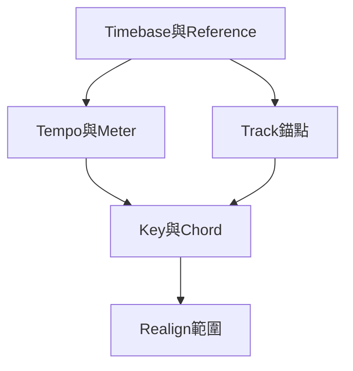

# Ch39c — Meter時間操作與KeyChord

> 拍號、時間插刪、調性與和弦各自控制不同層次；先選會移動哪些資料，再套用變更。

[[Pro_Tools_Reference_Guide_2023.3.pdf#page=940|原書 p. 908–921／PDF p. 940–953]]。內容依 **2023.3** 原文消化重組；英文功能名稱保留。實務連結與原創示意圖用於教學，不是原書逐字翻譯，也不代表現行版本的支援狀態。

## 觀念地圖

![[PT-Ch39-concept.png]]

圖為原創概念示意；示例位置、長度與曲線只用來比較機制，不是原書量測資料或建議處理參數。

## 1. Meter改小節框架，也決定click怎麼數

Meter ruler 記錄拍號，Tempo ruler 記錄速度；兩者不是同一控制。改成 6/8 後，若 click 仍每八分一次，就有六下；選 dotted-quarter click 則是每小節兩下。這是 meter 和 beat note 的配合，不是把 BPM 隨便除三。

| 操作 | 入口 | 檢查 |
|---|---|---|
| 插 Meter event | Add Meter Change／Event > Time Operations > Change Meter | location、meter、click |
| 精確改既有 event | 雙擊 Meter event | 改拍位置是否在 barline |
| 刪 Meter event | Option-click | 會改後續小節解讀 |
| 避免 partial bar | Snap To Bar／Time Operations Change Meter | 拍號不要意外插在半小節 |

原書用斜體 Meter event 提示前面有 partial measure。Meter change 會重畫 barline；是不是同時搬後方 Track 與 Tempo，則要看 Time Operations 的 Realign 設定，不能只看「換拍號」三個字。

> [!tip] 實務連結
> Prog metal 段落連續變拍，可用 Change Meter 的 Until the Next Bar，每 Apply 一次自動往下一個新小節前進。先把 click 的重拍感設對，再叫樂手錄，通常比錄完才對每個 bar 省事。

## 2. Time Operations是工程結構操作，不只是刪空白

`Event > Time Operations`；Mac `Option+numeric keypad 1`開最近頁。操作可能牽動 Conductor events、tick-based 素材、sample-based 素材與 Markers。Realign 決定哪些要一起跟著走，是按 Apply 前最重要的一欄。

| Operation | 實際改動 | 常見使用 |
|---|---|---|
| Change Meter | 更換選定 bar 範圍的 meter，可補／減時間以保後方對齊 | 重排拍號結構 |
| Insert Time | 插入時間並把指定後續資料往後移 | 多四小節 intro |
| Cut Time | 移除時間與區間內資料，指定後續資料往前接 | 刪不需要的段落 |
| Move Song Start | 移 Song Start，可帶相關資料 | 留影片前導／count-in |
| Renumber Bars | 改 bar 編號，sample／Timecode 位置不變 | pickup 或音樂段從指定 bar 數開始 |

Insert 四小節的原書流程是 Main Time Scale 設 Bars|Beats、輸入 Start 與 Length，再決定 Meter/Tempo/Key/Chord、tick-based markers/tracks 與 All Sample-Based 是否一起 realign。若只移 MIDI 卻沒移 Audio，人聲／影片就可能與編曲錯開。

| Realign 範圍 | 用途 | 風險 |
|---|---|---|
| Meter Ruler Only | 只重解小節結構 | 素材未跟著搬，不可當全曲重排 |
| Conductor + tick-based | 音樂結構與相對時間素材一起動 | sample-based Audio 可能留原處 |
| 再含 All Sample-Based | 整套相關聲音／Markers 一起移 | 對固定影片 Timecode 時需格外確認 |
| Absolute timebase 下逐類選擇 | 依秒數精準插刪 | 仍需檢查每類資料的選擇 |

> [!warning] 改 bar 編號與搬音樂是兩個需求
> Renumber Bars 不改 sample／Timecode 位置；Move Song Start 則可搬。對影片的 Cue 若只想讓第 1 小節從音樂起點算，不要用 Insert Time 把已對準畫面的聲音意外推走。

## 3. Key Signature：只標調性，或真的處理MIDI

預設 Key 是 C major。Key ruler 可插入／編輯 Key Change，指定 Major／Minor、升降記號、From／To 範圍與 Snap To Bar。原書 Minor 採 natural minor；不要把它當自動 harmonic／melodic minor 運算。

| 選擇 | 對 MIDI 的作用 | 適合目標 |
|---|---|---|
| 只放 Key marker，不啟 Edit Pitched Tracks | 標示調性與讀譜資訊 | 保留原演奏 |
| Transpose Chromatically | 按固定音程轉移 | 原音程關係照搬 |
| Transpose Diatonically | 按新 key 級數關係轉移 | 大／小調轉換等 |
| Constrain Pitches To Key | 把不屬新 key 音改到其 diatonic pitch | 限制音階音，可能改掉色彩音 |

原書 C major 轉 D minor 的例子：diatonic 轉換讓 C、D、E 變 D、E、F，而不是 chromatic 的 D、E、F-sharp。Constrain 又不同：C major 轉 D major，C、D、E、F、G 變 C-sharp、D、E、F-sharp、G，不是整句往上大二度。

Pitched 開關在 MIDI／Instrument Track 的 Playlist selector。Drum machine 與 key-mapped sampler 一般不應因調性改變而把 Kick 移成 Snare 或觸發別顆 sample，故先取消這些 Track 的 Pitched，再處理其他聲部。

> [!tip] 實務連結
> 改歌手 key 前，先區分旋律音源、鼓、keyswitch／sample mapping。移調應有音樂對象，不是所有 MIDI Track 都按同一個+2 就結束。

## 4. Chord Symbols是註記，Chord Extraction是判讀

Chords ruler 可插 Root、Chord Quality、Bass 與 Chord Diagram；Chord Symbols 不改 MIDI notes，也不自動產生伴奏。Chord Diagram 只在 Score Editor 顯示，Standard MIDI File 不帶這些 Chord Symbols，匯出 Sibelius 則可保留。

| 工作 | 操作 | 限制 |
|---|---|---|
| 人工加 Chord | Chords ruler 的+，或 Control-click ruler | 用耳朵／和聲判斷決定名稱 |
| 改 Chord | 雙擊 marker | 分清 Root 與 Slash Bass |
| 搬 Chord | Grabber 拖 marker | 不帶著 MIDI 和弦自動重寫 |
| Extract Chords from Selection | 選完整 MIDI Clips，Event 選單執行 | 只辨識對話框支援和弦，marker 按 quarter-note 量化 |

辨識結果是草稿，不是和聲學裁決。Voicing 缺根音、Bass 經過音、延留音或一拍中快速變化，都可能需要人工改名；四分音符落點限制也代表它不是逐 sample 分析每個和聲瞬間。

Import MIDI 可選 Import Key Signature from MIDI File；Import Session Data 另有 Import Key Signature/Chord Map。工程交換前先確認是否需要覆蓋目前的 key/chord 結構，避免新匯素材把已標好的 map 意外換掉。

> [!abstract] Takeaway
> Meter、Tempo、Key 和 Chord 各有職責。Time Operations 先看 Realign 範圍；Key Change 先看 Pitched 與是否改 notes；Chord Symbol 只標註，不自動改和聲。

## 相關

%% PT-NAV-BEGIN %%

上一篇：[[PT-Ch39b-Tempo曲線與IdentifyBeat]]

下一篇：[[PT-Ch40-MemoryLocations段落與工作畫面]]

按任務閱讀：[[PT-00-工作流程導航]]

%% PT-NAV-END %%

- [[PT-Ch39a-時間基準與Track錨定]]
- [[PT-Ch39b-Tempo曲線與IdentifyBeat]]
- [[PT-00-功能目錄#Ch38 — MIDI Event List]] — 對照相鄰章原文脈絡。
- [[PT-00-功能目錄#Ch40 — Memory Locations]] — 對照相鄰章原文脈絡。
- [[PT-00-索引]] · [[PT-00-快速檢索]] · [[PT-00-Mac快捷鍵]]
- [[PT-00-版本與原文疑義]] — 原書跨頁表述或快捷鍵差異，另行集中核對。

標籤： #pro-tools #audio #editing
