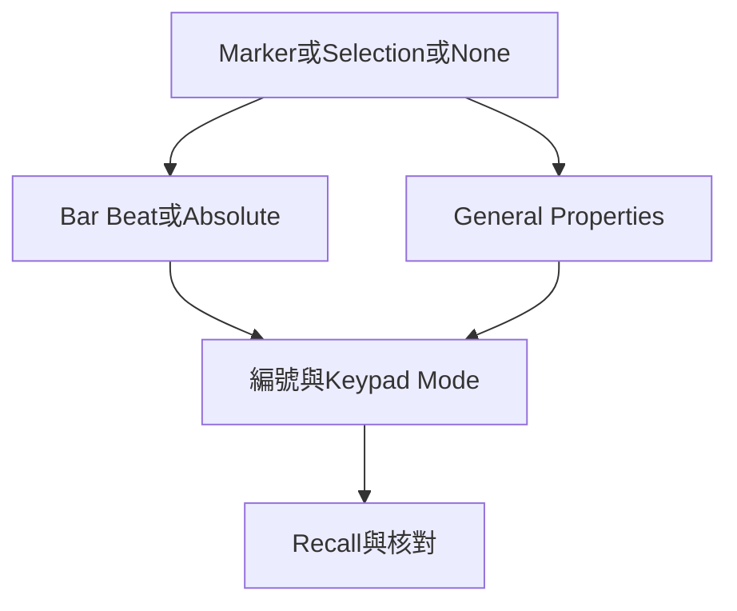

# Ch40 — MemoryLocations段落與工作畫面

> Memory Location 不只能跳段落，也能保存選取範圍與工作畫面，讓常做的工作一鍵回到正確情境。

[[Pro_Tools_Reference_Guide_2023.3.pdf#page=955|原書 p. 923–932／PDF p. 955–964]]。內容依 **2023.3** 原文消化重組；英文功能名稱保留。實務連結與原創示意圖用於教學，不是原書逐字翻譯，也不代表現行版本的支援狀態。

## 觀念地圖

![[PT-Ch40-concept.png]]

圖為原創概念示意；示例位置、長度與曲線只用來比較機制，不是原書量測資料或建議處理參數。

## 1. 三種Time Properties，一個共同的保存框架

2023.3 原書寫每個 Session 最多 32,000 個 Memory Locations。數量並不是重點，命名與屬性分工才是：Marker 存一個點，Selection 存一段範圍，None 則不跳時間、只叫回其他工作設定。

| 類型 | 保存的時間資訊 | 實務例子 |
|---|---|---|
| Marker | Timeline 上一個位置 | Verse、Chorus、Picture hit |
| Selection | Edit range，可跨多 Track | 一句人聲補錄、一段鼓分析 |
| None | 不存 Time Properties | 只看鼓組、只看人聲、sample-level 工作畫面 |

三種都可再勾 General Properties，例如 Zoom、Track Show/Hide、Track Heights、Group Enables 與 Window Configuration。所以某個 Marker 一點下去，視窗突然變高、別的 Track 不見，可能只是它存了這些屬性，並非 Session 壞掉。

> [!tip] 實務連結
> 純段落 Marker 只存時間，避免每次跳副歌就把混音畫面改亂；人聲編輯工作台可用 None 加 Show/Hide、Height 與 Zoom。把導航與視覺工作台分開命名，長工程會清楚很多。

## 2. Bar|Beat或Absolute：跟音樂走，還是跟畫面走

Bar|Beat reference 固定音樂位置；Tempo 改後，秒數會跟著改。Absolute 固定 sample 位置，音樂尺上的 bar/beat 可變。Markers ruler 裡，原書以黃色 chevron 與 diamond 區分這兩種，不要只看顏色。

| Reference | Tempo 改後保持 | 適合用途 |
|---|---|---|
| Bar\|Beat | 第幾小節第幾拍 | 音樂段落、編曲入口 |
| Absolute | 同一 sample／絕對時間 | 固定畫面事件、原錄音定位 |

Selection 只保存連續範圍；Object Grabber 做的不連續多 Clip 選取，叫回時會像 Time Grabber 那樣成為連續時間範圍。若原意是挑幾個不相鄰的 Clip，不要把 Memory Location 當能完整保存任意 Object selection。

## 3. 建立與叫回：numeric keypad規則要說完整

1. 先把需要保存的 Zoom、Show/Hide、Height 等調好。
2. 放 cursor 或建立 selection；要存播放／錄音 range 時，確認 Link Timeline and Edit Selection。
3. 按 numeric keypad Enter，或用 Memory Locations menu 建立。
4. 選 Marker／Selection／None 與 Reference，只勾真正需要的 General Properties。
5. 命名、OK，再試叫回一次，確認沒有帶入多餘畫面變動。

| 動作 | 操作／條件 | 注意 |
|---|---|---|
| 建新 Memory Location | numeric keypad Enter | 主鍵盤 Return 不是所有狀態都同義 |
| 叫回，keypad=Classic | 編號後按 numeric keypad . | 不需開 Memory Locations 視窗 |
| 叫回，keypad=Transport／Shuttle | numeric keypad .、編號、. | 例：. 12 . |
| 叫回 Marker | click Markers ruler 的 Marker | 其 General Properties 也會一併叫回 |
| 編輯既有 Marker | 雙擊 Marker | 會定位到 Marker；Control-click 可編而不先定位 |

numeric keypad mode 在 Preferences 裡決定，因此一篇只寫「按.編號.」而不說模式的快捷鍵表並不完整。沒有 numeric keypad 的 Mac 鍵盤，可先用 Window > Memory Locations click 叫回，不必為查段落先改一套不確定的系統映射。

## 4. General Properties最有價值的保存方式

| Property | 保存什麼 | 不保存／容易誤會 |
|---|---|---|
| Zoom Settings | horizontal、Audio、MIDI zoom | 不改 Audio gain |
| Pre/Post Roll Times | 時間長度 | 不保存是否 enabled |
| Track Show/Hide | 哪些 Track 可見 | hide 不等於 mute |
| Track Heights | 各 Track 高度 | 不等於 MIDI pitch zoom 本身 |
| Group Enables | 哪些 Edit／Mix Groups 開啟 | 使用前確認會否影響跨軌編輯 |
| Window Configuration | 指定 Window Configuration | 不是另存整份 Session |
| Comments | 最多 255 字元說明 | 可作錄音／修改備註 |

> [!tip] 實務連結
> 補錄一段人聲時，Selection 加 pre/post-roll times 很實用：叫回相同 Punch 範圍與前後聽感脈絡。但原書明確說只存 roll 長度，不存啟用狀態，因此真正錄音前仍看 Transport 的 roll 開關。

## 5. 播放中標記，避免開對話框打斷聆聽

開 Auto-Name Memory Locations When Playing，可在 Playback 按 Enter 直接建 Memory Location。若 Default To Marker 啟用就建立 Marker；沒啟用時可能沿用最近建立的類型，結果按了卻不是你期待的段落點。

Use Separate Play and Stop Keys 會搶走 Enter 的原標記用途；原書在此模式要求 numeric keypad 先`.`再 Enter 才加 Marker。這是具體 preference 改變快捷鍵的例子，排查時應看設定而非只換鍵盤。

## 6. 改範圍、刪位置與刪Slot分清楚

| 需求 | 動作 | 後果 |
|---|---|---|
| 只清某位置但保留編號 slot | Clear 該 Memory Location | 後面不重編號 |
| 刪某個 slot | Delete Slot | 後面的 Memory Locations 重編號 |
| 插入 slot | Insert Slot Before | 後面重編號 |
| 全清 | Delete All | 下次由 slot 1 開始 |
| 重新定義 Selection／Marker 位置 | 先建立新範圍／cursor 再用對應編輯操作 | 確認是否仍存原 General Properties |

Memory Locations window 可顯示 Main／Sub Counter、Comments 並 Sort by Time；未依 Time 排序時按編號列。View Filter 的圖示可依所含屬性篩選；某項隱藏不代表 Memory Location 刪除，若同時含其他已顯示屬性仍可能可見。

> [!warning] 重新編號會影響肌肉記憶
> 若已用.12.固定叫回副歌，Delete Slot 或 Insert Slot 後再核對編號。為了清爽只想移除內容時，用 Clear 更能保持原編號架構。

> [!abstract] Takeaway
> Marker 存點，Selection 存範圍，None 存工作情境。Reference 決定 Tempo 改後跟音樂還是絕對時間走；保存屬性要精簡，keypad mode 要記清楚。

## 相關

%% PT-NAV-BEGIN %%

上一篇：[[PT-Ch39c-Meter時間操作與KeyChord]]

下一篇：[[PT-Ch41a-Clip放置與精準定位]]

按任務閱讀：[[PT-00-工作流程導航]]

%% PT-NAV-END %%

- [[PT-00-功能目錄#Ch39 — Time, Tempo, Meter, Key, and Chords]] — 對照相鄰章原文脈絡。
- [[PT-00-功能目錄#Ch41 — Arranging Clips]] — 對照相鄰章原文脈絡。
- [[PT-00-索引]] · [[PT-00-快速檢索]] · [[PT-00-Mac快捷鍵]]

標籤： #pro-tools #audio #editing
