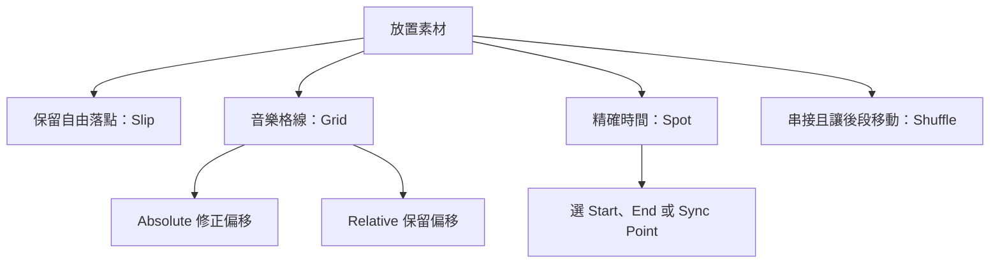

# Ch41a — Clip放置與精準定位

> 移動 Clip 前，先決定要對齊的是起點、尾端還是聲音裡真正發生的那一刻。

原文：[[Pro_Tools_Reference_Guide_2023.3.pdf#page=965|Chapter 41，原書 p. 933–949／PDF p. 965–981]]。內容依 **2023.3** 文件消化重組；下文未標為原書數值的練習情境與圖解均為筆記補充。

## 同一個拖曳動作，Edit Mode 決定結果

從 Clips List 拖一個 Clip 到 Timeline，看似只是搬動素材，實際上它同時受到 channel format、Timeline Drop Order 與 Edit Mode 影響。Stereo Clip 必須落在 Stereo Track 或兩條 Mono Track，不能把聲道數當成純粹顯示差異。多個 Clip 要排成一列或分散到多軌，也要先從 Clips List menu 設定。

| 設定 | 拖入後如何排列 | 適合工作 |
|---|---|---|
| Timeline Drop Order：Top to Bottom | 素材分到多條 Track | 同起點的分軌、一次建立多個音效軌 |
| Timeline Drop Order：Left to Right | 依序排在同一條 Track | 素材串接、對白片段順序整理 |
| 丟到最後一軌下方空白區 | 新建 Track，落在拖入的時間 | 直接指定素材起點 |
| 丟到 Tracks List | 新建 Track，從 Session 起點放置 | 匯入後再統一定位 |

| Edit Mode | 放置規則 | 要先想到的風險 |
|---|---|---|
| Shuffle | 鄰近 Clip 讓位，彼此接合 | 後面的素材可能被推移 |
| Slip | 依實際落點，自由留下間隔或重疊 | 要自己確認對拍與覆蓋關係 |
| Spot | 用 Spot dialog 指定位置 | 先選對 Time Scale 與對齊點 |
| Grid | 吸附 Grid | Absolute／Relative 的目的不同 |

> [!tip] 實務連結
> 收到錄音分軌，要的是同時間起跑，先用 Top to Bottom；整理一串音效 demo，則用 Left to Right。這比拖完後再逐條搬動更穩定。Grid 模式拖曳中按住 Command 可暫時切成自由放置，適合最後一點微調。

## Absolute Grid 與 Relative Grid：要修正偏移，還是保留偏移？

Absolute Grid 讓 Clip 起點吸到實際格線；Relative Grid 則用格線單位移動，同時保留原本與格線的相對偏移。若一個鼓點刻意稍晚，將它搬到下一小節時常想保留那一點 late feel，這正是 Relative Grid 的用途。若要把錯位的小節頭修回拍點，才選 Absolute Grid。Clip 已有 Sync Point 時，Grid 定位也會考慮該 Sync Point。

Grid 不必跟 Main Counter 使用相同 Timebase：在 Grid value menu 取消 Follow Main Timebase 即可另選。還能用 Clips/Markers 讓 Clip boundaries、Marker 與 selection 成為參考。格線值可用 Shift 加 `=` 增大、Shift 加 `-` 減小；這是格線間距，不是音訊本身的長度。

## 三個對齊點，比硬把 Clip 開頭剪到 transient 更靈活

門關上的音效可能先有門軸聲，真正需要對畫面的，是 slam 發生的時刻。保留前面的自然聲音，將 slam 定義成 Sync Point，再讓它對齊畫面，會比破壞 Clip 結構更容易修。

1. 先在 Slip mode 用 Selector 點到要作為同步依據的聲音位置。
2. 選 `Clip > Identify Sync Point`；Clip 內會出現對應標記。
3. 用 Spot mode 打開 Spot dialog，輸入 Start、Sync Point 或 End 的目標時間。
4. 核對畫面與聲音，必要時用 Scrubber 聽同步點，而不只看 waveform peak。

| 要對齊到 Edit insertion point 的部分 | Mac：拖曳或以 Time Grabber 點擊 Clip | 說明 |
|---|---|---|
| 起點 | Control | Clip start 對到游標 |
| 尾端 | Command + Control | 保留長度，讓尾端對到游標 |
| Sync Point | Control + Shift | 音效內部事件對到游標 |
| 複製而非搬動 | 在對齊 modifier 上再加 Option | 原始位置保留副本 |

這些 modifier 是 Mac 的 Control，不是要一律改成 Command。Pro Tools Studio／Ultimate 若 Scrolling 設成 Center Playhead，原書指出對齊參考會改成 playhead，操作時要先看當前顯示狀態。

> [!warning] Original Time Stamp 與 User Time Stamp 不同
> Original Time Stamp 隨 Clip 建立，不能修改，適合把素材還原到最初位置；User Time Stamp 可以重設。Spot dialog 裡應確認你取用的是哪一個，否則「回原位」可能回到另一種工作參考點。沒有 Sync Point 的 Clip，Spot dialog 的 Sync Point 欄相當於 Start。

## 覆蓋、層次與精確位移

Time Grabber／Object Grabber 主要覆蓋搬動的 Audio data；Separation Grabber 會以整個選取範圍替換目的 Timeline 區域，包含選區中沒有音訊的部分。Layered Editing 用來保留**部分重疊**的底層 Clip，並不代表完全被另一個大 Clip 蓋住的素材一定仍留在 Timeline。若要清除選區內所有層，原書提供 Command+Delete。

`Edit > Snap To > Previous／Next` 適合把片段接到前／後一個 Clip 的邊界。若要一次精確平移指定時間，改用 `Edit > Shift`，選 Earlier／Later 並輸入值。**Shift command 不服從 Edit Mode 的吸附規則**：即使在 Shuffle、Spot 或 Grid，也不會因此自動接合、跳出 Spot dialog 或吸到格線。

| 工作需求 | 合適工具 | 為什麼 |
|---|---|---|
| 緊接前一段，不留縫 | Snap To Previous | 直接做 butt splice |
| 維持整組相對位置、精確平移 | Shift | 用同一個明確時間偏移 |
| 將片段間距統一 | Space Clips | 指定 Gap Between Clips；0 可接合 |
| 更換全 Session 的某個重複音效 | Replace Clip（Ultimate） | 選取匹配範圍與替換長度規則 |

Replace Clip 要先決定是只換一處、所有 instance，還是符合 start／end／name 條件的片段；也要選 Original Clip Length、Original Selection Length 或 Replacement Clip Length。不同規則會決定新音效被裁短、是否保留整段，不是單純換一個檔案名稱。格式必須相容，不能拿兩個 Mono Clip 直接當成一個 Stereo Clip 的替身。

![[PT-Ch41-arrangement.png]]

圖用原創示意比較 Absolute 與 Relative 的位置概念，不代表手冊的實測素材。

> [!abstract] Takeaway
> 先選 Edit Mode 與 Drop Order，再搬動素材。Sync Point 讓你保留完整聲音而對準內部事件；Absolute Grid 對準格線，Relative Grid 保留原來的偏移。需要指定量平移時用 Shift，不要假設它會繼承當前模式的吸附行為。

## 相關

%% PT-NAV-BEGIN %%

上一篇：[[PT-Ch40-MemoryLocations段落與工作畫面]]

下一篇：[[PT-Ch41b-保護Clip與整理空白片段]]

按任務閱讀：[[PT-00-工作流程導航]]

%% PT-NAV-END %%

同章分篇：[[PT-Ch41b-保護Clip與整理空白片段]]

跨章延伸：[[PT-Ch42-ClipLoop與Group的編排方法]] · [[PT-Ch45a-ElasticAudio啟用與演算法]]

[[PT-00-索引]] · [[PT-00-快速檢索]] · [[PT-00-功能目錄]] · [[PT-00-Mac快捷鍵]]

標籤： #pro-tools #audio #workflow
