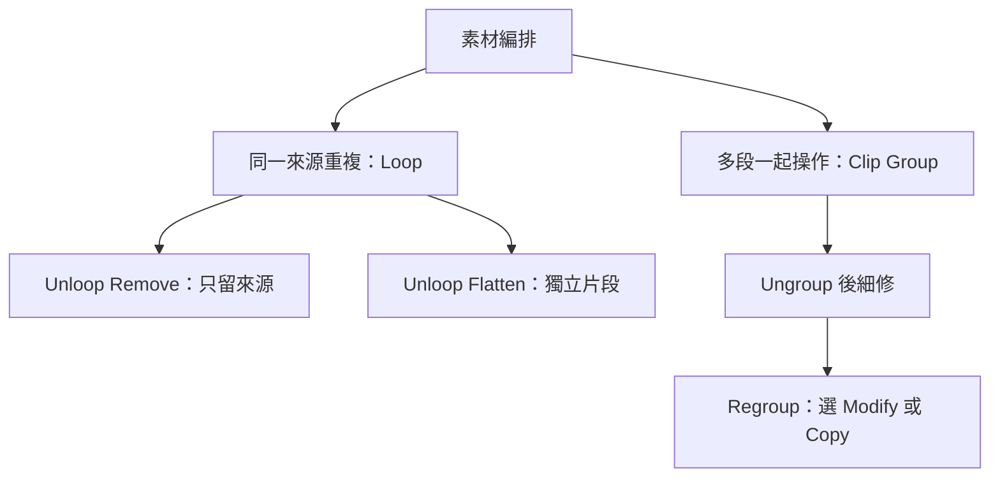

# Ch42 — ClipLoop與Group的編排方法

> Loop 管重複，Clip Group 管一起搬動；兩者都不是把全部音訊混成新檔。

原文：[[Pro_Tools_Reference_Guide_2023.3.pdf#page=991|Chapter 42，原書 p. 959–970／PDF p. 991–1002]]。內容依 **2023.3** 文件消化重組；下文未標為原書數值的練習情境與圖解均為筆記補充。

## 先分清三件看似相近的事

Duplicate 會建立一份相鄰內容，Loop 把同一來源的多次 iteration 管成整體，Clip Group 則把多段 Audio／MIDI Clip 包成一個可編輯的容器。它們不是同一種「合併」。特別是 Clip Group 與 Mix／Edit Group 完全獨立：前者是 Timeline 上的素材容器，後者是 Track 之間的控制關係。

| 需求 | 選擇 | 保留的工作彈性 |
|---|---|---|
| 只要再接一段相同內容 | Duplicate／Repeat | 各個 Clip 可以繼續個別剪輯 |
| 用同一個來源循環到指定長度 | Clip Loop | 伸縮整個 looped region |
| 一起搬動跨多軌的段落 | Clip Group | 容器內仍是原來的 Clip 與相對位置 |
| 生出單一新的 Audio file | Consolidate 等 render 操作 | 與 Clip Group 的資料性質不同 |

> [!tip] 實務連結
> 一段鼓的 kick、snare 與 overhead 經過剪輯後，可先用 Clip Group 包成一個段落，方便複製到下個 chorus；若目的只是讓一個兩小節鼓 Loop 鋪到下一段，就用 Loop，不用先把每軌混成檔案。

## Loop：指定次數、長度或終點

選 Audio Clip、MIDI Clip 或 Clip Group，開 `Clip > Loop`；Mac 可按 Command+Option+L。你可以指定 Number of Loops、Loop Length，或 Loop Until End of Session or Next Clip。若總長不是來源長度的整數倍，最後一個 iteration 會被截短。需要循環接縫平滑時，啟用 Enable Crossfade，再到 Settings 調整。

| 操作 | 影響範圍 | 容易誤會的地方 |
|---|---|---|
| Grabber 點 looped Clip | 整段來源與所有 iteration | 不是只選畫面下的一次 |
| 點單次 iteration 的 Loop icon | 該次 iteration | 可針對它做部分編輯 |
| 移動 looped Clip | 整組一起移動 | iteration 不能任意離開 source 單獨搬動 |
| Unloop：Remove | 留第一個完整來源，移除後續 iteration | 不會留下一串獨立 Clip |
| Unloop：Flatten | 每次 iteration 變成獨立 Clip | 之後不再是同一個 Loop 結構 |

對 iteration 手動 Warp 會讓該次 iteration 從 Loop 分開；Separate Clips 也會先把 Loop unloop／flatten 再分割。這些是資料結構的改變，不只畫面外觀變了。

> [!warning] Loop 不會重複 Track Automation
> 把一段 Audio Loop 拉長，不會把該段的 Volume／Pan automation 自動複製到每次循環。要重複它，先選 source，`Edit > Copy Special` 選所需 automation，再選完整 Loop，`Edit > Paste Special > Repeat to Fill Selection`。因此長段 fade 可以跨多個 iteration 發展，而不會每次從頭開始。

## Clip Group：以選區作為容器邊界

先選一段範圍，再選 `Clip > Group`，Mac 為 Command+Option+G。選區可以包括空白，也可以從 Clip 中間開始；這時 Pro Tools 會在容器邊界切開 Clip。容器長度由選區決定，不必等於裡面最有聲的區段。

跨軌建立時要使用相鄰 Track，可混合 Audio、MIDI、Instrument，也可包含 sample-based 與 tick-based Track。內部還能有 nested Clip Group。這讓細碎節奏 Clip 可以暫時以較高層級的樂句單位思考。

| 操作 | 結果 | Mac |
|---|---|---|
| Group | 建立容器 | Command+Option+G |
| Ungroup | 解除最外層，保留較內層 Group | Command+Option+U |
| Ungroup All | 連 nested Group 全部拆開 | `Clip > Ungroup All` |
| Regroup | 編完內部素材後恢復 Group | Command+Option+R |

同一 Clip Group 已在多處使用時，Regroup 可能要求選 Modify 或 Copy：Modify 將改動套到其他 instance，Copy 則建立只屬於當前版本的副本。這是重複段落中「只改第二次副歌」的重要選擇。

## 裁邊與編輯：改到容器，還是改到素材？

Standard Trim 改的是 Clip Group 的邊界，內部 Clip 的原始長度與位置仍保留，只是超出容器的部分暫時不播放。但若裁短後再 Ungroup，位於邊界外的部分可能被裁到容器範圍或被移除，不能把任何 ungroup 都當成無條件「全恢復」。

有些操作會在 Group 上方建立新 Clip，例如 AudioSuite、Consolidate、錄音、Pencil waveform redraw，以及修改 Group 內 MIDI note／controller。要把結果納回原群組，常用流程是 **Ungroup → 編輯／錄音 → Regroup**。Clip gain 可同時存在於群組內個別 Clip 與群組層；要改裡面的設定，同樣先拆開。

> [!tip] 實務連結
> 若只是想把整段人聲齊奏拉低，先調 Group 的 Clip Gain；若其中一句太大，再 Ungroup 改那句。這保留了「段落整體」與「單句修整」兩個清楚層級。

## Tempo、分離標記與交換檔

Tick-based Clip Group 遇到 Tempo change，會依音樂時間重新安排內部 Clip 位置；sample-based Track 的時間基準不同。混合 timebase 的多軌 Group 因此可能出現 separated group 標記。插入／隱藏／搬動 Track、換 Playlist、錄入內容或切到 Playlists view，也可能讓結構分離；這個標記是提醒群組不再完整相鄰，並非一定已遺失所有資料。

| `.cgrp` 交換保留 | 不保留 |
|---|---|
| Audio file references、Clip 名稱與相對位置 | Track routing |
| MIDI data、Track 名稱、timebase、Sync Point | Plug-In |
| Fades、Clip Gain、Loop、Tempo map | Automation |
| Warp markers 與 TCE factor | Meter map、Clips List 資訊 |

原書 p.963 一處寫 `.rgrp`，但同章交換檔說明 p.970 與版本相容性均使用 `.cgrp`；本篇以 `.cgrp` 為查找名稱。它保存的是引用與編排資料，不等於把所有外部 Audio file 都包進去。Pro Tools 10 以後建立的 `.cgrp` 不能匯入更早版本；較早 `.rgp` 可以匯入 10 及後續版本。

![[PT-Ch42-loop-group.png]]

> [!abstract] Takeaway
> Loop 決定重複關係，Clip Group 包住編排；都不自動把 Track Automation、routing 與 Plug-In 變成可攜素材。容器內部要細修時，先拆、編輯、再組回，並留意 Modify／Copy 的影響範圍。

## 相關

%% PT-NAV-BEGIN %%

上一篇：[[PT-Ch41b-保護Clip與整理空白片段]]

下一篇：[[PT-Ch43-AudioSuite離線處理與Handles]]

按任務閱讀：[[PT-00-工作流程導航]]

%% PT-NAV-END %%

跨章延伸：[[PT-Ch41a-Clip放置與精準定位]] · [[PT-Ch44a-ClipGain與音量整理]]

[[PT-00-索引]] · [[PT-00-快速檢索]] · [[PT-00-功能目錄]] · [[PT-00-Mac快捷鍵]]

標籤： #pro-tools #audio #workflow
