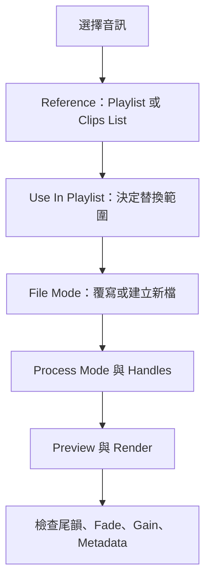

# Ch43 — AudioSuite離線處理與Handles

> AudioSuite 不只是「先算好的 Plug-In」；它的引用範圍與檔案模式，決定哪些素材被替換、原檔是否改寫。

原文：[[Pro_Tools_Reference_Guide_2023.3.pdf#page=1005|Chapter 43，原書 p. 973–983／PDF p. 1005–1015]]。內容依 **2023.3** 文件消化重組；下文未標為原書數值的練習情境與圖解均為筆記補充。

## 先選對三個層次，再按 Render

AudioSuite 對所選音訊進行 non-real-time processing，結果寫入磁碟。它可以建立新 audio file，也可以覆寫來源，不能單純認為任何 AudioSuite 都是無破壞性的。先在 Edit window 選要處理的範圍，或在 Clips List 選素材，再從 AudioSuite menu 開啟效果。

| 決策 | 選項 | 真正決定的事 |
|---|---|---|
| Selection Reference | Playlist／Clips List | 對 Timeline 選取，還是 Clips List 素材操作 |
| Use In Playlist | On／Off | 渲染結果是否替換工程中正在使用的片段 |
| File Mode | Overwrite／Individual／Continuous | 是否改原檔，以及輸出幾個檔案 |
| Process Mode | Clip by Clip／Entire Selection | 分開分析各 Clip，還是把整個選區一起分析 |

Selection Reference 為 Playlist 且 Use In Playlist 開啟時，只替換 Timeline 上所選 instance；其他使用同一來源的 Clip 不一起變。Reference 改為 Clips List 並開啟 Use In Playlist，才可能替換 Session 內該 Clip 的所有出現位置。若 Use In Playlist 關閉，處理後的版本加入 Clips List，不直接換掉現有編排。

> [!tip] 實務連結
> 只想替一句對白降噪，使用 Playlist reference 比較容易限定範圍；若同一音效在工程出現幾十次，才考慮 Clips List reference 加 Use In Playlist。按 Render 前，先問自己「只改這次使用，還是每次使用？」。

## File Mode 與分析模式不能混為一談

| File Mode | 是否留原始來源 | 常見用途 | 限制 |
|---|---|---|---|
| Overwrite Files | 否，直接改寫 | 已明確接受 destructive processing 的工作 | 不是所有 Plug-In 支援，不能依一般 Undo 復原 |
| Create Individual Files | 是 | 逐段處理後保留各 Clip 身分 | 視 rendering mode 決定 gain／fade 是否燒入 |
| Create Continuous File | 是 | 將選區內多段合成一個處理檔 | Clips List reference 不提供；部分 time-domain Plug-In 不提供 |

Clip by Clip 讓每段各自分析；Entire Selection 以整體為參考。對會分析訊號的工具，這會改變各段之間的相對處理結果，不能只根據想要「一個檔還是很多檔」決定。檔案數由 File Mode 主導，分析範圍則是另一件事。

若對 Clip Group 作 AudioSuite，Clips List 裡的群組不是直接可當作普通 Audio file 的物件。原書給的流程是 Ungroup All → 處理 → Regroup，並選 Modify 套到同 Group 的其他 instance，或 Copy 只保留當前變體。

## Preview 聽不到，先看 Audition Path

Preview 使用 `I/O Setup > Output` 裡的 Audition Path，不是想當然地跟著目前 Track Output。它也有試聽限制：多個選取不會全部同時預覽；通常只聽第一條 Stereo Track 或第一對 Mono Track，Mono mode 只預覽第一個 channel，Clip by Clip 只預覽第一個 Clip。想聽多 Clip 連續結果時，可暫用 Create Continuous File 試聽，再設回真正需要的輸出模式。

| 控制 | 功能 | 不要誤認成 |
|---|---|---|
| Preview volume | 調整試聽音量 | 最終渲染增益 |
| Bypass | 比較有／無處理的 Preview | 阻止 Render 套用效果 |
| Reverse（部分 Delay／Reverb） | 先反轉、處理、再反轉 | 只把原音倒放 |
| Channel Mode | 按 Mono／Stereo／Multi 規則處理 | 自動判斷所有 Track 的藝術意圖 |

> [!warning] Side-chain 要有正確參考
> AudioSuite 的 Key Input 要與目標音訊在同一時間出現；若 Selection Reference 是 Clips List，side-chain input 不起作用。使用 Stereo mode 處理奇數個 channel，最後未成對的 channel 會以左聲道設定當 Mono 處理。

## Handles 讓你之後能拉回邊界，但尾韻還是要選進去

Handle Length 可設 0.00–60.00 seconds，讓渲染後 Clip 在選區外仍有可延伸素材；Whole File 則可保留到整個所引用檔案的可用範圍。預設長度位於 `Setup > Preferences > Processing`。這與「讓 reverb tail 寫在選區外」並非同一個操作保證：原書仍要求 Delay／Reverb 處理時，將 source 後的空白一起選入，避免尾巴在選區結尾被切掉。

1. 選需要處理的內容，若有 time-based effect，先把預期尾韻時間納入。
2. Reference 選 Playlist，先用 Create Individual Files 保留原始來源。
3. 根據 Plug-In 的分析方式，選 Clip by Clip 或 Entire Selection。
4. 指定 Handles，必要時 Whole File；Preview 比較並觀察 clipping。
5. Render 後聽句首、尾韻、fade，確認其他 instance 沒被意外替換。

| File／Process 組合 | Handle | Fade／Clip Gain | Metadata |
|---|---|---|---|
| Overwrite／Clip by Clip | 無 | 保留設定 | 保留 |
| Overwrite／Entire Selection | 無 | 燒入處理 | 保留 |
| Individual／Clip by Clip | 建立 | 保留設定 | 保留 |
| Individual／Entire Selection | 無 | 燒入處理 | 保留 |
| Continuous／任一 Process Mode | 新連續檔前後建立 | 燒入處理 | 不保留 |

上表依 p.983 條件矩陣重組。對依賴 Edit selection 或 analysis pass 的 Plug-In，Handles 可能造成非預期結果；原書建議這時將 Handle Length 設 0。處理 Edit-locked Clip 會解除 lock，處理 muted Clip 也會使其 unmute，渲染後不要跳過狀態檢查。

![[PT-Ch43-render-handles.png]]

> [!abstract] Takeaway
> AudioSuite 要分別確認 Reference、Use In Playlist、File Mode 與 Process Mode。想保留每段與後續拉邊彈性，Individual Files／Clip by Clip 常是較清楚的起點；覆寫原檔、分析依賴選區與殘響尾韻，都要另行核對。

## 相關

%% PT-NAV-BEGIN %%

上一篇：[[PT-Ch42-ClipLoop與Group的編排方法]]

下一篇：[[PT-Ch44a-ClipGain與音量整理]]

按任務閱讀：[[PT-00-工作流程導航]]

%% PT-NAV-END %%

跨章延伸：[[PT-Ch44a-ClipGain與音量整理]] · [[PT-Ch47a-Commit固定處理與交接]]

[[PT-00-索引]] · [[PT-00-快速檢索]] · [[PT-00-功能目錄]] · [[PT-00-Mac快捷鍵]]

標籤： #pro-tools #audio #workflow
