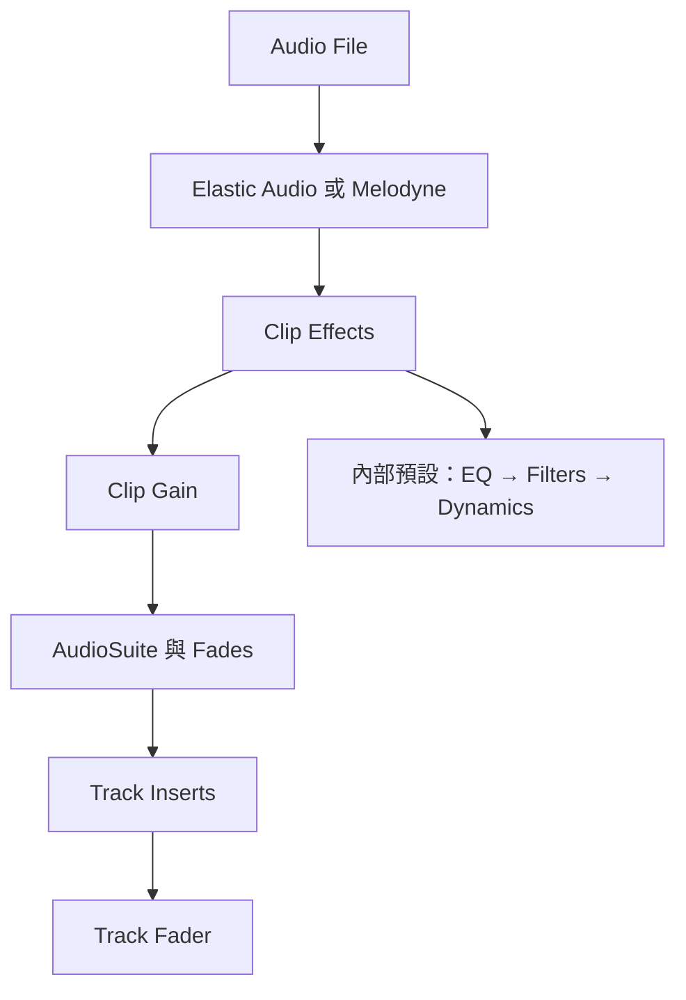

# Ch44b — ClipEffects與片段處理鏈

> Clip Effects 讓每個片段帶著自己的 EQ、Filter 與 Dynamics，適合修整來源差異，同時保留 Track Insert 的整體音色設計。

原文：[[Pro_Tools_Reference_Guide_2023.3.pdf#page=1025|Chapter 44，原書 p. 993–1007／PDF p. 1025–1039]]。內容依 **2023.3** 文件消化重組；下文未標為原書數值的練習情境與圖解均為筆記補充。

## Clip Effects 是每段自帶的 Channel Strip

Clip Effects 以 Avid Channel Strip 的演算法提供 non-destructive EQ、Filters 與 Dynamics。它套用在**完整選取的 Audio Clip**，設定跟著 Clip 搬動、Duplicate 與 Loop；不是只在你當前看到的 Track 那一小格生效。Studio／Ultimate 能建立與編輯，Artist／Intro 可以播放帶有這些效果的工程，也能 Bypass、Clear、Render 已存在的效果，但不能建立或改設定。所有系統的 Clip Effects 都使用 Native processing。

| 工作方式 | 處理範圍 | 適用情況 |
|---|---|---|
| Clip Effects | 每個完整 Clip | 不同句子／場次有不同音色問題 |
| Track Insert | 進入 Track 的音訊 | 整條 Track 的混音音色與空間設計 |
| AudioSuite | 渲染所選音訊為檔案 | 明確要固定處理、交換素材 |

> [!tip] 實務連結
> 同一條對白 Track 裡，一句來自領夾麥、另一句來自 boom mic。先用 Clip Effects 修整每段的低頻、刺耳頻帶與動態，再讓整軌 Insert 做共同風格，會比為每次音色差異寫一大串 Plug-In automation 清楚。

## 選完整 Clip，才是真的選到處理對象

打開 `View > Other Displays > Clip Effects` 或按 Option+6。這個快捷鍵會隨是否有完整 Clip selection 改變顯示與 focus 行為：沒選完整 Clip 時偏向顯示／隱藏；有完整 Clip 時會讓面板取得操作焦點。Clip Effects 與 docked MIDI Editor／Melodyne Editor 位於相同區域，以 tab 切換，不能同時並排顯示在那個位置。

1. 用 Grabber 選完整 Clip，或建立含至少一個完整 Clip 的選區。
2. 開 Clip Effects，先確認 header 的 Clip 名稱或選取數量。
3. 只啟用需要的處理區，調整並比較 Bypass。
4. 拖曳 EQ／Filters／Dynamics 標題，可改三區順序。
5. 最後檢查 Clip status：ø 表示 polarity invert；EQ 表示 EQ／Filtering；DYN 表示 Dynamics 或非 0 的 Input Gain。

原書不允許對 committed 或 frozen Track 套用 Clip Effects。若要繼續改 source，要先回到可編輯的來源或 Unfreeze。

## 訊號順序比參數多少更重要

原書 p.996 的一般處理順序為：Audio File → Elastic Audio／Melodyne → Clip Effects → Clip Gain → AudioSuite → Fades → Inserts → Fader。這是理解渲染邊界的關鍵：Render Clip Effects 不等於把後面的 Fader 或 Insert 也燒進去。下游仍可保留自己的設定。

![[PT-Ch44-signal-order.png]]

> [!warning] Clip Gain 不在 Clip Effects 前面
> 本章所列順序中，Clip Effects 先於 Clip Gain；因此調 Clip Gain 不會改變 Clip Effects Dynamics 的輸入門檻關係。若要控制該處理器的輸入，使用 Clip Effects 的 Input Trim。這與「Clip Gain 在 Track Insert 前」並不矛盾，它們是不同處理階段。

## EQ、Filters 與 Dynamics 如何讀

| 區域 | 控制／能力 | 操作判斷 |
|---|---|---|
| Input Trim | −36.0 至 +36.0 dB，處理鏈前端 | 調整 Clip Effects 的輸入，留意 overload |
| Polarity Invert | 反轉 polarity | 處理多麥與接線相位關係，不能取代時間對齊 |
| EQ | 四個頻帶；LF／HF 可用 Peak／Shelf，兩個 Mid 為 Peak | 大範圍音色與局部共振分開處理 |
| Filters 1／2 | High Pass、Low Pass、Band Pass、Notch | 依 type 決定 Slope 或 Q 是否可調 |
| Dynamics | Expander/Gate、Compressor/Limiter、Side Chain | 先看是門檻以下抑制，還是以上壓縮 |

EQ graph 左右改 Frequency、上下改 Gain；在曲線區域或搭配 Control 拖曳可改 Q。Shift 可限制只改一個方向，Option+Shift 點 EQ control point 可反轉 Gain。Filter 的 High／Low Pass 提供 12 或 24 dB/octave；Band Pass／Notch 使用 Q。別把 EQ graph 的顯示刻度切換，當成處理增益本身有變。

Dynamics 的 Threshold 決定何時介入，Attack／Release 決定速度，Knee 決定門檻附近轉折。Gate 的 Hold 可避免訊號在 threshold 附近開開關關，Hysteresis 則讓開門與關門門檻不同。原書例子是 Threshold −30、Hysteresis 10：到 −20 才開，到 −30 關，這比單一閾值更能抑制 chatter。

| Side Chain 控制 | 作用 | 常見誤解 |
|---|---|---|
| Internal | 由各 channel／stereo pair 的訊號觸發 | 不一定整個 multichannel 共用同一 gain reduction |
| All-Linked | 任一非 LFE channel 觸發，其他 channel 一起處理 | LFE 仍依自己訊號獨立處理 |
| Peak／Average | 以 peak 或 average amplitude 偵測 | 改變的是 detector，不是另加一條可聽 Track |
| Filter／Listen | 篩選或試聽 detector 收到的內容 | Filter 不是直接把主音訊削掉該頻帶 |

> [!tip] 實務連結
> 低頻爆破音一直觸發壓縮，可先聽 Side Chain、確認是低頻能量主導，再決定 detector filter 或先修爆破音。只把 Compressor Threshold 拉高，可能連本來需要控制的字都不再壓到。

## 複製、Presets 與 Render

Clip Effects 的 Cut／Copy Special 可把設定獨立於 Audio 搬到另一個完整 Clip，Paste 使用 Command+V。Clear 回到 factory default，Bypass 保留設定供比較，Render 則寫成新的 whole-file Clip 並清掉即時效果設定。Preset buttons 有五個，Command-click 儲存；一般點擊載入。設定也可存成 `.tfx`，位置依 Root Settings Folder 或 Session Folder 決定。

快捷數字 1–5 的用途會受 Editing preferences「1–5 Number Keys Control」與 Commands Keyboard Focus 影響，可能是在叫 Zoom Preset，也可能是 Clip Effects Preset；查 [[PT-00-Mac快捷鍵]] 的 focus 說明，不要只背一顆數字。

> [!abstract] Takeaway
> Clip Effects 針對完整 Clip，且只由 Studio／Ultimate 建立編輯。它位於 Clip Gain 之前，輸入要靠自己的 Input Trim；EQ、Filters、Dynamics 可以改順序。先確認 detector 與 signal chain，再用 Presets 提速，最後才決定是否 Render 固定。

## 相關

%% PT-NAV-BEGIN %%

上一篇：[[PT-Ch44a-ClipGain與音量整理]]

下一篇：[[PT-Ch45a-ElasticAudio啟用與演算法]]

按任務閱讀：[[PT-00-工作流程導航]]

%% PT-NAV-END %%

同章分篇：[[PT-Ch44a-ClipGain與音量整理]]

跨章延伸：[[PT-Ch43-AudioSuite離線處理與Handles]] · [[PT-Ch50a-混音Track與訊號流]]

[[PT-00-索引]] · [[PT-00-快速檢索]] · [[PT-00-功能目錄]] · [[PT-00-Mac快捷鍵]]

標籤： #pro-tools #audio #workflow
