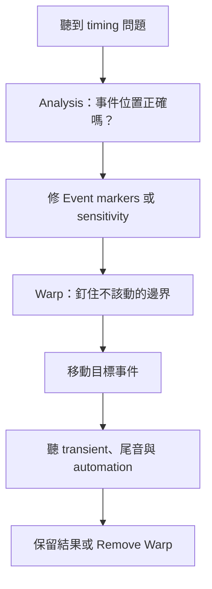

# Ch45b — Warp與Analysis的時間修正

> Event marker 告訴你聲音被偵測在哪裡，Warp marker 才把某個聲音位置釘在 Timeline 上。

原文：[[Pro_Tools_Reference_Guide_2023.3.pdf#page=1055|Chapter 45，原書 p. 1023–1032／PDF p. 1055–1064]]。內容依 **2023.3** 文件消化重組；下文未標為原書數值的練習情境與圖解均為筆記補充。

## 先區分三種標記，才知道你在改哪一層

Elastic Audio 可以想成把錄音放在一條可伸縮的時間帶上。Event marker 是辨認出的事件參考，Warp marker 是固定音訊與 Timeline 對應的控制點。改變偵測，不等於立即把聲音搬動；真正拉伸要在 Warp view 進行。

| 標記 | 所在 view | 能否直接編輯 | 用途 |
|---|---|---|---|
| Event marker | Analysis／Warp | 在 Analysis 改 | 表示偵測或手動定義的事件 |
| Warp marker | Warp | 可以新增、搬動與刪除 | 把來源事件錨定到 Timeline |
| Tempo Event-generated Warp marker | Warp；tick-based | 不是一般可編輯 marker | 表示依 Tempo map 自動 conform 的位置 |

在 Warp view 看不到 Event marker，先放大 Horizontal Zoom；zoom 太遠時原書會隱藏它們。不要因此重複分析或亂加大量 Warp markers。

## 三種 Warp，各自固定不同邊界

| 操作類型 | 需要的固定點 | 聲音怎麼變 | 適合情況 |
|---|---|---|---|
| Telescoping Warp | 一端或最近的邊界 Warp marker | 向外展開或往內壓縮 | 長素材先對節拍、整段配長度 |
| Accordion Warp | 中間的一個固定 Warp marker | 固定點兩側一起伸縮 | Clip 的 downbeat 在中間 |
| Range Warp | 左右兩個 bounding Warp markers | 只改兩點之間 | 修一個字／音，不碰外側 |
| Individual Range Warp | 自動釘住相鄰 Event markers | 局部單一事件修正 | Shift-drag 一個明確 transient |

以修一個晚到的 Bass note 為例，先釘住前後不該變的位置，再移中間的 note，會比直接拉整段更可控。若沒有 bounding markers，你以為只動一個音，實際上可能把整段尾巴也一起拉長。

### Range Warp 可以直接跟做

1. 將 Track view 設為 Warp，放大到看清楚句子。
2. 在錯誤音前、後各建立一個 Warp marker 作邊界。
3. 用 Grabber 拖中間的 Event marker；程式會在該處建立 Warp marker。
4. 對照原節奏聽前後變化，確認外側未動。
5. 若選取範圍內有多個 Warp markers，再整組移動，可保留它們之間的相對節奏，只拉伸兩端的過渡區。

> [!tip] 實務連結
> 一句人聲中，只要某個子音晚了一點，就先用 Range Warp 限定該字。修完聽母音是否被壓扁、換氣是否變得不自然。好看的格線對齊，不是好聽的充分條件。

## 新增、移動錨點與移動聲音，不是同一動作

| 在 Warp view 的動作 | Mac／方法 | 作用 |
|---|---|---|
| 新增 Warp marker | Pencil 點擊，或 Grabber Control-click | 在指定位置釘點 |
| 搬 marker 但不 Warp 聲音 | Control-drag marker | 重新安排控制點，不改現有時間伸縮 |
| 刪除 marker | Option-click，或對 marker 的右鍵命令 | 解除控制點 |
| 移動 Event／Warp marker 以拉伸 | Grabber 拖曳；依現有 marker 決定方式 | 改音訊與 Timeline 的對應 |
| Remove Warp | `Clip > Remove Warp` | 回原 duration，但 Warp markers 本身不一定消失 |

Remove Warp 不能直接對 Clip Group 使用，先 Ungroup，再對內部 Clip 執行，最後 Regroup。若 Track 屬 Edit Group，Warp 操作會連動到其他成員；需要的是共同編輯的多麥素材，這能維持操作一致，但也可能不小心動到不相關 Track。

> [!warning] Track Automation 不跟著手動 Warp 變形
> 原書明確指出，手動 Warp、TCE Trim 與 Elastic Audio Quantize 不會讓 Track Automation 跟著音訊局部變形；tick-based Tempo change 的 automation 行為則不同。若早已寫好單字音量與 effect throw，改 timing 後要重新檢查那些 automation。

## Analysis view：修偵測資料，讓演算法知道真正的事件

Analysis view 只編輯 Event markers，不能像普通 Waveform view 一樣操作 Clip。用 Pencil 點擊或 Grabber double-click／Control-click 可加事件；拖曳改偵測位置；Option-click 或選區 Delete 刪掉誤判事件。

偵測 confidence 不等於 peak amplitude。高頻 hi-hat 的 transient 可能比更大聲但較圓的 kick 更容易被清楚辨認。Pad、legato strings 或含滑音的人聲，若被切出太多假 transient，反而讓 TCE 保留了不該保留的地方，產生顆粒或 flam 類 artifact。

| 問題 | 先檢查 | 修整方向 |
|---|---|---|
| 音頭被拉糊 | Event 是否落在真正 attack | 移 marker 到正確位置 |
| Pad 拉伸顆粒多 | Event 數量是否太多 | 降 sensitivity 或刪誤判 marker |
| 小聲重要音被濾掉 | confidence 是否太低 | Promote 或手動建立 marker |
| 整段變紅 | 局部 TCE 是否超過正常範圍 | 降低極端拉伸或調整邊界 |

Promote Event marker 會使它得到 100% confidence；手動建立或移動的 Event 也被視為高可信。這讓你能在降低整體 sensitivity 時保住重要弱音。標記的目的不是越多越精準，而是讓事件位置對應你真的想保護的聲音。

一般演算法正常 TCE 範圍為 1/4× 至 4×，X-Form 為 1/8× 至 8×；超範圍區域會紅色提示，並可能出現 dropout。這個警告不是「一定不能做」，而是提醒已超出正常設計範圍，需要更仔細試聽。

![[PT-Ch45-warp-map.png]]

> [!abstract] Takeaway
> Analysis 修的是「哪裡算事件」，Warp 改的是「事件對應何時」。局部修正先設邊界，必要時才拉整段；不要用更多 marker 取代更準確的判斷。改 timing 後，也要聽 automation 是否還在正確的字上。

## 相關

%% PT-NAV-BEGIN %%

上一篇：[[PT-Ch45a-ElasticAudio啟用與演算法]]

下一篇：[[PT-Ch45c-ElasticProperties與轉檔邊界]]

按任務閱讀：[[PT-00-工作流程導航]]

%% PT-NAV-END %%

同章分篇：[[PT-Ch45a-ElasticAudio啟用與演算法]] · [[PT-Ch45c-ElasticProperties與轉檔邊界]]

跨章延伸：[[PT-Ch48a-Quantize與Groove的節奏整理]] · [[PT-Ch46-Melodyne整合與Audio轉MIDI]]

[[PT-00-索引]] · [[PT-00-快速檢索]] · [[PT-00-功能目錄]] · [[PT-00-Mac快捷鍵]]

標籤： #pro-tools #audio #workflow
