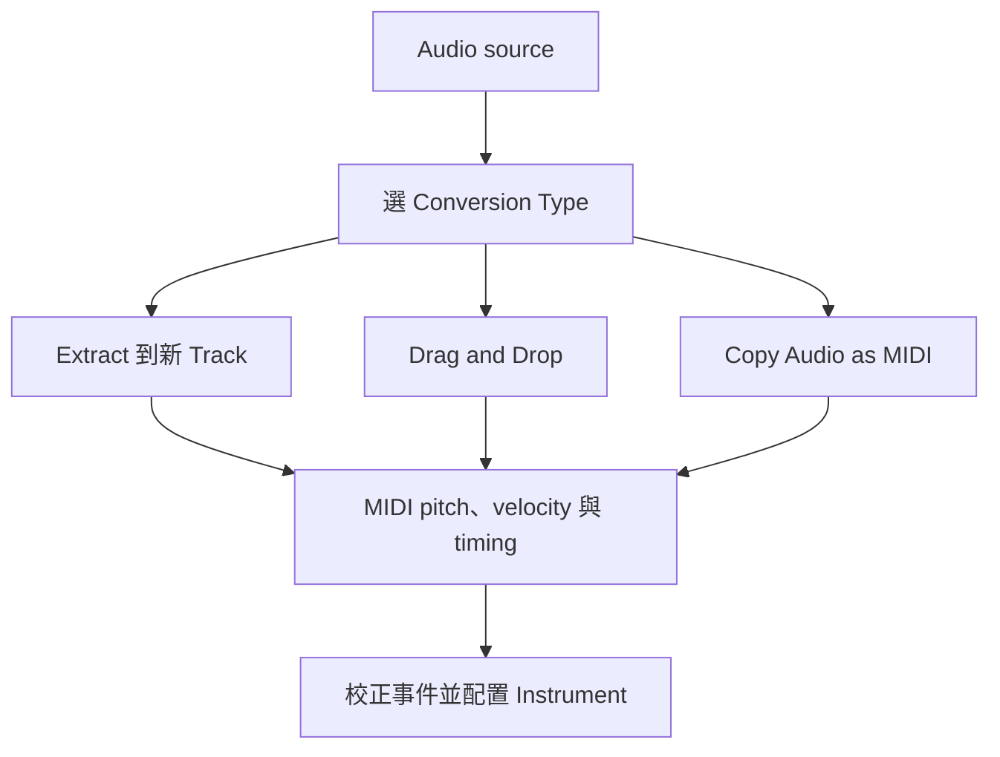

# Ch46 — Melodyne整合與Audio轉MIDI

> Melodyne 整合讓你直接在 Edit window 改 Audio，但 Audio to MIDI 擷取的是演奏資料，不是把原音色複製成另一種檔案。

原文：[[Pro_Tools_Reference_Guide_2023.3.pdf#page=1073|Chapter 46，原書 p. 1041–1046／PDF p. 1073–1078]]。內容依 **2023.3** 文件消化重組；下文未標為原書數值的練習情境與圖解均為筆記補充。

## 整合編輯器與 Insert workflow 不同

Pro Tools 2023.3 在 Edit window 底部提供 Melodyne tab，與 docked MIDI Editor、Clip Effects 共用區域。可以分析整條 Audio Track，也可以只分析 Clip；這裡不需要照舊式每次把整段以 Transfer 錄入 Plug-In 的流程操作。

| 想做什麼 | 入口 | Mac |
|---|---|---|
| 顯示 Melodyne editor | View > Other Displays > Melodyne | Option+8 |
| 分析整條 Track | Track > Melodyne > Edit；或 Track 的 Elastic Audio／ARA selector 選 Melodyne | 右鍵 Track 名稱也可 |
| 分析選取 Clip | Clip > Melodyne > Edit | Control+Shift+A |
| 暫時比較原音 | Melodyne > Bypass | 設定保留 |
| 清除修改 | Melodyne > Clear | 與 Bypass 不同 |
| 固定處理結果 | Melodyne > Render | 寫入渲染結果 |

Clip 右上 ARA icon 與透明 note overlay 表示已分析。圖示較透明是僅分析、solid 是已有實際修改，不能看到音符圖就認定音高已被改過。原書提醒 Melodyne edits 使用自己的 Undo queue，與 Pro Tools 的主 Undo history 分開；如果一次 Undo 沒改到你預期的 note，先看當下 editor focus 與對應歷史。

> [!warning] 版本與授權條件（依 2023.3）
> Melodyne Essentials 隨各 tier 安裝，但原書說 Intro 不含其授權；要另購或升級。更高 Melodyne 版本亦需各自授權。Studio／Ultimate 支援 greater-than-stereo Track 的 Melodyne editing，不能僅因看得到 editor 就推定全部演算法與工具都可用。

> [!tip] 實務連結
> 先用 Clip 層級分析，通常比較容易知道自己改了哪一句。要從 Elastic Audio 切到 Melodyne，也要注意 Track 的處理模式已更換；不要把兩套 timing／pitch 編輯當成同一層完全互不影響的控制。

## Audio to MIDI 擷取什麼，不能期待什麼

Audio to MIDI 將音訊中偵測到的 pitch、velocity 等演奏資訊轉成 MIDI，之後由 Instrument Plug-In 或外部 MIDI device 發聲。它不是把吉他的原始音色完整轉存到 MIDI；失真、空間感、錄音噪音與細節不會變成另一份可同樣發聲的 waveform。

要取得好結果，先選適合 source 的 Conversion Type。Melodic 適合單音旋律，Percussive 適合鼓等素材；實際可選項目由 `Setup > Preferences > Processing > Audio to MIDI Plug-in` 及安裝的工具決定。

| 方法 | 結果／適用情況 | 位置依據 |
|---|---|---|
| Extract MIDI to New Track | 從整條來源 Audio Track 擷取，建立 MIDI／Instrument Track | 保持來源 Timeline 位置 |
| Drag and Drop | 將 Clip／Clip Group 拖到 MIDI／Instrument Track | 拖放目的位置 |
| Copy Audio as MIDI → Paste | 只擷取所需選區，貼到指定位置 | 目的 Track 的 edit cursor |

### 從 Audio Track 建立新的 MIDI

1. 選 source Track，執行 `Track > Extract MIDI to New Track`。
2. 在 Audio to MIDI Properties 選 Destination Track Type：MIDI 或 Instrument。
3. 選與 source 相符的 Conversion Type。
4. 多個 Clip 若要成為單一 MIDI Clip，啟用 Consolidate Clips。
5. 選擇新 Track 的插入位置，以及 Source Tracks 的保留方式。
6. 擷取後以 MIDI Editor 看 pitch／note length／velocity，接上聲音後再比較原演奏。

| Source Tracks 選項 | 原來源最後狀態 | 何時用 |
|---|---|---|
| Hide and Make Inactive | 隱藏並停用 | 保留比對來源、縮減畫面 |
| Make Inactive | 仍可見但停用 | 交接與核對時較容易找到 |
| Delete | 刪除來源 Track | 明確不再需要時才選 |
| Do Nothing | 完整保留 | 初次轉換與驗證最清楚 |

> [!tip] 實務連結
> 想把 Bass 的節奏與音高拿來疊一層 synth bass，先保留 source，再擷取到 Instrument Track。檢查 note start、結尾與 octave 判斷；轉換只是把演奏「估計成可編輯事件」，人工修正仍是工作流程的一部分。

## 拖放與 Copy Audio as MIDI：快速，但別跳過設定

可以從 Audio Track、Clips List、Workspace 或 Finder 拖 Audio 到 MIDI／Instrument Track；多 Clip 可用 Consolidate Clips。若要指定一小段，右鍵選區 `Copy Audio as MIDI`，再把游標放到目的 MIDI／Instrument Track，用 Command+V 貼上。

這與一般 Copy／Paste Audio 不一樣：剪貼簿內已是抽出的 MIDI 資料。轉換後沒有聲音，先查 Instrument 是否載入、MIDI output 是否有目的地；不要把「事件轉出來」與「音源已接好」當成同一個步驟。

![[PT-Ch46-audio-midi.png]]

> [!abstract] Takeaway
> Melodyne editor、已分析 Clip 與已修改 Clip 是不同狀態；Undo 也有獨立 history。Audio to MIDI 是演奏資料擷取，要選對 Conversion Type、保留來源比對，再檢查 note、octave 與 routing。詳細 Melodyne note tool 操作應接 Celemony 文件，本章本來就把那部分轉介給原廠。

## 相關

%% PT-NAV-BEGIN %%

上一篇：[[PT-Ch45c-ElasticProperties與轉檔邊界]]

下一篇：[[PT-Ch47a-Commit固定處理與交接]]

按任務閱讀：[[PT-00-工作流程導航]]

%% PT-NAV-END %%

跨章延伸：[[PT-Ch45a-ElasticAudio啟用與演算法]] · [[PT-Ch47a-Commit固定處理與交接]]

[[PT-00-索引]] · [[PT-00-快速檢索]] · [[PT-00-功能目錄]] · [[PT-00-Mac快捷鍵]]

標籤： #pro-tools #audio #workflow
