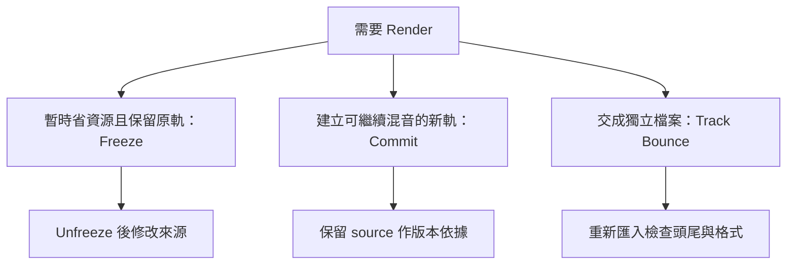

# Ch47b — Freeze與TrackBounce的使用時機

> Freeze 暫停修改來換運算資源，Track Bounce 則把結果交成檔案；先選目的，再選命令。

原文：[[Pro_Tools_Reference_Guide_2023.3.pdf#page=1084|Chapter 47，原書 p. 1052–1056／PDF p. 1084–1088]]。內容依 **2023.3** 文件消化重組；下文未標為原書數值的練習情境與圖解均為筆記補充。

## 三種 Render 工作的分工

| 方法 | 主要產物 | 回頭修改方式 | 適合情況 |
|---|---|---|---|
| Commit | 新 Audio Track | 回到保留的 source 再 Commit | 固定部分製作、交接 Session |
| Freeze | 原 Track 的暫時 render 狀態 | Unfreeze → 修改 → 再 Freeze | 暫省 CPU、仍要保留來源 |
| Track Bounce | 磁碟上的 Audio file | 回工程重 Bounce | 交分軌、stem 或單軌檔案 |

Freeze 支援 Audio、Auxiliary Input、Instrument Track。它把 source 與指定範圍的 Plug-In processing render 成 Audio，讓被 freeze 的 Plug-In inactive；不是單純按 Bypass。可在 `Track > Freeze`、Track 的 Freeze icon 或右鍵名稱操作。若只想固定到某個 Insert，右鍵該 Insert 選 Freeze Up To This Insert。

> [!tip] 實務連結
> 重型 synth 已經錄好 MIDI，但晚上還可能換和弦，用 Freeze 省 CPU 比永久移除音源設定方便。需要交給混音師一條可獨立工作的 Audio，則較適合 Commit 或 Track Bounce，並另外保留 MIDI source。

## Freeze 後還能調哪些東西？

Freeze 把 Clip Gain、Clip Effects、Elastic Audio、指定 Plug-In 與其 automation 固定；HEAT 若在 pre-insert 也會納入。Track 的 Volume、Mute、Pan、Send 等基本混音控制仍維持可用。這讓你能先暫停昂貴的聲音計算，繼續做混音平衡。

| Freeze 後允許 | Freeze 後限制 |
|---|---|
| 調整／寫基本 Track、Send automation | 編輯 Clip 與 Clip 內容 |
| 改 Track output path | Clip Gain／Clip Effects／AudioSuite |
| Freeze Up To This Insert 後，改後段未凍結 Plug-In | 對已凍結部分改 Plug-In 設定 |
| 保留原來源，Unfreeze 後再改 | MIDI note、Real-Time Quantize 等內容修改 |

不只單軌編輯受到限制：只要 Session 有 frozen Track，Tempo change、Song Start、Conductor Track enable／disable、Insert／Cut Time 等時間操作也有限制。想改編曲速度時，先 Unfreeze，再執行時間操作，不能期待 frozen Audio 自動像即時 Instrument 一樣重算。

> [!warning] 不是每一條 Track 都能從隱藏狀態直接 Freeze
> 原書指出 hidden 或 inactive Track 不能直接 Freeze。Global Freeze icon 也能依 Audio／Aux／Instrument 選擇 include 範圍，批次操作前要先看 Include options，別只看 icon 有沒有亮。

## Freeze 的尾韻與多輸出

對 Audio／Instrument Track，Freeze 從各 Clip 起點開始，延伸到 Clip 尾端或處理後音訊降到 −144 dBFS 至少 60 秒的停止條件；muted Clip 不 render。Aux Track 則從偵測到 input signal 開始，直到訊號低於該條件。這與 Commit 的 Clip 邊界處理不是完全同一套終止條件。

有 Auxiliary Output Stems 的 Plug-In 會詢問是否也 freeze 接收那些 output 的 Track。以多輸出鼓音源為例，主 Track 的立體聲輸出不一定含 kick／snare 分送的完整結果；必須一起確認哪些接收 Track 仍在即時處理。

## Track Bounce：選對範圍，再處理 Volume 與 Pan

選欲輸出的 Track，`Track > Bounce`，Mac Command+Option+Shift+B。它支援 Audio、Auxiliary Input、Master Fader 與 Instrument Track。Track Bounce dialog 類似 Bounce Mix，但多出是否 render Track Volume 與 Pan automation 的選項。

| 項目 | 怎麼決定 | 忘記確認的後果 |
|---|---|---|
| Timeline selection | 有選區只 Bounce 該範圍 | 尾韻或前奏可能漏掉 |
| 沒有 selection | 從 Session 起點到該 Track 最後音訊 sample | 開頭可能包含長空白 |
| Volume automation | 是否固定相對音量變化 | 乾素材與聽感固定版混淆 |
| Pan automation | 是否固定空間位置與 width | 多路 output 可能產出不同 channel width 的檔案 |
| Format／file options | 依交付規格 | 再匯入時聲道與格式不符 |

### 小型交付核對流程

1. 用明確 Timeline selection 包含整段音樂與尾韻。
2. 選要 Bounce 的 Track，不把參考音樂或 talkback 算進去。
3. 確認是否要固定 Volume／Pan；不確定時先把版本命名清楚。
4. Bounce 完重新匯入空白 Track 或新 Session，從起點對齊，檢查頭尾。
5. 留下 source／版本資訊，之後修改能重現同一份輸出。

> [!tip] 實務連結
> 「Stem」可能指含處理的群組輸出，也可能被對方用來指逐軌檔。用 Track Bounce 前先寫清楚交付內容，例如「含 EQ／Compression、保留 Reverb return 另檔、Pan 已固定」。這是交接規格建議，不是 Pro Tools 自動替你決定的定義。

![[PT-Ch47-render-choice.png]]

> [!abstract] Takeaway
> Freeze 是可逆的工作狀態，但凍結期間不能任意改內容與全曲時間；Track Bounce 是交檔工具，要明確選區與 Volume／Pan 策略。省資源、保留修改與交付檔案，是三個不同目的。

## 相關

%% PT-NAV-BEGIN %%

上一篇：[[PT-Ch47a-Commit固定處理與交接]]

下一篇：[[PT-Ch48a-Quantize與Groove的節奏整理]]

按任務閱讀：[[PT-00-工作流程導航]]

%% PT-NAV-END %%

同章分篇：[[PT-Ch47a-Commit固定處理與交接]]

跨章延伸：[[PT-Ch51a-PlugInInsert與SideChain]] · [[PT-Ch50a-混音Track與訊號流]]

[[PT-00-索引]] · [[PT-00-快速檢索]] · [[PT-00-功能目錄]] · [[PT-00-Mac快捷鍵]]

標籤： #pro-tools #audio #workflow
