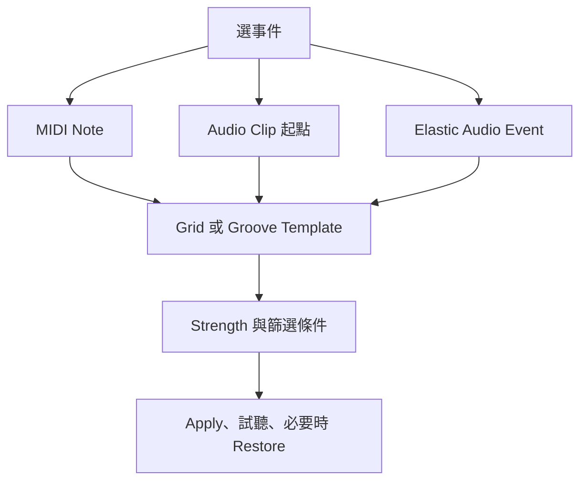

# Ch48a — Quantize與Groove的節奏整理

> Quantize 不是把所有事件硬吸到線上，而是指定哪些事件、朝哪個時間參考、移動多少。

原文：[[Pro_Tools_Reference_Guide_2023.3.pdf#page=1089|Chapter 48，原書 p. 1057–1071／PDF p. 1089–1103]]。內容依 **2023.3** 文件消化重組；下文未標為原書數值的練習情境與圖解均為筆記補充。

## 一個視窗，三種不同的處理對象

Event Operations 是 MIDI 與部分 Audio 編輯的批次工具。Option+3 打開上次頁面，Option+0 直接開 Quantize；視窗可以保持開啟。Numeric keypad Enter 會 Apply 並留下視窗，主鍵盤 Return 則 Apply 後關閉，連續試設定時差別很有用。

| What to Quantize | 變動的部分 | 不等於什麼 |
|---|---|---|
| MIDI Note On | note start | 不一定改 note length |
| MIDI Note Off | note end | 不一定搬 start |
| Audio Clips | Clip start／Sync Point | 不會自動把整個未切割演奏內部修拍 |
| Elastic Audio Events | EA 事件位置並 TCE | 需要 Elastic Audio-enabled Track |

要移 MIDI start 並維持長度，勾 Preserve Note Duration；若同時量化 Note On 與 Note Off，就不能再要求長度完全不變。Audio Clip 有 Sync Point 時先以它定位，這也是 Ch41 同步點概念在節奏整理上的應用。要 Quantize Clip Group 裡每個切片，先 Ungroup；否則動的是群組自己的起點。

> [!tip] 實務連結
> 鼓已切成單次 hit，可選 Audio Clips 做位置修正；一條連續 Bass 演奏想修內部 note timing，要用 Elastic Audio Events。選錯對象，就會出現「整段搬了，裡面還是不準」的結果。

## Grid Quantize：四個控制就能說清大多數決策

| 控制 | 功能 | 適合用途 |
|---|---|---|
| Quantize Grid | 目標節奏單位，含 dotted／triplet／Tuplet | 定義演奏應落在哪種細分 |
| Strength | 朝目標移動的百分比 | 保留部分 timing deviation |
| Include Within | 只改接近 Grid 的事件 | 修強拍，保留離拍的裝飾 |
| Exclude Within | 保留已接近 Grid 的事件 | 只救明顯偏離的音 |
| Offset Grid By | 把目標 Grid 整體提前／延後 | push／laid-back 的目標位置 |
| Randomize | Quantize 後再加入隨機時間偏移 | 減少機械感，但不是演奏意圖的替身 |

原書給一個保留原 feel 的起點：Exclude Within 10–15%、Strength 70–80%。這是書中例子，不是所有音樂必須採用的公式。先聽 groove，再決定只動哪幾個音，通常比讓整首同樣變化更有用。

Tuplet 可依「幾個音放進幾個單位」設定。例如原書六連值基準中的 16th note 為 240 ticks，5 in the time of 4 得到 $\frac{240}{5}\times4=192\text{ ticks}$。這裡的 ticks 是 960 ppq 時間網格的一部分，不是 sample 數。

> [!note] Swing 百分比請按 Pro Tools 的定義讀
> p.1062 定義 0% 無 Swing、100% 達 triplet feel；p.1064 的操作例子又稱 50–75% 為 triplet-like feel，措辭不完全一致。本篇保留前者作參數定義、把後者視為聽感示例，不把不同 DAW 的「66% Swing」慣例硬套進來。直接用效果與原演奏比較。

## Groove Quantize：把另一段表演當成參考

Groove Template 是從演奏抽出的 quantization map，能攜帶 timing、duration 與 velocity。Beat Detective 可由 Audio 或 MIDI 製作 DigiGroove，參考解析度是 960 ppq；原書支援 Numerical Sound Feel Injector 的 960 ppq 模板，不支援 DNA 的 192 ppq。

| Slider | 0% | 100% | 200% |
|---|---|---|---|
| Timing | 不移動 | 到 template 目標 | 超過目標、移動兩倍差值 |
| Duration（MIDI） | 不按 template 改 | 接近 template duration 關係 | 誇張其相對差異 |
| Velocity（MIDI） | 保留原值 | 採 template velocity | 誇張強弱差異 |

原書 Timing 例：事件從 `1|1|060` 對到 template 的 `1|1|073`，100% 到 073，200% 到 086。Audio 本身沒有 MIDI velocity 與 note duration 欄，所以相應選項不適用。Beat Detective 從 Audio 抽 groove 也不代表真正擷取了每個音的 MIDI duration。

Pre-Quantize 先把 MIDI hard-quantize 到 16th，再套 groove；若來源本來有好聽的自然偏移，不應無意間先清掉它。Template 跟 Song Start 對齊、依模板長度重複，並非你把選區放在哪裡都一律從 template 第一拍開始。不同 Meter 時會重複或截短，遇到新的 Meter marker 可重設 template 起點。

## Restore Performance 與 Undo 的差別

Restore Performance 可還原選定的 Timing、Duration、Velocity、Pitch，到錄音或手動建立時的原始狀態；即使已存檔、Undo queue 清掉，仍可依保留的 performance 資訊還原。這也能移除 Input Quantize，但不會把手動搬動、剪貼的事件當成單純 Quantize 直接撤回。

1. 先框定要修的素材與段落，讓 loop playback 範圍穩定。
2. 選 What to Quantize，確認是 Notes、Audio Clips 還是 EA Events。
3. 選 grid 或 template，先降低 Strength 試聽。
4. 比較前後，若不對就 Undo 或 Restore 指定 attribute。
5. 設定確認後再套到其他相同性質的段落。

> [!warning] MIDI Real-Time Properties 會在實際資料之上再作用
> Event Operations 改的是實際 MIDI data；Real-Time Quantize 等是在其上再套用的播放處理。兩邊同時開啟，可能讓你改一次卻聽到兩層作用。先確認目前看到與聽到的是哪一層。

![[PT-Ch48-quantize.png]]

> [!abstract] Takeaway
> Quantize 先選對處理對象，再選參考與強度。Groove 是以另一段演奏為目標，不是隨機偏移；Restore Performance 也不是任意剪貼的 Undo。保留人味靠有目的的選擇，並非把所有資料加 Randomize。

## 相關

%% PT-NAV-BEGIN %%

上一篇：[[PT-Ch47b-Freeze與TrackBounce的使用時機]]

下一篇：[[PT-Ch48b-MIDI力度時值移調與StepInput]]

按任務閱讀：[[PT-00-工作流程導航]]

%% PT-NAV-END %%

同章分篇：[[PT-Ch48b-MIDI力度時值移調與StepInput]]

跨章延伸：[[PT-Ch45a-ElasticAudio啟用與演算法]] · [[PT-Ch53a-Automation模式與資料層]]

[[PT-00-索引]] · [[PT-00-快速檢索]] · [[PT-00-功能目錄]] · [[PT-00-Mac快捷鍵]]

標籤： #pro-tools #audio #workflow
