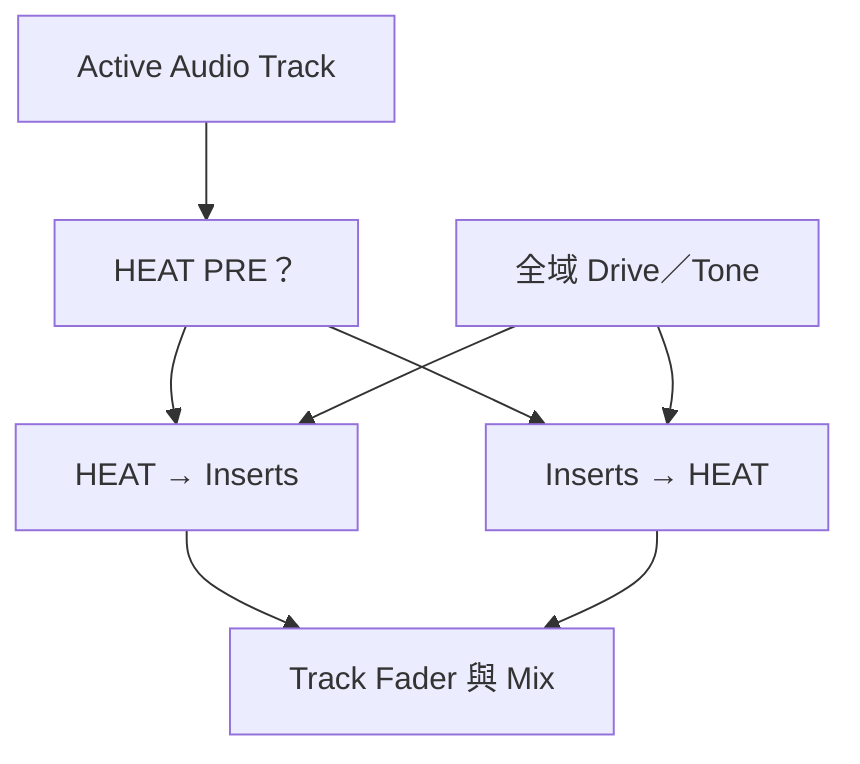

# Ch49 — HEAT的音色與資源管理

> HEAT 用一組全域 Drive 與 Tone 改變 Audio Track 的非線性色彩，效果取決於輸入，也取決於它放在 Insert 前還是後。

原文：[[Pro_Tools_Reference_Guide_2023.3.pdf#page=1117|Chapter 49，原書 p. 1085–1092／PDF p. 1117–1124]]。內容依 **2023.3** 文件消化重組；下文未標為原書數值的練習情境與圖解均為筆記補充。

## HEAT 不是在 Master 上放一顆 Saturator

HEAT 是 Harmonically Enhanced Algorithm Technology，原書將它描述為模擬 tape 與 analog mixing console 類型 coloration 的處理。依 2023.3 文件，它適用 Studio／Ultimate，需相應 HEAT 與 Pro Tools iLok authorizations；有 Native 與 DSP 形式。

啟用 `Options > Activate HEAT`，或在 Mix window 的 HEAT controls 操作。它作用於 **active Audio Tracks**，不直接作用在 Instrument、Auxiliary Input 或 Master Fader。這與在整個主輸出只處理一次有根本差別：各 source 先依自己的 level 和內容進入非線性處理，再一起混合。

| 控制 | 範圍 | 作用 |
|---|---|---|
| Master On／Off | 全 Session 的 HEAT | 啟用／停用 HEAT 處理系統 |
| Master Bypass | 全 Audio Track | 暫時比較，資源仍占用 |
| Drive | 全部未 bypass 的 Audio Track | 改變非線性處理量與 harmonic character |
| Tone | 同上 | 依 Drive 與內容改變細節與明暗 |
| Track BYP | 個別 Audio Track | 保留例外素材不處理 |
| Track PRE | 個別 Audio Track | 決定 HEAT 在一般 Inserts 前或後 |

> [!tip] 實務連結
> 若混音想讓多條真實錄音有共同底色，可先整體少量 Drive，再讓本來很飽和的吉他個別 bypass。它不必在所有素材上都一樣明顯；先保留編曲層次，再決定哪一條需要例外。

## Drive 的左右兩邊不是單純「少一點／多一點」

12 點的預設 Drive 不套用 HEAT。往逆時針方向，原書描述以 odd harmonics 為主的 tape-like coloration，特別提到 3rd／5th harmonic；往順時針，則在 odd harmonic series 上加入 even harmonic 成分，類比 triode tube character。兩邊是不同色彩路線，不是把同一個效果連續往大調。

| 調整方向 | 文件描述 | 聆聽焦點 |
|---|---|---|
| Drive 逆時針 | Tape-like，增加 odd harmonics | low／mid 厚度、high transient 柔化 |
| Drive 順時針 | Odd 加 even harmonic series | 更積極的 tube-like character |
| Tone 順時針 | 增加明亮與細節 | 是否過度突出高頻 |
| Tone 逆時針 | 降低明亮感 | 是否讓 mix 失去空氣與辨識度 |

Tone 不是固定頻率響應的普通 EQ：效果隨 Drive、input level 與 program material 非線性變化。相同設定放在很大聲的 snare 與柔和 pad-like guitar，結果本來就不同。原書建議一般起點可試 Drive 任一方向兩格，再花時間比較。

> [!warning] 非線性處理不能只靠靜態曲線評估
> 下方圖僅用原創數學示意說明「輸入變大可能使 peak 被壓縮」，不是 HEAT 的真實 transfer function，也不是量測結果。手冊未提供可復刻其演算法的完整方程，本筆記不把示意當作逆向工程證據。

## Pre／Post Insert 決定誰先改變誰

PRE 亮起，HEAT 在 Track Insert 前；沒亮時在其後。若 Compressor 在 Insert 裡，HEAT 放前面會先改輸入 waveform 與 harmonics，Compressor 收到的內容也變。放後面則由 Insert 先塑造動態，再由 HEAT 著色。Commit／Freeze 是否 render HEAT，也取決於這個位置，與 Ch47 相連。

1. 先固定可比較的播放段落，選包含 transient 與 sustain 的內容。
2. 從適量 Drive 開始，暫時不大幅改 Tone。
3. 比較 Pre／Post，聽 Compressor 如何反應，而不只比較平均音量。
4. 調 Tone 補回需要的亮度，個別 bypass 不合適的 Track。
5. 用 Master Bypass 整體 A/B，再確認沒有以更大音量誤認改善。

> [!tip] 實務連結
> 想讓 Instrument Track 的音源經過 HEAT，可 bus-record 成 Audio Track，或把音源的 output 路由到 Audio Track 並開 Input Monitoring；不要只在 Instrument Track 找不存在的 HEAT channel control。

## 資源、Meter 與 HDX 特例

HDX 上 HEAT 依 active Audio Track 的 voices、sample rate 與 DSP chip 資源運作。原書每 HDX DSP chip 的 Mono Audio Track 容量表為 44.1／48 kHz：86；88.2／96：42；176.4／192：19。Stereo 約需兩個 Mono 的資源，5.1 則按六個 channel 計。這是文件對該系統的容量，不適用拿來估算任何 Mac CPU 的 Native performance。

| 狀態／現象 | 解讀 | 下一步 |
|---|---|---|
| Track BYP 亮橘 | 明確個別 bypass | Master Bypass 關掉後仍會維持 |
| Master Bypass 亮，Track 暗橘 | 因 master 造成的間接 bypass | 區分原本是否個別 bypass |
| DSP 不足，新 Track 無法 active | HEAT 仍需每 active Track 資源 | 減 active Track、停用 HEAT 或調整 DSP |
| 開工程時部分 Plug-In inactive | HEAT 的 DSP 優先配置可能有影響 | 看 Session notes 與 DSP 配置 |

Bypass 不釋放 Native／DSP 資源，On／Off、Track active 狀態則是另一層。HEAT meter 表示處理程度，multichannel 及 master 會呈現各 channel／Track 的平均處理資訊，不應當成標準輸出 peak meter 使用。

## Control Surface 入口

原書另列 ICON 與 C|24 控制。D-Control／D-Command 可用 Custom Fader 區的 Shift+Control 加 Plug-Ins switch 取 Master controls；channel 端以 Shift+Control 加 Inserts switch 存取。C|24 以 Channel Bar 的 Soft Keys 進入 master，encoder 21–24 分別為 On／Off、Master Bypass、Drive、Tone。這些是硬體按鍵流程，和 Mac computer keyboard shortcuts 不混用。

![[PT-Ch49-nonlinearity.png]]

> [!abstract] Takeaway
> HEAT 是各 Audio Track 的全域色彩系統，不是 Master-only Saturator。Drive 左右選不同 harmonic character，Tone 隨內容與 Drive 改變；Pre／Post、個別 bypass 與資源占用，都要一起看。

## 相關

%% PT-NAV-BEGIN %%

上一篇：[[PT-Ch48b-MIDI力度時值移調與StepInput]]

下一篇：[[PT-Ch50a-混音Track與訊號流]]

按任務閱讀：[[PT-00-工作流程導航]]

%% PT-NAV-END %%

跨章延伸：[[PT-Ch50a-混音Track與訊號流]] · [[PT-Ch51a-PlugInInsert與SideChain]]

[[PT-00-索引]] · [[PT-00-快速檢索]] · [[PT-00-功能目錄]] · [[PT-00-Mac快捷鍵]]

標籤： #pro-tools #audio #workflow
