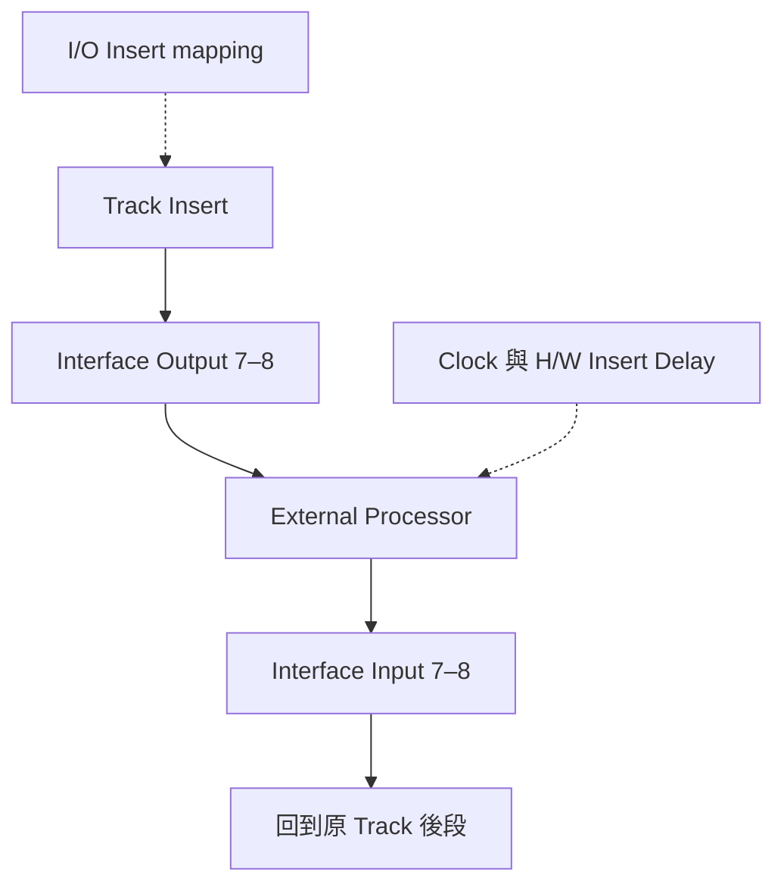

# Ch51c — HardwareInsert與數位Clock

> 外部 Insert 要同時接對送出、返回、時間與 Clock；少一項，就可能有聲但不可靠。

原文：[[Pro_Tools_Reference_Guide_2023.3.pdf#page=1207|Chapter 51，原書 p. 1175–1177／PDF p. 1207–1209]]。內容依 **2023.3** 文件消化重組；下文未標為原書數值的練習情境與圖解均為筆記補充。

## Hardware Insert 是對應的一組 Input／Output

Pro Tools 把 Hardware Insert 當成 Track 的串接處理：送到外部設備，再回同一條處理鏈。原書要求對應的硬體 I/O channels，例如 outputs 7–8 送出，就由 inputs 7–8 回來。這不同於手動 Send／Return 可以自行挑不同回路；若用 Insert，先滿足對應規則。

| 階段 | 連接／設定 | 核對內容 |
|---|---|---|
| 送出 | Interface output → device input | Line level 與左右 channel |
| 返回 | Device output → matching interface input | 相同 I/O 編號、Mono／Stereo format |
| 定義 | Setup > I/O > Insert | Path name、width、channel grid mapping |
| 指派 | Track Insert selector 選硬體 path | 確認串在哪個 slot |
| 對齊 | H/W Insert Delay 與 Delay Compensation | 見 Ch50 的回路量測 |

先用低風險測試聲與適當 level 接通，再把正式 mix 送入。若需要外部效果的平行 wet return，通常用 Ch50 的 Send／Return 思路更清楚，而不是將 dry／wet 邏輯含糊地藏在串接 Insert 裡。

> [!tip] 實務連結
> 接 Stereo bus compressor，先分別檢查 L／R 路徑，再聽中置信號是否偏移。某一邊接錯或 level 不同，可能被誤認為 Compressor 左右連動的「類比個性」。先驗證回路，才評價音色。

## Bypass 與延遲是另外兩項設定

Hardware Insert 沒有一般 Plug-In 的 Bypass control。要比較，可用硬體本身 bypass、把 Insert inactive，或移到 No Insert。這些方法不完全相同：設備 bypass 可能仍保留 converter／數位傳輸路徑；No Insert 則移除宿主回路。

| 比較方式 | 保留什麼 | 判讀 |
|---|---|---|
| 設備 Bypass | 可能保留硬體回路與轉換 | 適合比較 processing，但看設備設計 |
| Insert inactive | 保留宿主 assignment／設定 | 可暫時取消該處理資源 |
| No Insert | 移除 Insert | 後續要自己重新指派 |
| Track Bounce／Commit | 將結果錄成 Audio | 外部設備需 real-time passing |

Delay Compensation 可以管理 Hardware Insert，但需要正確的 I/O 與手動 offset。量測應在設備只通 dry 的條件下，比較 source 與返回 transient；不能拿 Reverb tail 或 Compressor envelope 的改變當作傳輸 latency。完整量測流程連到 Ch50d。

## 數位連接除了音訊，還要共享 Clock

兩個 digital audio device 即使 Sample Rate 都寫 48 kHz，若各自用獨立 clock，仍不代表每個 sample 的實際時間一致。原書在外部 digital effects 的典型接法，建議 Pro Tools／interface 為 clock master，外部設備採 external digital clock 同步。若實務需要 Pro Tools 跟外部來源，則在相應 Hardware Setup 選對 Clock Master 與輸入格式。

| 連接問題 | 常見確認項 | 原則 |
|---|---|---|
| Click／pop、不穩定數位音訊 | Clock source、Sample Rate、線材與設備供電 | 一個明確 master，其餘同步 |
| Optical 有接卻無訊號 | ADAT／S/PDIF format 是否相符 | 接頭一樣不代表資料格式一樣 |
| 選 external clock 後無法穩定工作 | source 是否開機且真的提供有效 clock | 沒來源時別指定它作時鐘 |
| RCA S/PDIF 與 Optical 切換不符預期 | 該 interface 的格式／mirroring 規則 | 依硬體手冊確認 |

原書有 HDX／HD Native、003、Eleven Rack、Mbox 等不同步驟；它們是指定硬體的設定，不可直接投射到所有 third-party audio interface。Core Audio device 可能由自己的 control panel 管 Clock；這時以其原廠文件與實際 Hardware Setup 可選項目為準。

### 連接後的完整核對

1. 先確認實體 line I/O 與 Insert mapping，避免形成 feedback。
2. 純 dry 回路測試 level、左右 channel 與是否有異常噪音。
3. 若 digital 連接，確認 master／slave 與格式。
4. 量測殘餘 round-trip delay，填入對應 offset。
5. 最後才開正式 processing，對照 Bypass 並保留交接備註。

> [!warning] 不要把 A/D／D/A 回路當成零成本 Insert
> 外部設備需要實體 passing、轉換與時鐘條件。Offline render 不會自動讓實體 Compressor 加速運算；交接到沒有相同設備的系統前，要留 printed audio 版本。

![[PT-Ch51-insert-paths.png]]

> [!abstract] Takeaway
> Hardware Insert 先滿足對應 I/O pairing，再管 level、latency 與 Clock。數位格式與 master／slave 必須一致；比較 Bypass 時也要知道是否保留轉換回路。交接前留 print，才能帶走硬體處理結果。

## 相關

%% PT-NAV-BEGIN %%

上一篇：[[PT-Ch51b-Preset與MultiMono控制]]

下一篇：[[PT-Ch52-DSPMode與低延遲錄音]]

按任務閱讀：[[PT-00-工作流程導航]]

%% PT-NAV-END %%

同章分篇：[[PT-Ch51a-PlugInInsert與SideChain]] · [[PT-Ch51b-Preset與MultiMono控制]]

跨章延伸：[[PT-Ch50a-混音Track與訊號流]] · [[PT-Ch52-DSPMode與低延遲錄音]]

[[PT-00-索引]] · [[PT-00-快速檢索]] · [[PT-00-功能目錄]] · [[PT-00-Mac快捷鍵]]

標籤： #pro-tools #audio #workflow
