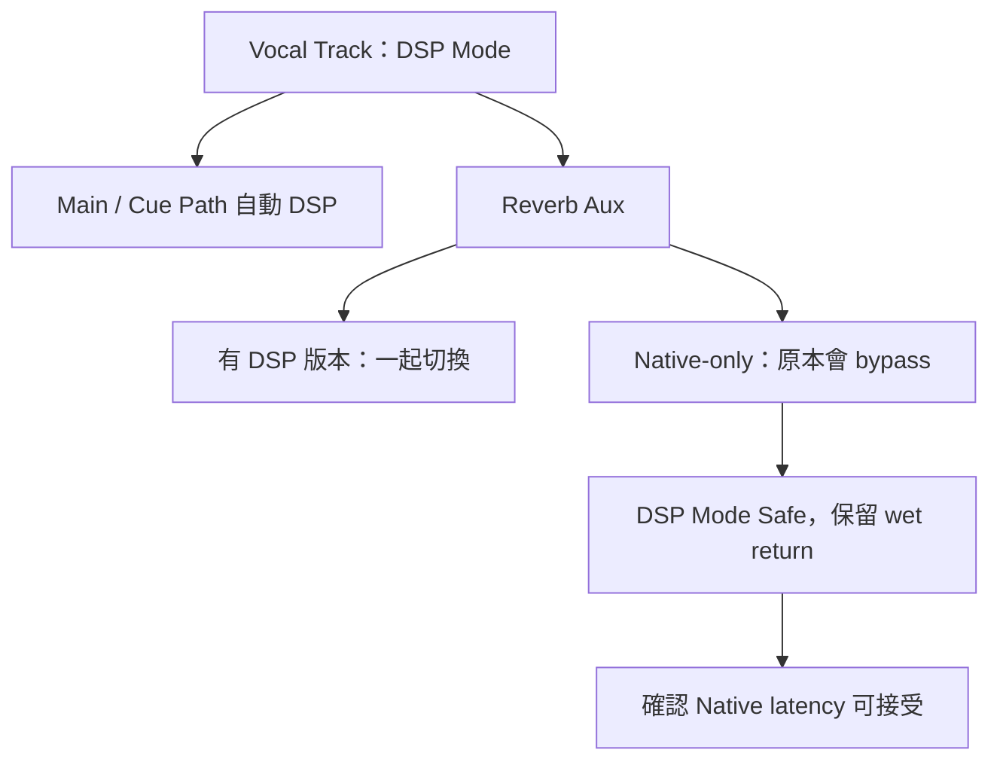

# Ch52 — DSPMode與低延遲錄音

> DSP Mode 優先保護 live monitoring 的低延遲路徑，代價是 Native-only Plug-In 可能被旁路。

原文：[[Pro_Tools_Reference_Guide_2023.3.pdf#page=1211|Chapter 52，原書 p. 1179–1188／PDF p. 1211–1220]]。內容依 **2023.3** 文件消化重組；下文未標為原書數值的練習情境與圖解均為筆記補充。

## 只適用受支援的 Hybrid 硬體架構

本章的 DSP Mode 適用 **HDX Hybrid Engine 或 Pro Tools Carbon**，不是每台 Mac 都能直接用 CPU 開啟的通用模式。可以逐 Track 啟用，涵蓋 Audio、Aux、Instrument、Routing Folder、Master Fader。目的是讓 live input 的整條 signal chain 在 dedicated DSP mixer 上運作。

| 狀態 | 指示 | 行為 |
|---|---|---|
| DSP Mode Enabled | Bright green | 主動指定的 Track 跑 DSP；有 DSP 版本的 Plug-In 切換 |
| DSP Mode Auto Enabled | Dim green | 因為位於另一條 DSP Track 的路徑上，被自動納入 |
| Native Mode | Gray | Track 使用 Native processing |
| DSP Mode Safe | 對應 Safe 狀態 | 防止該 Track 被自動切入 DSP Mode |

Native-only Plug-In 在 DSP Mode Track 會自動 bypass，不會因為開了這個模式就變成 DSP 軟體。DSP-Compatible badge 表示該 Plug-In 有相應 DSP 版本。這是聲音可能改變的主要原因：不只 latency 變小，原先的效果也可能暫時沒了。

> [!tip] 實務連結
> 錄音前把同一條 vocal path 在 Native／DSP Mode 間切換試聽，檢查 loudness 與處理有沒有突變。若一顆 Native-only saturation 原本有增益，切 DSP 後被旁路，可能讓歌手耳機音量突然改變；先用可用 input／output gain 建立一致的監聽條件。

## 自動傳播：不是只有你點的那條 Track 會變

人聲 Track 送到 Reverb Aux，又經 main／cue Master Fader，這些下游只要屬 signal chain，也可能自動切到 DSP Mode。優點是整條路徑保持低延遲，缺點是 Native-only Reverb 或 limiter 可能一起 bypass。

| 需求 | 做法 | 結果 |
|---|---|---|
| 所有 live-path 處理都維持低延遲 | 使用 DSP-compatible Plug-In | 整條路徑可在 DSP 工作 |
| 保留 Native-only Reverb | 對 Reverb Aux 開 DSP Mode Safe | Wet return 仍有 Native latency |
| 比較 DSP／Native | 切換後核對 bypass 與 level | 不把音色差異誤認成 latency 改善 |
| 混音時分攤 CPU | 可視需要開 DSP Mode | 對非 live-path Track 並不額外改善演奏監聽 |

原書的例子讓人聲保持 DSP，Reverb Aux 用 Safe 並設 100% wet。Reverb 的時間性質使部分 wet latency 較不明顯，但這不是任意平行訊號都能忽略 latency 的理由；dry 與處理過的同一訊號並行時，仍可能有 phase／timing 問題。

> [!warning] Native 與 DSP 兩路 live input 不一定對齊
> 同一個現場訊號如果同時走低延遲 DSP 與 Native 路徑，再直接混回，可能產生不同 arrival time。Safe 只保證不被自動切換，不保證這條路徑變成 zero latency。

## 操作與資源狀態

點 Track 的 DSP Mode button，或右鍵 Track 名稱選 DSP Mode。Track 太小看不到按鈕時，用右鍵或 Mix window，不必以為功能消失。Mac Command-click DSP button 可切 Safe；亦可用右鍵選 DSP Mode Safe。Operation preferences 的相關選項，可讓接 hardware input 的 Track 在 record-arm／input-enable 時自動進入 DSP。

| 顯示 | 原書解讀 | 先排查 |
|---|---|---|
| Insert green／dark green | DSP 主動／自動啟用 | 屬於哪條 live path |
| Insert／Send／Output dark orange | DSP 資源不足造成 inactive | DSP allocation 與 Track 範圍 |
| Native-only Insert bypass | 不提供 DSP 版本 | 是否接受沒有該效果的監聽 |
| HEAT bypass | DSP Mode 的 Audio Track 不支援 HEAT | 與 Native mix 聲音差異 |

不要以為所有 inactive 都能靠增加 CPU 解決，這裡的瓶頸可能是 dedicated DSP。相反地，不是 live signal chain 的 Track，開 DSP 主要是 processing offload，不會讓另一條完全無關的 live input 自動變快。

## 小型錄音流程

1. 建好人聲 Audio、伴奏 Audio、Reverb Aux 與獨立 headphone output。
2. 先在一般 mix 狀態確認所有 routing 與演奏者 balance。
3. 在 vocal Track 開 DSP Mode，看哪些 return／Master 自動變色。
4. 需要的 Native-only Reverb Aux 改 Safe，確認 100% wet。
5. 再次核對 Plug-In bypass、音量、HEAT 與 cue output，才 record-arm。
6. 錄完回 Native mix 狀態，比較所有效果與 routing 已恢復預期。

> [!tip] 實務連結
> 使用專用 Mono bus，而不是把 Guitar、Bass 各塞同一條 Stereo bus 的 L／R sub-path，能避免無關 Track 因共同 multichannel path 被一起自動切 DSP。這與 Ch50 的 Mono 路由與 Delay Compensation 原則相呼應。

![[PT-Ch52-dsp-path.png]]

> [!abstract] Takeaway
> DSP Mode 是受支援硬體上的 live-path 設計；Native-only Plug-In 會 bypass，下游也可能自動切換。Safe 讓例外路徑留在 Native，卻保留其 latency。錄音前要同時確認時間、音色與音量。

## 相關

%% PT-NAV-BEGIN %%

上一篇：[[PT-Ch51c-HardwareInsert與數位Clock]]

下一篇：[[PT-Ch53a-Automation模式與資料層]]

按任務閱讀：[[PT-00-工作流程導航]]

%% PT-NAV-END %%

跨章延伸：[[PT-Ch50a-混音Track與訊號流]] · [[PT-Ch51a-PlugInInsert與SideChain]]

[[PT-00-索引]] · [[PT-00-快速檢索]] · [[PT-00-功能目錄]] · [[PT-00-Mac快捷鍵]]

標籤： #pro-tools #audio #workflow
