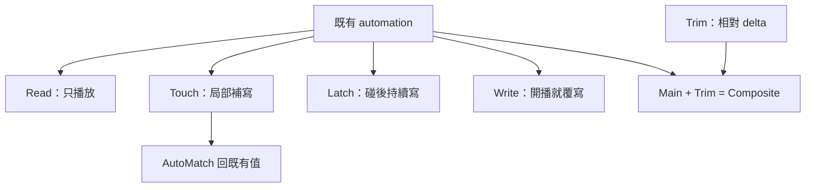

# Ch53a — Automation模式與資料層

> Automation 把控制變化記成時間資料；先弄清讀取、寫入與修改層級，才能避免一按播放就覆蓋原混音。

原文：[[Pro_Tools_Reference_Guide_2023.3.pdf#page=1221|Chapter 53，原書 p. 1189–1201／PDF p. 1221–1233]]。內容依 **2023.3** 文件消化重組；下文未標為原書數值的練習情境與圖解均為筆記補充。

## Automation Playlist 不等於 Audio Playlist

每個可 automation 的參數都有自己的 automation playlist，例如 Volume、Pan、Send level、Mute、Plug-In controls。Audio Track 的不同 edit playlists 共用同一套 Track automation；換一份人聲 take，不代表換了一套獨立 Volume automation。MIDI／Instrument 的多數 controller data 則隨 MIDI Clip 儲存，MIDI Mute 與部分 Audio controls 又有自己的獨立規則。

| 資料 | 主要所在層級 | 操作含意 |
|---|---|---|
| Audio edit playlist | Clip 編排 | 多份 take 可以切換 |
| Audio Track automation | Track 參數各自的 playlist | 不同 edit playlist 仍共享 |
| MIDI CC／pitch bend 等 | MIDI Clip 的 controller data | 跟隨 Clip performance |
| MIDI Mute | 獨立於一般 MIDI CC | 不直接改寫演奏 controller |
| Trim automation | 相對於 main automation 的增減 | Studio／Ultimate 的另層修整 |

> [!tip] 實務連結
> 已經寫好 lead vocal Volume automation，又想比較另一個 take，先聽每一句是否仍對應原曲線。要測完全不同的音量設計，可以 Duplicate Track，而不是只 Duplicate Playlist 就認定 automation 已隔離。

## 五個基本模式，要記的是「什麼時候開始、什麼時候停」

| Mode | 播放既有 automation | 何時寫入 | 放手後 |
|---|---|---|---|
| Off | 忽略相關 automation | 不寫 | 手動值；不是 Read |
| Read | 讀取 | 不寫 | 回到時間位置對應的值 |
| Write | 播放開始即寫 | 所有已啟用相關控制 | 繼續寫到停止，覆蓋既有資料 |
| Touch | 讀取到觸碰控制 | 按住／移動時 | 依 AutoMatch 回既有值 |
| Latch | 讀取到首次觸碰 | 觸碰後持續 | 即使放手仍寫，直到停止或 punch out |

第一次建立整體 automation 可用 Write，但它容易無意間覆蓋所有已 enabled 的參數。完成後一般切回 Touch／Latch 等局部修整模式；Mixing preferences 的 After Write Pass, Switch To 可選 Touch、Latch 或 No Change，避免下一次播放還在 Write。

Touch／Latch（Studio／Ultimate）讓 Volume 用 Touch，其他可寫控制用 Latch，適合人聲 fader 隨時回歸、而 Pan／Plug-In knob 想停留在剛調的位置。實體 touch-sensitive fader 與非觸控控制器的起寫偵測不同，不能假設滑鼠與任何 MIDI controller 都完全相同行為。

> [!warning] Write 不只寫你手碰到的那顆
> 如果全域已啟用多個 automation type，Write pass 可能覆寫那些參數的現有時間資料。開始前先在 Automation window 關掉不想寫的類型，或對 Plug-In／Output／Send 啟用 Automation Safe。

## Trim 保留形狀，另加一層相對變化

Trim mode（Studio／Ultimate）與 Read、Touch、Latch 等搭配，用相對增減值修改 Track Volume／Send level。它不是把所有 curve 換成現在 fader 的絕對值。Trim fader 與曲線以黃色顯示，常用在原本人聲 rider 已經順，只需要某個段落整體再抬一點。

| Trim 搭配 | 結果 | 適合 |
|---|---|---|
| Read Trim | 讀既有 Trim，手動可 audition、不寫 | 先試整體 offset |
| Touch Trim | 接觸時寫 delta，放手回原 Trim | 局部 offset |
| Latch Trim | 接觸後持續寫 delta | 段落性調整 |
| Write Trim | 開播即寫 Volume／Send delta | 明確的整段 trim pass |

Pan、Mute、Plug-In 不能以這裡的 real-time Trim 當成 Volume 一樣修；Write Trim 的非可 trim controls 也不會全部直接進 Write，而依原書採較保守的 Touch 行為。Coalesce 時機會決定 Trim 是否每次 pass 後合進 main curve，詳見後篇。

## Smoothing、Thinning、AutoMatch 各管一件事

Smoothing 把連續控制器動作的階梯整理成合理 ramp；Thinning 減少不必要 breakpoints，過強可能改變曲線；AutoMatch Time 則是放手或 punch out 時，回到既有值所花的時間。它們不是三種同義的「平滑」。Switched／stepped control 不一定能像 Volume 連續漸變。

| 設定 | 問題 | 判斷 |
|---|---|---|
| Smoothing | 動作記成太多細小階梯 | 觀察與聽連續變化 |
| Thinning | 點太密、效率不佳 | 比較減點後是否保留重要轉折 |
| AutoMatch Time | 回原曲線太突然或拖太久 | 以局部修整的銜接決定 |
| Automation Follows Edit | 搬 Audio 是否帶 automation | 依段落編排或固定場景需要選 |

## 顯示與操作焦點

從 Track View selector 選 Volume／Pan 等，或在原 Track 下開 Automation Lane。Lane 可新增、移除、改順序與高度，讓 Audio waveform 和多種參數一起看。橘色的 Track View／Lane name 提示該參數含 automation；Command-click lane 名稱可對應 suspend 控制。

Studio／Ultimate 可顯示 Trim Playlist 與 Composite Playlist。Composite 是 main 加 Trim（或 VCA 等貢獻）的可視結果，不能直接在那條合成顯示上任意編輯。要改原曲線，回到對應 main／Trim playlist。

![[PT-Ch53-automation-modes.png]]

> [!abstract] Takeaway
> Audio playlists 共用 Track automation，別把換 take 當成換曲線。Mode 的核心是起寫與停寫條件：Write 最容易覆蓋，Touch 放手回去，Latch 繼續寫。Trim 保留主曲線形狀，Composite 只是結果顯示。

## 相關

%% PT-NAV-BEGIN %%

上一篇：[[PT-Ch52-DSPMode與低延遲錄音]]

下一篇：[[PT-Ch53b-Automation錄寫與保護]]

按任務閱讀：[[PT-00-工作流程導航]]

%% PT-NAV-END %%

同章分篇：[[PT-Ch53b-Automation錄寫與保護]] · [[PT-Ch53c-Breakpoint編輯與Trim整合]] · [[PT-Ch53d-WriteTo快照與Preview工作流]] · [[PT-Ch53e-VCAAutomation與Coalesce]]

跨章延伸：[[PT-Ch50a-混音Track與訊號流]] · [[PT-Ch44a-ClipGain與音量整理]]

[[PT-00-索引]] · [[PT-00-快速檢索]] · [[PT-00-功能目錄]] · [[PT-00-Mac快捷鍵]]

標籤： #pro-tools #audio #workflow
