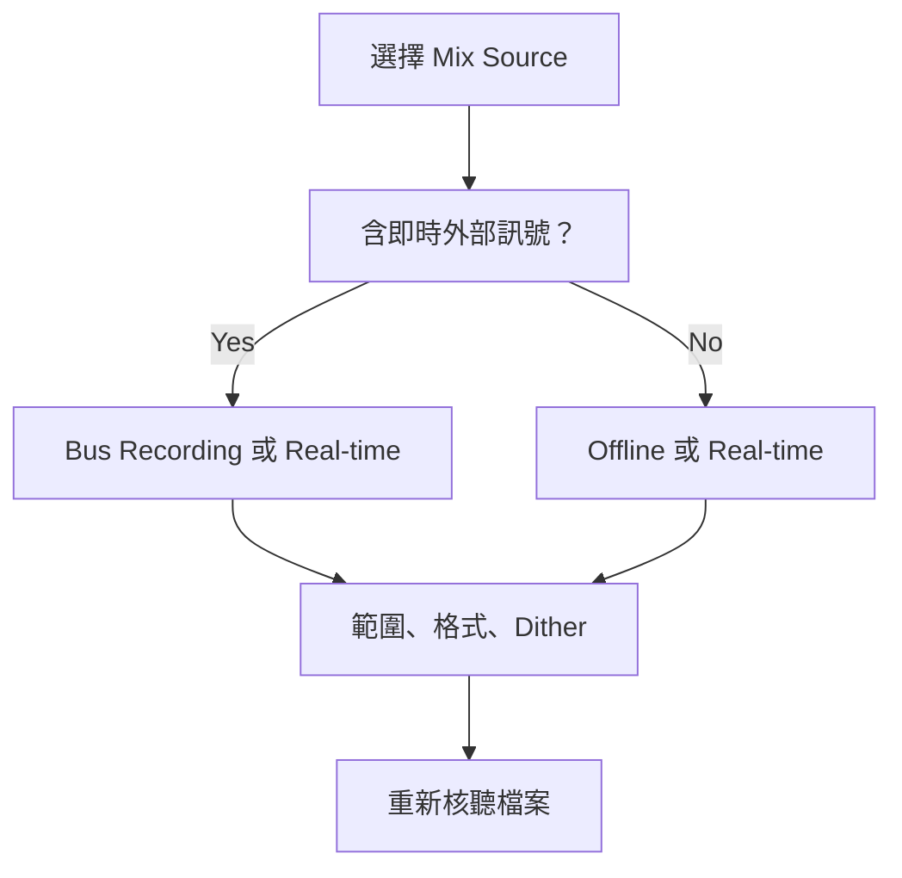

# Ch54 — Mixdown與交付檔案

> 把混音交出去以前，先決定要錄下哪條訊號、哪段時間，以及哪些處理必須留在檔案裡。

來源：[[Pro_Tools_Reference_Guide_2023.3.pdf#page=1281|原書 p. 1249–1263／PDF p. 1281–1295]]。內容以 2023.3 為準；工程情境與自繪圖為本筆記的教學補充。

## 先選路徑，再選檔案格式

Mixdown 不是按一個 Export 就完成。Pro Tools 有兩條主要路線：把內部 bus 錄進新的 Audio Track，或用 `File > Bounce Mix` 直接建立檔案。前者像在 Session 裡多接一台錄音機，會吃掉接收軌、voice 與 bus 的資源；後者直接寫檔，不必替輸出結果保留一組錄音軌。兩者都能做 full mix、submix、stem 或 loop，關鍵在訊號實際路過哪裡。

| 選法 | 適用情況 | 最容易漏掉的條件 |
|---|---|---|
| Bus Recording | 混音時還要手動調整、加入 live input、在 Session 保留 print | 來源播放和目的錄音都要有足夠 voice |
| Real-time Bounce | 要邊聽邊輸出，路徑含可即時使用的外部硬體 | Bounce 期間不能手動改 mixer 控制 |
| Offline Bounce | 內部處理完成，希望加快交付 | 外部 Audio、MIDI 硬體與外部同步來源不會自動被錄進去 |

> [!tip] 實務連結
> 掛了外接 compressor 的 master chain，不能只因 Offline 比較快就勾它。先決定要即時 Bounce，或先把硬體回路 print 成檔案，再用這份 print 製作其他格式。這是 Ch51 Hardware Insert 的交付延伸。

## Bus Recording：把輸出真的接回錄音軌

先把要納入的來源與效果準備好，讓各來源的主輸出送到同一條命名清楚的 bus；建立相同寬度的 Audio Track，把 Input 指到這條 bus，Output 指向監聽主輸出。避免把 print 軌輸出又送回自己的 Input bus，否則形成回授。

1. 關閉 Loop Record，確認來源的 Pan 與 Plug-In 狀態。
2. 建立目的 Audio Track，配置 Input／Output；Stereo 目的軌的左右 Pan 依手冊設為兩端。
3. 開啟 `Options > Link Timeline and Edit Selection`，框出要錄的範圍。
4. 尾端多留足以容納 reverb tail、delay 的時間。
5. Record-enable 目的軌，在 Transport 按 Record 與 Play。
6. 錄完核聽，再以 `Export Clips as Files` 產生所需檔案。

有選取範圍時，錄音依範圍 punch in／out；沒選範圍則從 playback cursor 起錄，直到手動停止。不要把「畫面上所有素材播完」當成效果尾音一定錄完整的保證。

## Bounce Mix：理解 Mix Source 才不會漏軌

Bounce 包含送往指定來源路徑、當下可聽的 Track、read-enabled Automation、active Insert 與 Send。Mute 的軌不進結果；Solo 狀態也會改變聽到與輸出的內容。手冊明確指出，Record-enabled 或處於 Input Only monitoring 的 Track 不包含在 Bounce 裡。

| Mix Source 類型 | 取到什麼 | 常見用途 |
|---|---|---|
| Bus | 指定 internal mix bus 內的訊號 | 特定音樂／對白 stem |
| Output | 指定 output bus 的訊號 | Main Mix |
| Physical Output | 映射到該實體輸出的所有 output path | 處理重疊的 output mapping |

操作時先選 Timeline 範圍，再 `File > Bounce Mix`，選 Mix Source，最後才決定格式。也可在 Track Output 或 Send Path selector 上右鍵，選 `Bounce <path>`，讓對話框預先填入該路徑。Bounce 檔案帶 timestamp，並補償 bus／Plug-In delay，方便回到原時間位置核對。

> [!warning] 多來源上限的文件不一致
> 原書 p.1257 文字寫可同時 Bounce 24 個 source，但同頁步驟寫「up to 16 simultaneous Mix Sources」。這份筆記保留矛盾，不替文件猜答案；實作請以你的 2023.3 版本對話框與授權可新增數目確認。多來源 Bounce 屬 Studio／Ultimate。

## 格式、解析度、資料夾：把交付規格變成明確設定

| 設定 | 代表什麼 | 實務判斷 |
|---|---|---|
| WAV／AIFF | 未壓縮 Audio 檔案容器 | 工作交換常用；先依收件規格決定 |
| WAV Dolby Atmos ADM BWF | Audio 加 Atmos metadata | 不是普通 Stereo WAV，見 Ch58 |
| M4A | AAC 壓縮，手冊限制 44.1／48 kHz | 小檔分享版本 |
| MP3／Add MP3 | MP3 或同時附加 MP3 | 先保留需要的高解析母檔 |
| MXF OP-Atom | 每個檔案一個 Audio channel | Studio／Ultimate；強制 Multiple Mono 與 Pad to Frame Boundary |
| MOV | 可帶 Video 與 Audio | Session 有 Video 才可選，見 Ch63 |

Mono (Summed) 會把來源相加成 Mono，必須重新聽與看 meter；Multiple Mono 分成各 channel 的單獨檔案，Stereo 會有 `.L`／`.R`；Interleaved 把多個 channel 裝在同一檔案。Studio／Ultimate 可把多個 stem 裝進單一 Interleaved WAV BWF：設定多個 Mix Source、WAV BWF、Interleaved、Delivery Format = Single File。其 channel 排序依 source 清單上到下，並帶 iXML stem/channel 定義；不等於把 stem 全部混成 Stereo。

`Import After Bounce` 只有在輸出 sample rate 與 Session 相同，且目標 resolution 不高於 Session 時可用。`Pad to Frame Boundary` 向兩端 frame 邊界補齊，給 NLE 準確定位。Location 可選 Session Folder、Prompt for Location、Directory；Mac 子資料夾可寫 `Mixes/MP3s`。

## Dither：在真正降低 bit depth 的最後一步處理

Bounce Mix 降 bit depth 時**不會自動加 dither**。需要時，把 Dither Plug-In 放在控制 Mix Source 的 Master Fader 最後一格；Master Fader Insert 是 post-fader，能處理經過主推桿變動的訊號。放在 Aux 最後，不代表整條鏈之後沒有音量變化。

| 情境 | 本章手冊建議 |
|---|---|
| 交付 16-bit | Main output 最後使用 dither；即使 Session 原本 16-bit 亦然 |
| 同 Session 內 bus-record submix | 目的錄音軌不加 dither |
| 交付 24-bit | 依本章建議不在 Main output 加 dither |
| 24-bit capable interface 送 analog | 不加 Main output dither |
| 一般錄音與播放 | bypass Main output dither |

原因是檔案位元深度不等於內部運算精度。本章說明 Pro Tools mixing／processing 使用更高的內部精度；最後輸出較低 resolution 才是要評估量化的地方。同時要做 sample rate conversion 與 bit depth reduction 時，手冊建議先維持較高 bit depth 做 sample rate conversion，再在降低 bit depth 時加 dither。

## 最後檢查與重用設定

Offline 速度受 CPU、disk bandwidth、mixer 複雜度、各 core 負載與 Plug-In 影響，不保證永遠更快。HEAT 可含於 Offline Bounce；DSP Plug-In 需有 Native 對應版本，DSP-only 不會神奇變成離線可用。

Bounce 有 5 顆 quick preset：Mac `Command-click` 寫入，點擊或 `Control+1–5` 叫出。具名 `.ptpreset` 可保存更多組，預設在 Documents/Pro Tools/Pro Tools Settings/Bounce；不包含 File Name，且路徑必須在目前電腦存在才可重用。最後核對名稱、範圍、尾音、Solo／Mute、Mix Source、sample rate／bit depth、存檔位置；然後重新播放交付檔案。高平均能量的壓縮素材相加容易讓 master 超出 full scale，不能只看每軌都沒紅燈。

> [!abstract] Takeaway
> Mixdown 的本質是指定訊號、時間範圍與交付格式。需要即時來源就用可實際捕捉它的路線；純內部混音才適合 Offline。Dither 不由 Bounce Mix 自動完成，輸出後也一定要核聽。

## 觀念圖

![[PT-Ch54-concept.png]]

圖為本筆記依原文觀念自繪的示意，不是官方接線圖或產品畫面。

## 相關

%% PT-NAV-BEGIN %%

上一篇：[[PT-Ch53e-VCAAutomation與Coalesce]]

下一篇：[[PT-Ch55-Surround設定與Channel順序]]

按任務閱讀：[[PT-00-工作流程導航]]

%% PT-NAV-END %%

[[PT-00-功能目錄#Ch53 — Automation]] · [[PT-00-版本與原文疑義]]

[[PT-00-索引]] · [[PT-00-功能目錄]] · [[PT-00-Mac快捷鍵]]

[[PT-00-功能目錄#Ch55 — Pro Tools Setup for Surround]]

標籤： #pro-tools #audio #study-note
