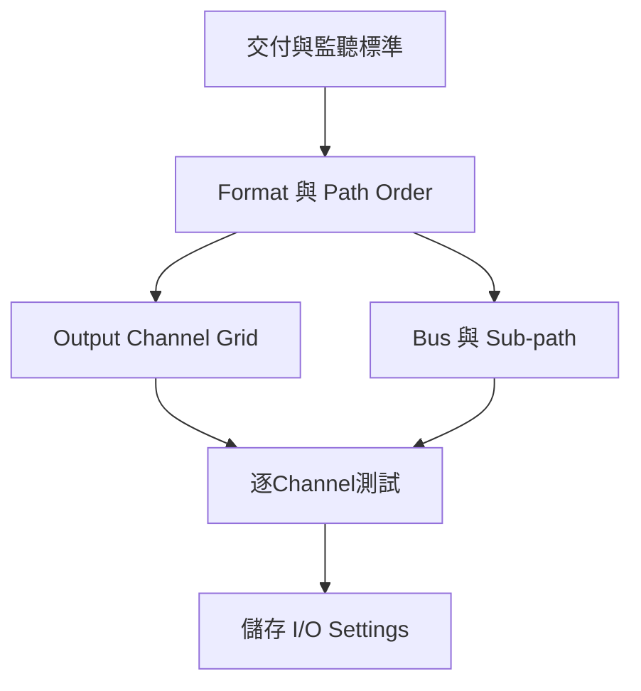

# Ch55 — Surround設定與Channel順序

> Surround 最容易出錯的地方，是畫面中的 channel 順序、實體接線與交付標準看起來很像，實際上卻不是同一層。

來源：[[Pro_Tools_Reference_Guide_2023.3.pdf#page=1299|原書 p. 1267–1275／PDF p. 1299–1307]]。內容以 2023.3 為準；工程情境與自繪圖為本筆記的教學補充。

## 先建立「幾個聲道、送哪個喇叭」的地圖

2023.3 的 Surround mixing 屬 Pro Tools Studio／Ultimate。除了 LCR、Quad、LCRS、5.0／5.1、6.0／6.1、7.0／7.1 與 SDDS，Atmos 工作流程還有 7.0.2／7.1.2。這些名稱決定 Track 與 path 裡有幾條離散訊號，不只是套用某個效果的名字。

例如 5.1 有 Left、Center、Right、Left Surround、Right Surround 與 LFE；7.1 一般配置再把側面和後方分開。SDDS 7.1 則是五個前方聲道，加兩個 Surround 與 LFE。兩者都有八個 channel，配置卻不同，所以不能只靠 channel count 判斷可互換。

| 格式 | 前方 | Surround／後方 | 其他 |
|---|---|---|---|
| 5.1 | L、C、R | Ls、Rs | LFE |
| 7.1 | L、C、R | Lss、Rss、Lsr、Rsr | LFE |
| 7.1 SDDS | L、Lc、C、Rc、R | Ls、Rs | LFE |
| 7.1.2 | L、C、R | Lss、Rss、Lsr、Rsr | LFE、Lts、Rts |

> [!tip] 實務連結
> 接手別間錄音室的 8-channel 檔案時，先問它是 7.1、7.1 SDDS 還是另一種排列。把檔案直接送進八個硬體輸出，不能保證對白仍在 Center。

## Track layout 與 Path Order 要分開看

Pro Tools 的 5.1 Track 與畫面 meter 固定使用 Film layout：`L C R Ls Rs LFE`。I/O Setup 可以把這些訊號重新映射到實體輸出，對應不同設備標準。改 Path Order 不會把 Edit Window 中六條 waveform 換位置，也不會改畫面 meter 的順序。

| 5.1 排列 | Channel 1→6 | 你要核對的地方 |
|---|---|---|
| Film／Pro Tools 畫面 | L C R Ls Rs LFE | waveform 與 meter 的解讀 |
| SMPTE／ITU | L R C LFE Ls Rs | 設備 input 與實體 output mapping |
| DTS | L R Ls Rs C LFE | 對方交付與監聽規格 |

7.1.2 的 Film 排列是 `L C R Lss Rss Lsr Rsr LFE Lts Rts`；SMPTE 排列是 `L R C LFE Lss Rss Lsr Rsr Lts Rts`。7.0.2 沒有 LFE，不要把原書為顯示位置而使用的空格或破折號誤當成第十條實際訊號。

> [!warning] 耳朵與畫面都要驗證
> 設定完成後，用可辨識的逐 channel 測試訊號確認「這條訊號實際從哪顆喇叭出來」。這是根據原書 mapping 原則延伸的工程檢查；不是只看 Film/SMPTE 字樣就宣告接線正確。

## 新建 Session 與改裝既有 Session

新建時，在 `File > New Session` 選 Create Blank Session，設定 Audio File Type、Sample Rate、Bit Depth，再從 I/O Settings 選合適的 5.1 設定。手冊列有 5.1 Film Mix、SMPTE/ITU、DTS Monitoring、C24、ICON X-MON 等設定；這些是起點，仍要檢查目前硬體。

既有 Stereo Session 不必重錄才能進入 Surround。可在 `Setup > I/O` 匯入 `.pio`，或 `File > Import > Session Data`帶入 Track 與相關路徑，再把原本 Stereo 的路由改成需要的 Multichannel 路徑。

| 方法 | 得到什麼 | 要注意什麼 |
|---|---|---|
| 新 Session 選 I/O Settings | 初始 Output／Bus 配置 | Input／Insert 仍可能只有 Stereo／Mono 預設 |
| Import Settings | 加入或取代現有 path 定義 | 對話框問是否刪既有 path 時，不要隨手確認 |
| Import Session Data | Track、media 及相關 assignment | 匯入後仍需整理 main／sub-path |
| 自建 New Path | 精準符合硬體與工作流程 | Channel Grid 與 Bus mapping 必須都完成 |

匯入 `.pio` 的流程是到 Output 頁選 Import Settings，決定保留或取代既有配置，再到 Bus 頁核對 output mapping。必要時可對 Output Busses 或 All Busses 按 Default，但這是會重新建立配置的動作，先理解自己的既有路由。完成後用 Export Settings 另存，建立不同監聽／交付環境的設定庫。

## Main path與Sub-path：一條大路裡的分支

例如建立 LCRS main path，可再建立 LCR、front Stereo、Center Mono 與 Surround Mono sub-path。Main path 讓需要移動的素材在完整聲場中 Pan；sub-path 讓固定位置的素材直接抵達指定 channel。到 I/O Setup 的 Channel Grid 點選起始硬體 channel，Pro Tools 會填入該格式的相鄰 channel；仍可拖曳 channel assignment 重新配置。

這裡延伸 Ch06 的概念：**Output path 描述通往設備的路，Bus 描述 Session 內部的集合與指派。**改好 Output 頁，不代表 Bus 頁已自動完成所有映射。Ch56 會把這件事接到實際 Track、Aux 與 Stem。

## 常用I/O預設的用途

| 選項 | 作用 | 常見誤會 |
|---|---|---|
| Default Format／Path Order | 新 Output path 的格式／排列 | 不會替現有畫面 meter 重排序 |
| Monitor Path | Session 主混音監聽路徑 | 不等於所有 preview 都跟著走 |
| Audition Path | Clips List、Import Audio 與 Workspace 預聽 | 只用 primary interface 的 outputs |
| Object Fold Down Path | 無 Renderer 時監聽 Object 粗略 fold-down | 不是正式 Atmos render |
| Output Meter Path | Transport 與控制面輸出 meter 顯示路徑 | 顯示路徑與聽見的路徑可不同 |
| Default Output Bus | 新 Track 各格式的預設 output bus | 可以是 bus，不限 physical output |
| AFL/PFL Path | AFL／PFL Solo 路由 | 手冊限 HDX／HD Native |

> [!note] 文件的年代
> 原書提到 Surround Mixer Plug-In 必須位於 Plug-Ins 資料夾，並可能從 Unused 移入。這是 2023.3 文件中的架構說明；不要據此推定任何其他版本的安裝狀況。

> [!abstract] Takeaway
> 先確認格式，再確認排列，最後確認實體聲音。Track／meter 順序、I/O Path Order 與硬體接線各自負責不同層；把這三層對齊，Surround Session 才有可靠地基。

## 觀念圖

![[PT-Ch55-concept.png]]

圖為本筆記依原文觀念自繪的示意，不是官方接線圖或產品畫面。

## 相關

%% PT-NAV-BEGIN %%

上一篇：[[PT-Ch54-Mixdown與交付檔案]]

下一篇：[[PT-Ch56-Multichannel路由與Stem]]

按任務閱讀：[[PT-00-工作流程導航]]

%% PT-NAV-END %%

[[PT-00-索引]] · [[PT-00-功能目錄]] · [[PT-00-Mac快捷鍵]]

[[PT-00-功能目錄#Ch54 — Mixdown]]

[[PT-00-功能目錄#Ch56 — Multichannel Tracks and Signal Routing]]

標籤： #pro-tools #audio #study-note
