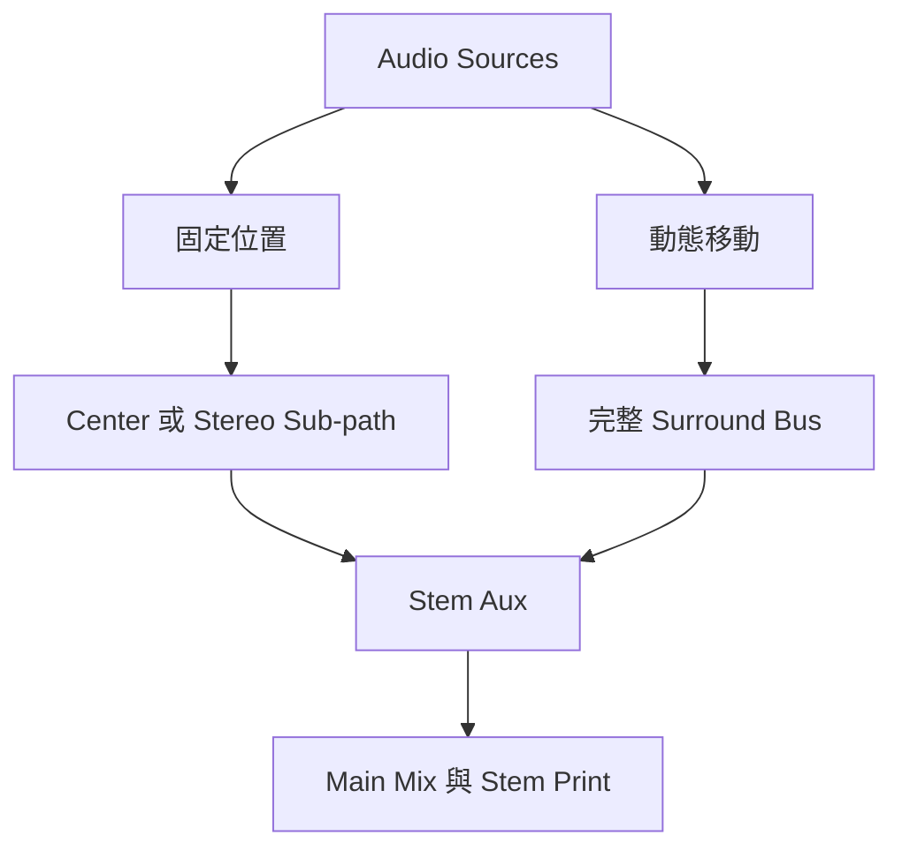

# Ch56 — Multichannel路由與Stem

> Multichannel 混音的核心，是讓需要移動的聲音有完整 panner，讓固定聲音走簡單路徑，並保留可獨立交付的 stem。

來源：[[Pro_Tools_Reference_Guide_2023.3.pdf#page=1309|原書 p. 1277–1289／PDF p. 1309–1321]]。內容以 2023.3 為準；工程情境與自繪圖為本筆記的教學補充。

## Track寬度和Output寬度不是同一件事

5.1 Audio Track 含六條離散訊號，但一條 Mono Audio Track 也能送到 5.1 bus，再由 Surround Panner 決定如何分配。反過來，畫面 meter 數量通常反映 Track 本身的 channel，而非所有輸出喇叭數。這是 Ch55 設定好 I/O 之後，真正建立混音時首先要釐清的關係。

| 物件 | 描述 | 範例 |
|---|---|---|
| Track format | 軌內實際 Audio channel 數 | Mono 收音仍是一條訊號 |
| Output path format | 目的地的 channel 配置 | Mono Track 可以送 5.1 |
| Send format | 額外平行送出的目的地 | Mono 對白另送 Multichannel reverb |
| Panner | 從軌訊號分配到 Output 的控制 | 改 Output 格式時介面也會改 |

同一軌有多個不同格式 Output 時，主 panner 依最寬的 path 呈現，Pro Tools 再為其他格式解讀 Pan 資料。這可以同時做多種格式的平行混音，但結果仍需各別核聽。縮窄 Output 格式可能刪掉不再適用的 Pan Automation playlist，原書因此會跳警告；要改格式前先保存可回溯版本。

## 把素材放進Multichannel Track之前

從 Clips List、Workspace、Finder 或其他 Track 拖入時，channel 數必須符合目的 Track 格式。LCR 需要三個，5.1 需要六個；5.1 畫面內部仍是 Film 順序 `L C R Ls Rs LFE`。Clips List 的 Timeline Drop Order 若為 Top to Bottom，拖入順序就依當時清單從上到下，不會因你心中想的是 L/R/C 就自動重排。

| 任務 | 方法 | 代價／限制 |
|---|---|---|
| 每 channel 獨立編輯 | `Track > Split Into Mono` | 無直接一鍵還原原本 Multichannel Track；重新組裝可能失去部分 Automation |
| 只改個別 channel gain／polarity | 插入 Multi-Mono Trim 並 Unlink | 保留 Track 整體結構，參數須選對 channel |
| 合併 Mono 檔案到 Multichannel Track | 依正確 suffix／清單順序拖入 | channel 數、順序、時間需匹配 |
| 隱藏不常用的新建格式 | Channel Show/Hide | 只過濾新增選單，不會讓既有 Track 消失 |

> [!tip] 實務連結
> 若只是左後方比右後方大聲，先用 Unlinked Multi-Mono Trim 修正。為了一個 gain 數值就把整軌拆開，後續管理與 Automation 更容易出錯。

## Multi-Mono與Multichannel Plug-In：連動旋鈕不代表連動偵測

Multi-Mono 是各 channel 各自處理，可把控制值連在一起；Multichannel Plug-In 則可做跨 channel 相關的處理，例如保留聲像穩定的 linked dynamics。兩者不能只看「同時插六個 channel」就當成一樣。

Multi-Mono 最初通常 Master Link 開啟，改一個 Gain 會一起改全部。要只讓 Ls／Rs 共用 EQ，關 Master Link，再勾兩個 channel 的 Link Enable。Channel selector 選你現在編輯哪個 channel；Mac `Option-click`該 selector 可開全部 channel 的 Plug-In 視窗。

| 要求 | 優先選擇 | 為什麼 |
|---|---|---|
| 各喇叭獨立修 EQ | Multi-Mono | 各 channel 可以不同 |
| 多 channel 相關的 Dynamics | 支援該格式的 Multichannel Plug-In | 由 Plug-In 設計處理 channel 關係 |
| Plug-In 沒原生 Multichannel 版 | 可用的 Multi-Mono 版本 | 仍需核對運作是否適合素材 |
| LFE 要旁通 Dynamics | 支援 LFE Enable 的版本 | 不要假定所有 Plug-In 都同樣處理 LFE |

## 用Sub-path建立穩定的聲場骨架

不是所有聲音都應持續在房間裡飛。原書建議固定元素走 sub-path，需要動態空間移動才指向完整 Multichannel path。例如對白固定 Center；front music 用 Stereo L/R；後方環境可送 Ls/Rs；jet fly-over 才送完整 5.1 做前後移動。這讓混音意圖、操作負擔與資源使用一致。

| Sub-path | 適合放什麼 | 工程意義 |
|---|---|---|
| Center Mono | 固定對白 | 直接保持畫面定位 |
| LCR | 前方為主的對白／效果 | 保留三個前方 channel |
| Front Stereo | 音樂／前方效果 | 避免不必要的 Surround panner |
| Ls/Rs Stereo | 後方效果 | 獨立管理 rear 內容 |
| 5.0 | 不進 LFE 的整體混音 | 將 LFE 需求分開決定 |
| LFE Mono | 特意設計的低頻效果 | 明確指定離散 LFE 內容 |

把 FX sources 各自送 FX bus，由 5.1 Auxiliary Input 當 submixer，再形成 FX stem；Music 也可有自己的 5.1 Aux 和 stem。Aux 提供獨立的 fader、mute、solo 與 Automation；Master Fader 控制已存在 path 的總電平，並不是另一個需要設定 Input 的回送軌。Main 與其 sub-path 的 Master Fader 指派也有互斥條件，不能以為每個階層都能任意再掛一個 Master Fader。

## LFE沒有自動low-pass

LFE 可透過 Output Window 裡的 post-fader LFE fader 加入，也可由自訂 Mono LFE sub-path 直接送入。**Pro Tools 不會自動對 LFE 訊號濾波**；交付若要求頻帶限制，必須自己以適當處理完成。LFE 也不能等同喇叭系統的 bass management。

> [!warning] 有低音不等於一定要送 LFE
> LFE 是分開的一條內容路徑。先決定聲音在主聲道的角色，再決定是否另有 LFE 用途；不要把整個 mix 無條件複製過去。

## Flexible Track Routing：可接上，仍要知道如何改變

Track Output 與 Send 可送往不同 channel width；較寬變窄會 Fold Down，較窄變寬會 Fan Out，係數由 Mixing Preferences 的 Routing Coefficients 決定。這不代表所有連接都能不匹配：Track Input、Object assignment 與 Hardware Insert 仍要求 channel width 相符。

Assignment 旁的`>`代表 Fold Down、`<`代表 Fan Out。出現在名稱左邊表示 Track／Send 內部路由層；右邊表示 bus 到 Output 層；兩邊都有代表兩層都轉換。開到 Pro Tools 2021.7 或更早版時，這些不匹配指派會被移除；使用 Modern Fold Down coefficients 的工程也有更早版本相容性限制。

> [!abstract] Takeaway
> 先用 main／sub-path 把工作意圖分清楚，再加 panning。Multi-Mono 的參數連動、Multichannel 的相關處理、Flexible Routing 的格式轉換，是三件不同的事；不要讓「能接通」取代核聽。

## 觀念圖

![[PT-Ch56-concept.png]]

圖為本筆記依原文觀念自繪的示意，不是官方接線圖或產品畫面。

## 相關

%% PT-NAV-BEGIN %%

上一篇：[[PT-Ch55-Surround設定與Channel順序]]

下一篇：[[PT-Ch57-SurroundPanner與移動聲像]]

按任務閱讀：[[PT-00-工作流程導航]]

%% PT-NAV-END %%

[[PT-00-索引]] · [[PT-00-功能目錄]] · [[PT-00-Mac快捷鍵]]

[[PT-00-功能目錄#Ch55 — Pro Tools Setup for Surround]]

[[PT-00-功能目錄#Ch57 — Surround Panning and Mixing]]

標籤： #pro-tools #audio #study-note
