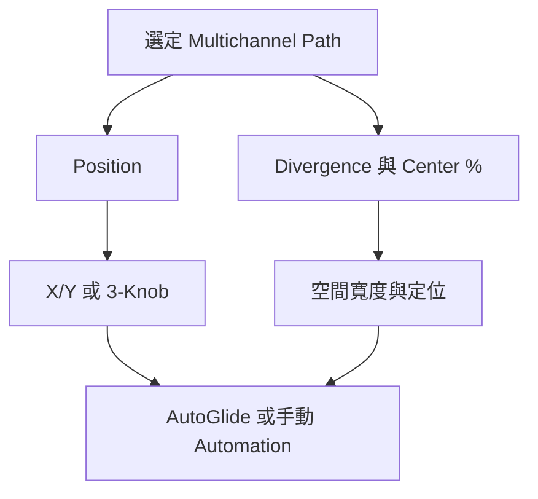

# Ch57 — SurroundPanner與移動聲像

> Surround Panner 不只決定聲音在哪裡，也決定它會集中在一顆喇叭，還是散到附近的 channel。

來源：[[Pro_Tools_Reference_Guide_2023.3.pdf#page=1323|原書 p. 1291–1302／PDF p. 1323–1334]]。內容以 2023.3 為準；工程情境與自繪圖為本筆記的教學補充。

## 路由先對，panner才有意義

先把 Track Output 或 Send 指到正確 Multichannel path，才會出現對應的 Surround Panner。Edit Window 需顯示 I/O View；Mix Window 的支援 Track 也會顯示縮小的 Panner Grid。按 Output selector 旁的小 fader 按鈕，可開完整 Output Window，看到較大的 Grid、位置、Divergence 與 LFE 控制。

這延續 Ch56 的思路：固定 Center 的對白不一定需要完整 5.1 panner；只有需要在整個聲場分配的元素，才把控制範圍打開。多開幾個 Output Window 能比較不同元素，但必須確認 Target 與 Track selector，不要誤寫另一軌的 Automation。

## Pan Location、Divergence、Center %各管一件事

| 控制 | 改什麼 | 直覺 |
|---|---|---|
| Front／Rear Position | 前方／後方各自的左右位置 | 直線軌跡兩端在哪裡 |
| F/R Position | 前後位置 | 現在沿軌跡走到哪裡 |
| Front/Rear Linking | 前後左右位置是否連動 | 解開才可設定斜向不同端點 |
| Divergence | 與鄰近喇叭的分配寬度 | 集中一點，或散到鄰居 |
| Center % | discrete Center 與 phantom center 比例 | 對白喇叭要接多少這個元素 |
| Side % | 7.0／7.1 的 discrete／phantom side 比例 | 側面定位如何建立 |
| LFE fader | 送 LFE 的量 | 不受 Pan 點位置自動替你決定 |

Divergence 預設 100%。此時 Pan 到某一顆 speaker，訊號可以只在該 speaker 出現；降低 Divergence，訊號會向鄰近 speaker 展開。它的百分比方向和不少人以為的「100%=最寬」相反。Front、Rear、Front/Rear 可分別控制並 Automation。

Center %=0 讓前方以 L/R 建立 phantom center，不送 discrete Center。若對白在 Center，降低 music 的 Center %，可讓兩者的空間分工清楚；但這是安排聲場的方法，不是把任何頻率或相位問題一次解完的按鈕。

> [!tip] 實務連結
> 做預告片時，可以先讓對白固定 Center、music 在 front L/R 形成 phantom center，再挑少數特效做前後移動。每個元素都不停繞場，注意力反而沒有焦點。

## 四種Panning Mode怎麼選

| Mode | 操作方式 | 適合情境 |
|---|---|---|
| X/Y | 在完整 Grid 拖 Pan Location | 自由探索聲場位置 |
| 3-Knob | 先定 Front／Rear 端點，再以 F/R 沿軌跡移動 | 要控制兩端 speaker 間的路徑 |
| Divergence Editing | 直接拖 Grid 中的分布邊界 | 視覺調整寬度 |
| AutoGlide | 點目標，由系統在指定時間滑過去 | 快速寫 point-to-point Automation |

X/Y 中拖對角線，不一定只經過兩顆端點 speaker，可能有其他 channel 一起參與；3-Knob 在 full divergence 條件下，能以兩端 speaker 間的離散分配建立軌跡。不要只看畫面都是一條斜線，就推定訊號分配一樣。

3-Knob 流程：按 Panning Mode 切到 3-Knob，設定 Front 與 Rear Position，再轉 F/R 沿白色軌跡移動；拖端點改角度，拖整條軌跡改位置並保留角度。X/Y 預設 Rear 與 Front 連動，要不同前後端點則解開 Front/Rear Linking。

## AutoGlide：讓動作有可控制的時間

到 `Setup > Preferences > Mixing` 的 Automation 區設定 AutoGlide Time，手冊範圍 10–10000 ms。開 Output Window 選 AutoGlide，把 Track 設為合適的 Automation 寫入模式，播放後點 speaker 圖示或 Grid 的新目的地。Pan 點會在設定時間內滑至目的地，抵達時寫入 breakpoint；再點下一個位置，就形成下一段動作。

> [!warning] 別把 Automation 模式留在背景
> AutoGlide 寫入時不能靠拖 Pan 點自由改軌跡；你是在指定目的地與滑行時間。若 Track 沒有進合適寫入模式，點了畫面不代表這段動作已經成為可重播的 Automation。

## 用顏色看狀態，用快捷鍵精確操作

| Pan 點顏色 | 狀態 | 看見它後先想什麼 |
|---|---|---|
| Green | Automation Read | 正在讀既有資料 |
| Red | Write／Touch／Latch／Touch-Latch | 可能寫入或覆寫資料 |
| Yellow | Off／Suspend | 不依一般 Read 行為播放 |

| Mac 操作 | 結果 | 條件 |
|---|---|---|
| `Command`配合調整 | Fine adjustment | Panner 控制 |
| `Shift-drag` | 限制 X 或 Y 軸 | Pan Location |
| `Option-click` Grid | 回預設 | 會重設 Panner 控制 |
| `Command+Shift-click` Grid | Snap 到該位置 | X/Y 模式 |
| 點 speaker 圖示 | Snap Pan to Speaker | 與 Atmos Speaker Snap 概念不同 |

Stereo Track 送 Multichannel output 會有左右兩套 Panner。預設 Link、Front Inverse、Rear Inverse 開啟，而 Front/Rear Inverse 預設未連動；這些控制影響左右兩端如何跟隨，適合保留或改變 Stereo 寬度。調其中一端前，先看 Link 狀態，不要把另一端的移動當成軟體 bug。

LFE fader 可跟 Mix／Edit Groups；支援的 Multichannel Plug-In 有 LFE Enable，決定 LFE 要不要進該處理。這與送多少 LFE、是否需要 low-pass 是不同問題。Pan 各位置與 Divergence 都有各自 Automation playlist，後續可以在 Edit Window 畫、剪、複製，接回 Ch53 的 Automation 技術。

> [!abstract] Takeaway
> Position 管位置，Divergence 管鄰近分布，Center／Side %管 discrete 與 phantom，LFE 是獨立的量。選對模式後，先確認 Automation 狀態，再寫動作。

## 觀念圖

![[PT-Ch57-concept.png]]

圖為本筆記依原文觀念自繪的示意，不是官方接線圖或產品畫面。

## 相關

%% PT-NAV-BEGIN %%

上一篇：[[PT-Ch56-Multichannel路由與Stem]]

下一篇：[[PT-Ch58a-DolbyAtmos架構與Renderer連接]]

按任務閱讀：[[PT-00-工作流程導航]]

%% PT-NAV-END %%

[[PT-00-索引]] · [[PT-00-功能目錄]] · [[PT-00-Mac快捷鍵]]

[[PT-00-功能目錄#Ch56 — Multichannel Tracks and Signal Routing]]

[[PT-00-功能目錄#Ch58 — Mixing to Dolby Atmos]]

標籤： #pro-tools #audio #study-note
