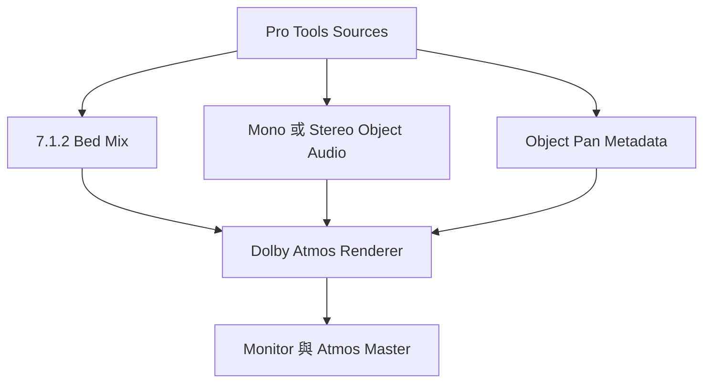

# Ch58a — DolbyAtmos架構與Renderer連接

> Dolby Atmos 把「聲音」與「聲音應該出現的位置」分開傳送，Renderer 才是把它們轉成實際監聽結果的核心。

來源：[[Pro_Tools_Reference_Guide_2023.3.pdf#page=1335|原書 p. 1303–1314／PDF p. 1335–1346]]。內容以 2023.3 為準；工程情境與自繪圖為本筆記的教學補充。

## Bed、Object、Metadata先分清楚

這份 2023.3 手冊的流程，是 Pro Tools Studio／Ultimate 搭配 Dolby Atmos Renderer，**不是後來版本的內建 Renderer 教學**。Renderer 可以是 RMU、rendering/mastering workstation，或 Dolby Atmos Production Suite 中的軟體。讀到 Renderer 時，要先知道自己接的是哪一種，不能把不同架構的設定混用。

| 元素 | Pro Tools 送出什麼 | 誰負責空間分配 |
|---|---|---|
| Bed Audio | 已經混為 channel-based 的 premix／stem | Pro Tools 先做 Multichannel Pan，再串流給 Renderer |
| Object Audio | 個別 Mono／Stereo 音訊來源 | Renderer 依對應 metadata 分配 |
| Dolby Atmos Metadata | Object 位置、Pan 與其他控制資料 | Renderer 解讀並套用 |

7.1.2 的`.2`是額外的兩個 overhead channel，不是「兩顆 Object」。Bed 可以包含 music、Foley、dialog 等基礎；Object 也不限飛機或蚊子，任何需要獨立空間控制的來源都可使用。Bed 不是低階版 Object，兩者負責不同的混音分工。

> [!tip] 實務連結
> 一片穩定包圍聽眾的 texture 可以先放 Bed；某個要越過頭頂的單獨聲音做 Object，容易維持控制。這是由架構延伸的設計例，不是必須照抄的分類法。

## Audio線與Metadata線各有工作

硬體範例裡，HDX 經 HD MADI 送 Audio 到 RMU，Ethernet 送 Dolby Atmos metadata。這兩條都成功才是完整 Object 工作流程；看到網路 Connected，不代表 Audio 已接對，看到 Audio meter，也不保證 Object metadata 正在控制它。

Mac 的 Production Suite 範例則使用 Dolby Audio Bridge：Renderer 的 Audio Input 選 Dolby Audio Bridge，Audio Output 選真正監聽設備；Pro Tools 的 Playback Engine 也選 Dolby Audio Bridge。Metadata 在 Peripherals 另建立連線。手冊說此組合 Core Audio output 可到 130 channels，input 仍為 32；這是本章特定配置的說明，不是所有 Core Audio 裝置的通則。

| 檢查層 | 要核對什麼 | 失敗可能看見什麼 |
|---|---|---|
| Playback Engine | Audio 要從哪個 driver 送出 | 沒訊號或送錯設備 |
| Renderer Audio Input／Output | 收到哪個 bridge／硬體、由哪裡監聽 | Pro Tools 有 meter 卻聽不到 |
| Peripherals > Atmos | Enable、RMU Host、連線狀態 | Object metadata 無法到 Renderer |
| I/O Bus mapping | 哪個 bus 對哪個 Renderer input | Audio 進錯 Bed 或 Object |

同機軟體 Renderer 的 RMU Host 可用`localhost`；外部 Renderer 輸入正確 IP 或選網路上正確主機。到 `Setup > Peripherals > Atmos` 啟用，成功狀態會持續亮，失敗則閃爍；即使暫未連上，也要 Enable 才能依此架構編輯相關內容。

## 在建立Session前，先確認速度與時間規格

| 條件 | 2023.3 手冊內容 | 為什麼要先決定 |
|---|---|---|
| Hardware RMU | 工作 sample rate 先轉 48kHz | 不要讓素材建立方式和主混音規格衝突 |
| 軟體 Production Suite Renderer | 可用 48 或 96kHz Session | Bridge、Buffer 與 Renderer 一起配置 |
| Home theater timecode | 23.976、24、25、29.97、29.97 DF、30fps | 確保 master 時間規格受支援 |
| Cinema master | 24fps | 24fps 時 Audio／Video Pull Up/Down 設 None |
| Core Audio 範例 Buffer | 48kHz 為 1024 samples，96kHz 為 2048 | 大型 Atmos Session 的建議，不是錄音延遲目標 |

完整 Mac 連接順序是先安裝並授權 Dolby 提供的產品、開 Renderer 設定 Core Audio 與 Audio Bridge、保持 Renderer 執行，再開 Pro Tools 選 Playback Engine、設定 Buffer、連 Peripherals，最後才做 I/O mapping。單在 Pro Tools 新增 7.1.2 Track，不會自動安裝 Dolby 軟體或讓系統具備全部 render 功能。

## Output、Bus、Renderer Input三層都要對齊

硬體基本範例把前十個 input 保留給 7.1.2 Bed，其後 11–128 給 Object，因此一個典型配置有 118 個 Mono object input。這是以單一 10-channel bed 占用前十個 input 的範例，不是任何工程都必須一 Bed 加 118 Objects。

1. Output 頁建立 7.1.2 path，確認 Path Order 符合 Renderer 需求。
2. Bus 頁建立 7.1.2 bus，Mapping to Output 接到該 path。
3. 同一列 Mapping to Renderer 指定正確 Bed input。
4. 為 Object 建立 Mono bus 與 Output，並映射到個別 Renderer object input。
5. Stereo Object 需要 Stereo bus 及其兩個 Mono sub-path，左右各對到一組相鄰 Object input；不能只把一條 Stereo path 隨意對到一個 Mono input。

手冊提供 `Use Atmos Renderer (Mono)`／`Use Atmos Renderer (Stereo)`配合 Default，讀取 Renderer 配置建立 bus。Stereo 選項會把相鄰且 group 一致的 Object 組成 Stereo；遇到奇數或兩者 group 不同，仍維持 Mono。不要先在重要 Session 刪掉所有既有 bus 測試；先保存副本，確認新配置再替換。

## Bed/Object Groups：分類名稱由誰管理

Groups 可把 Dialog、Music、Effects、Narration 等分類帶進 ADM 或用來產生 re-render。它們不是把 Audio 自動加總的 Mix Group；它們是 Renderer／Pro Tools 理解 Bed 與 Object 內容分類的 metadata。

| 管理方 | 能在哪裡編輯 | 切換時會怎樣 |
|---|---|---|
| Dolby Atmos Renderer | 在 Renderer 建立／命名／指派，Pro Tools 反映 | 切到 Pro Tools 時保留既有資料，之後 Pro Tools 改動不回寫 Renderer |
| Pro Tools | Manage Bed/Object Groups 與 Bus 頁 | 切回 Renderer 時，改以 Renderer 群組取代目前資料 |

Cinema RMU 與 Production／Mastering Suite 傳回 group／description 的能力不同，不能假定每種 Renderer 都送相同資料。依手冊，Cinema RMU 不會像另外兩套那樣傳 group list；若要把 group 帶進 ADM，應讓 Pro Tools 管理。

> [!warning] 音訊有送出，仍可能沒進 ADM
> ADM 只包含符合條件且映射到 Renderer 的 Bed／Object bus。只有 Mapping to Output 而沒有 Mapping to Renderer，不等於完成 Atmos 交付路由。下一篇會再核對 Track 端的 Bus/Object toggle。

> [!abstract] Takeaway
> 先建立 Audio、Metadata、Clock／Timecode 各自正確的連接，再逐層核對 Output→Bus→Renderer。Atmos 的名字看似新，工程原則仍是 Ch55–56 的路由思考，外加獨立的 Object 控制資料。

## 觀念圖

![[PT-Ch58-concept.png]]

圖為本筆記依原文觀念自繪的示意，不是官方接線圖或產品畫面。

## 相關

%% PT-NAV-BEGIN %%

上一篇：[[PT-Ch57-SurroundPanner與移動聲像]]

下一篇：[[PT-Ch58b-Object控制與空間Automation]]

按任務閱讀：[[PT-00-工作流程導航]]

%% PT-NAV-END %%

同章其他篇：[[PT-Ch58b-Object控制與空間Automation]] · [[PT-Ch58c-ADM交換與Atmos交付]]

[[PT-00-索引]] · [[PT-00-功能目錄]] · [[PT-00-Mac快捷鍵]]

[[PT-00-功能目錄#Ch57 — Surround Panning and Mixing]]

[[PT-00-功能目錄#Ch59 — Ambisonics]]

標籤： #pro-tools #audio #study-note
