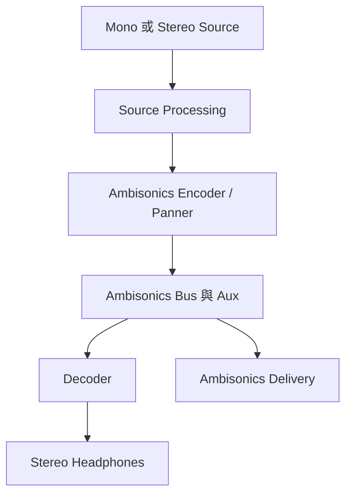

# Ch59 — Ambisonics與格式轉換陷阱

> Ambisonics channel 描述的是聲場資訊，不是某顆喇叭；沒有正確 encoder／decoder，接上幾條線也不等於聽到正確的空間。

來源：[[Pro_Tools_Reference_Guide_2023.3.pdf#page=1369|原書 p. 1337–1342／PDF p. 1369–1374]]。內容以 2023.3 為準；工程情境與自繪圖為本筆記的教學補充。

## 從「喇叭在哪裡」換成「聲場如何描述」

傳統 5.1 的 channel 可以對應 L、C、R 等喇叭；Ambisonics 則用一組聲場成分描述四周、上下與深度，最後再 decode 為耳機或特定 speaker 配置。這使 VR、遊戲與 360 video 可以讓聽者改變視角，而不必把整個聲場永久鎖死在耳朵的左右兩邊。

原書以 1st Order B-format 的 WXYZ 說明：W 對應 omni-directional sound pressure；X 描述 front-minus-back，Y 描述 left-minus-right，Z 描述 up-minus-down。Higher Order 使用更多空間成分，帶來更高的位置解析度；更多 channel 並不是「更多喇叭」的簡單對照。

| Pro Tools 支援 Order | Channel 數 | 操作上要先確認 |
|---|---|---|
| 1st Order | 4 | 素材的 B-format／channel convention |
| 2nd Order | 9 | Track、bus 與 Plug-In 支援相同 order |
| 3rd Order | 16 | decoder 及交付格式對應 |

本章支援屬 Studio／Ultimate。原文把 I/O 中 channel 標成從 00 開始的數字，也在 1st Order 例子標示 WXYZ；實際第三方 Plug-In 若有自己的 channel order 或 normalization 選項，應依它的文件核對，不能只靠四個檔案字母判斷整個交換流程相容。

> [!tip] 實務連結
> 用遊戲引擎或 360 影片接收 Ambisonics 時，除了問「幾階」，還要問對方採什麼資料規格。四條 Audio 都能播放，不代表轉頭後的前後上下仍正確。

## I/O先建bus，監聽再decode

多數工作只需要 Ambisonics bus：`Setup > I/O > Bus > New Path`，選 Order、Create，再 OK。真正錄 Ambisonics microphone array 才需要對應 Input path；若要把未 decode 的聲場傳到另一台系統，才可能需要 Ambisonics Output path。

| 路徑 | 用途 | 不要把它誤當成 |
|---|---|---|
| Ambisonics Input | 收 array／mic 輸出的聲場訊號 | 四顆一般喇叭 input |
| Ambisonics Bus | 集合與傳遞編碼後聲場 | 已經能直接給耳機的 Stereo mix |
| Ambisonics Output | 傳到外部 decode／另一台機器 | 固定喇叭位置對應 |
| Stereo Monitor Output | decoder 後的耳機輸出 | 原始 Ambisonics master |

Higher Order path 可有較低 Order 的 sub-path，且所有 Order 都可有 Mono sub-path；不允許隨便把 5.1 等 speaker-based 格式當成 Ambisonics sub-path，因為它們的 channel 意義不同。

## 一條可理解的混音鏈

原書以 FB360 Audio Plug-In 為例：Mono Audio Track 先處理一般效果，再經 Spatialiser 轉成 2nd Order Ambisonics，送 9-channel bus，由同格式 Auxiliary Input 接收，插入 Control／decoder，最後送 Stereo 監聽 output。這個例子是 2023.3 文件中的產品配置，不代表目前仍販售或必須選此產品。

1. 建正確 Order 的 bus。
2. 建 Mono／Stereo 或 Plug-In 支援的來源 Track。
3. 先安排 source 處理，再插 Ambisonics panner／encoder。
4. 把編碼後 Output 送 Ambisonics bus。
5. 建同 Order Aux，Input 接該 bus。
6. Aux 上的 decoder 把聲場轉成耳機 Stereo，Output 送監聽。
7. 在 encoder／panner 上寫空間 Automation，核對前後上下動作。

> [!warning] 不要在編碼後隨意放 Multi-Mono
> 原書明確要求一般 source processing 放 Ambisonics Plug-In 之前，不要把 Multi-Mono Plug-In 接在 Ambisonics Plug-In 後。各成分之間維持聲場數學關係很重要，獨立改其中一條可能改壞方向資訊。

有些會改 channel width 的 Plug-In，必須先建對來源 Track 與 Output format，才在 Insert 選單出現。找不到選項時先檢查 Track width 和 routing，不要立即認定未安裝。

## Fold Down不是正確的格式轉換

本章最後列出的 Flexible Routing 可用來監聽，但**不能用它替代 encoder／decoder**。

| 直接路由 | Pro Tools 做什麼 | 為什麼不等於正確轉換 |
|---|---|---|
| Ambisonics→speaker-based | 以−3dB 加成 Mono | 沒有把聲場 decode 到各喇叭 |
| speaker-based→Ambisonics | 以−3dB 加到 channel 0 | 沒有依原位置 encode |
| 低 Order→高 Order | 只對到前幾個 channel | 沒有創造較高階資訊 |
| 高 Order→低 Order | 留可容納的前幾個，丟其餘 | 丟失較高階成分 |

所以「接線後有聲」僅代表路由容許，不代表空間格式正確。這是 Ch56 Flexible Routing 最需要小心的特例。

Clip Effects editing 不支援 Ambisonics Track 上的 clip。跨 Ambisonics 與一般 Track 的選取，只處理一般 Track；若 clip 原本在一般 Track 帶著 Clip Effects，再移到 Ambisonics Track，效果仍可能播放，但要移回一般 Track 才可編輯。

> [!abstract] Takeaway
> Ambisonics 先 encode 成聲場，再 decode 監聽。Order、channel convention、Plug-In 格式與交付規格必須一致；普通 Fold Down／Fan Out 只是接通訊號，不會替你完成空間轉換。

## 觀念圖

![[PT-Ch59-concept.png]]

圖為本筆記依原文觀念自繪的示意，不是官方接線圖或產品畫面。

## 相關

%% PT-NAV-BEGIN %%

上一篇：[[PT-Ch58c-ADM交換與Atmos交付]]

下一篇：[[PT-Ch60a-Synchronization與SessionSetup]]

按任務閱讀：[[PT-00-工作流程導航]]

%% PT-NAV-END %%

[[PT-00-索引]] · [[PT-00-功能目錄]] · [[PT-00-Mac快捷鍵]]

[[PT-00-功能目錄#Ch58 — Mixing to Dolby Atmos]]

[[PT-00-功能目錄#Ch60 — Working with Synchronization]]

標籤： #pro-tools #audio #study-note
