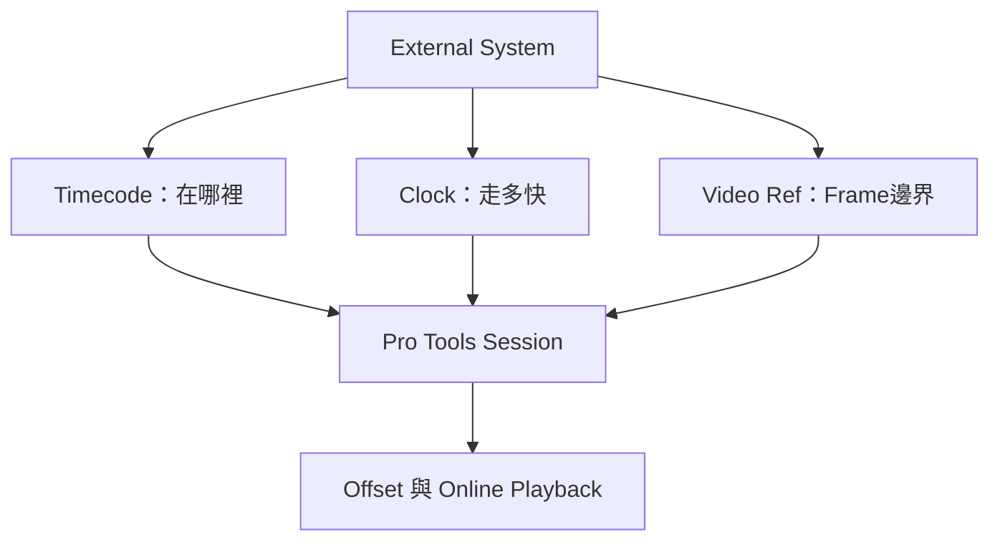

# Ch60a — Synchronization與SessionSetup

> Timecode 告訴系統「現在在哪裡」，Clock 決定「走多快」，Video Reference 還要讓每個 frame 從相同邊界開始。

來源：[[Pro_Tools_Reference_Guide_2023.3.pdf#page=1377|原書 p. 1345–1355／PDF p. 1377–1387]]。內容以 2023.3 為準；工程情境與自繪圖為本筆記的教學補充。

## 對齊起點，和一路不漂移是兩件事

只用 Timecode Trigger，可以讓另一台設備在正確位置開始，但兩台各自靠內部 clock 走，速度稍有差異就會越跑越開。原書指出，這種方式只適合速度非常接近的短專案，連續幾分鐘後也未必可靠。可靠同步要同時解決位置與速度，對影像還要考慮 frame edge。

| 維度 | 常見來源 | 解決什麼 |
|---|---|---|
| Positional Reference | LTC、MTC、Serial Timecode 等 | 對應時間位置 |
| Sample Rate Lock／Clock Ref | Word Clock、AES、Video Reference 等 | Audio 取樣走速 |
| Frame Edge Lock／Video Ref | 對應的 Video Reference | 影像 frame 邊界 |
| Transport control | MMC、MachineControl、Satellite | 誰下 Play／Stop／Locate 指令 |

Transport Master 也不一定是 Clock Master。你可能在 Pro Tools 按 Play，實際由 deck 提供 Timecode，整套設備又跟 house reference 走；把「我按按鈕」理解成「所有 clock 都跟我」會導致錯誤設定。

> [!tip] 實務連結
> 整段一開始就固定差幾 frame，先查 offset 與定位；開頭準、越播越偏，先查 clock 與真實 frame rate。這個症狀區分，比隨手多加幾 frame 延遲有效。

## Sync X與SYNC HD在架構裡扮演什麼

HDX／HD Native 搭配 Sync X 或 SYNC HD，可以跟外部 reference 解析走速，讀 Timecode 並再生 LTC／MTC，也能在需要時作主 clock。本章列 Sync X 可參考 Video Reference、LTC、Bi-phase/Tach、Pilot Tone、AES3／AES3-id、10MHz、Word Clock 等；SYNC HD 有自己的 LTC、Video／House Video Reference（相關 SD 限制）、VITC、Word Clock、AES/EBU 與其他來源。

它們不是任何 audio interface 都能直接替代的普通 MIDI 介面。實際接線與支援 frame/sample rate 要讀相應硬體 Guide，不能只在 Session Setup 看到某選項就推定硬體具備它。

## Session Setup三區怎麼看

到 `Setup > Session`，或 Mac `Command+2`開 Session Setup。上方 Format 固定顯示；中間 Sync X Setup & External Offsets／SYNC Setup & Timecode Offsets 依設備而異；下方 Timecode Settings 可展開。沒有同步硬體時也有部分設定，但不會變出硬體才能提供的功能。

| 控制／顯示 | 用途 | 新手要記住 |
|---|---|---|
| Sample Rate | 顯示目前 Session rate | 不等同改外部 clock 來源 |
| Bit Depth／Audio Format／Interleaved | 影響新錄或匯入並轉換的檔案 | 不把整個既有 media 自動重寫 |
| Clock Master／Clock Source | 選主 clock 或 interface 參考 | 名稱與可選內容依 HD 架構而異 |
| System Delay | Delay Compensation 總延遲 samples | 不是影片顯示器延遲 |
| Session Start | Session 的 Timecode 起點 | 改動時需選保留哪種位置 |
| Session Length | 外部控制可回應的工作範圍 | 手冊 6–24 小時，範圍外不回應 |
| Timecode Rate／Timecode 2 Rate | 主 frame rate 與第二參考 ruler | 不是兩台系統自動同步的保證 |
| Feet+Frames Rate | 膠片長度與 frame 關係 | 要跟 projector／轉換流程一致 |

外部 clock 沒被有效偵測時，interface 可能退回 Internal；所以選單上選過 External，不代表這一刻真的 lock。檢查有效訊號與狀態，才知道系統實際依誰走。

## Clock Ref、Video Ref、Positional Reference分開設定

Sync X 的 Clock Ref 管 sample rate lock，Video Ref 管 frame edge lock，Positional Reference 管 incoming timecode 格式或 Generate。用 10MHz 作 Clock Ref、Video Ref 為 Internal 時，生成的 video reference 相對於該 10MHz 來源。SYNC HD 介面也提供相應 clock、position 與 video 格式設定，但選項依它支援範圍而定。

VSO（Variable Speed Override）是在 Internal Clock Ref 下微調速度與音高，不是一般 time-stretch。若正在生成 Timecode，速度也會相應變動；HD MADI 在特定 channel count 下還有 stream bandwidth 限制，超出時 Audio 會 drop out。做特殊 varispeed 時，必須一起查硬體允許頻率，不能只看 Session nominal sample rate。

> [!warning] 不要把 VSO 拿來修固定 offset
> 固定 offset 是位置問題；VSO 改走速，會讓整段時間與 pitch 都改變。錯用它可能讓起點看似對上，後面卻越差越遠。

## Offsets：不同外部來源可以有不同補償

本章列 MMC、9-PIN、LTC／Sync、Satellite 等 External Offset，可分開輸入或連動。正值讓 Pro Tools 顯示對應到較晚時間、負值較早；實際要以你的時間定義與工作流程核對。`Setup > External Timecode Offset`可把目前位置重新對應到 Desired Timecode Position。

LTC Sample Offset／Sample Offset 則以 samples 微調相對 incoming timecode 的觸發位置；例如−50 讓 Pro Tools 事件相對 incoming LTC 早 50 samples。它不是 Satellite 同步的微調；手冊明確說不適用該用途。範圍約一個 frame 長度，依 sample/frame rate 而變。

## 改Session Start：保留絕對位置，還是保留相對位置

當 Session 已經有素材，改 Start 會問你如何處理。想像片頭原來在 01:00:00:00，要多出前方準備空間，這個決定直接影響素材會不會搬家。

| 選項 | 保留什麼 | 何時適合 |
|---|---|---|
| Maintain Timecode | clip 原本絕對 Timecode 位置 | picture 定位必須不動 |
| Maintain Relative Position | clip 相對 Session Start 的距離 | 要整套內容跟新起點一起平移 |

`Current Timecode Position`把當前 insertion 重新指定為新 Timecode，並重算 Session Start；`Current Feet+Frames Position`只重定義 Feet+Frames 關係，不改 Session Start。兩個名字像，影響卻不同。要捕捉 incoming timecode 作 Session Start，可點欄位、播放 Timecode 來源、按 numeric keypad 的`=`再 Enter 確認。

> [!abstract] Takeaway
> 先畫出誰給位置、誰給速度、誰給 frame edge、誰下 Transport 指令。Session Setup 是把這些關係明確化的地方；Offset 修位置，Clock／VSO 管速度，不要交叉代用。

## 觀念圖

![[PT-Ch60-concept.png]]

圖為本筆記依原文觀念自繪的示意，不是官方接線圖或產品畫面。

## 相關

%% PT-NAV-BEGIN %%

上一篇：[[PT-Ch59-Ambisonics與格式轉換陷阱]]

下一篇：[[PT-Ch60b-PullUpDown與外部Transport]]

按任務閱讀：[[PT-00-工作流程導航]]

%% PT-NAV-END %%

同章其他篇：[[PT-Ch60b-PullUpDown與外部Transport]] · [[PT-Ch60c-Spot與TimeStamp定位音效]]

[[PT-00-索引]] · [[PT-00-功能目錄]] · [[PT-00-Mac快捷鍵]]

[[PT-00-功能目錄#Ch59 — Ambisonics]]

[[PT-00-功能目錄#Ch61 — Pro Tools MachineControl]]

標籤： #pro-tools #audio #study-note
