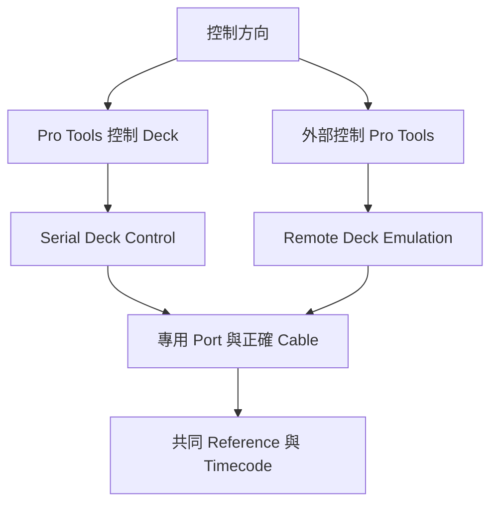

# Ch61a — MachineControl連接與Deck控制

> MachineControl 是用 Sony 9-pin 協定遙控機器；它跟提供位置的 Timecode、提供走速的 Clock 必須配合，卻不能互相取代。

來源：[[Pro_Tools_Reference_Guide_2023.3.pdf#page=1407|原書 p. 1375–1390／PDF p. 1407–1422]]。內容以 2023.3 為準；工程情境與自繪圖為本筆記的教學補充。

## 先判斷誰控制誰

2023.3 的 MachineControl 需要 Ultimate 與 HDX／HD Native。Serial Deck Control 是 Pro Tools 控制外部 deck；Remote 9-Pin Deck Emulation 是把 Pro Tools 當成一台 deck，讓外部 controller 控制它。兩種模式的線材、接頭性別與 port 用途不同，不是把同一條 9-pin cable 倒過來插就能互換。

| 模式 | 命令方向 | 主要用途 |
|---|---|---|
| Serial Deck Control | Pro Tools→外部機器 | Cue、播放、遠端 arm 外部 Track、layback |
| Remote Deck Emulation | 外部 controller→Pro Tools | Pro Tools 充當可被控制的 recorder |
| MMC | MIDI 命令 | 另見 Ch60，不等同本章 serial 功能 |

Sync X／SYNC HD 在 Serial Deck Control 可提升 lock 表現，接近 sample-accurate 控制需要同步硬體與正確 reference。Remote Deck Emulation 則要求同步硬體提供 frame-accurate LTC。沒有 common reference，網路或 serial 命令再快也不會自動讓各 sample/frame 對齊。

## Mac的接線：Port要符合模式

| 接法 | 2023.3 手冊例子 | 限制 |
|---|---|---|
| Mac→deck Serial Control | 支援的 USB serial adapter＋mini DIN-8 male 到 D-sub9 male | CPU 直連較適合 linear deck 性能需求 |
| Sync X／SYNC HD→deck | 9-pin Out 接 deck，主要給 non-linear device | 不是 Remote Emulation 的輸入 port |
| 外部 controller→Mac Remote | 支援 adapter＋mini DIN-8 male 到 D-sub9 female | 不用 HDX／HD Native serial 或同步器 9-pin 口代替 |

手冊以 Colin Broad 422 USB 等受支援 adapter 作例。一般外形一樣的 RS-232／RS-422 adapter 或 9-pin 線未必符合 pinout。原書 p.1405–1407 附接線圖；自行製線應逐 pin 核對與測通，而非憑接頭照片猜。Windows 的 Rosetta Stone adapter 與 COM port 細節不直接套到 Mac。

開機順序依原文先 external machines、MIDI／sync devices，降低 output 音量後開 audio interface，待硬體初始化再開電腦與 Pro Tools。外部 deck 要在 Remote／Ext，若仍是 Local，Pro Tools 可能看得到但控制不了。

> [!tip] 實務連結
> 「機器有出現在選單，Play 卻不動」先看 Local／Remote；「能 Play 但時間不穩」才追 timecode 與 clock。把連線、命令、同步分層排查，能少拆很多次線。

## Serial Deck Control設定順序

1. 在 `Setup > Peripherals > Synchronization` 啟用正確 sync peripheral。
2. Machine Control 頁啟用 9-pin Deck Control，選專用 Port 與合適 Machine Type。
3. 設 Machine Pre-roll，讓機器有時間 servo lock。
4. 在 Session Setup 確認 Session Start、Timecode Rate、Feet+Frames Rate 與 clock。
5. 若要以 Serial Timecode 作 Positional Reference，deck 與同步器都要鎖到共同 Video Reference。
6. 在 Transport 選控制 Pro Tools 還是 Machine，再決定是否 Online。

Machine Pre-roll 會加在 Transport Pre-roll 上。對舊 tape deck 可能需要較長，non-linear machine 可以較短；不要把兩個 pre-roll 當成同一個欄位。MachineControl 的專用 serial port 也不要同時拿去輸出 Timecode 或 MIDI metronome。

## Transport Master改的是操作焦點

Serial Deck Control 中 deck 是 Timecode master；Transport Master 決定按 Play 時，以哪邊位置為起始依據。

| 設定 | Offline | Online |
|---|---|---|
| Transport = Pro Tools | 只控制 Pro Tools | deck 先找 Pro Tools 指定位置減總 pre-roll，再播放，Pro Tools 追 deck timecode |
| Transport = Machine | 只控制 deck | 控制 deck 從自己目前位置播放，Pro Tools 追它 |
| Transport = MMC | 控制 MIDI Machine Control 裝置 | 依 MMC／MTC 配置工作 |

所以「Transport = Pro Tools」不代表 deck 的 clock 突然跟著電腦。Online button 閃爍是等同步，lock 後持續亮；Incoming Time 在 Session Setup 顯示原始 incoming time，不帶 Session offset，Edit Counter 則可能顯示套用 offset 後的 Session 時間。兩邊不同不一定是資料錯誤。

| 常用 Mac 操作 | 功能 | 原文位置 |
|---|---|---|
| `Command+J`或`Option+Space` | Online | p.1381 |
| `Command+\` | 切換可用 Transport Master | p.1389、1402 |
| `Command+6` numeric keypad | Machine Track Arming | p.1391 |

> [!note] 快捷鍵文件疑義
> p.1381 附近文字出現不明確的 Control+反斜線說法，後面 p.1389 與 p.1402 的 Mac 欄明確列 Command+反斜線。本筆記採明確 Mac 欄，詳細疑義另見[[PT-00-版本與原文疑義]]。

## Preferences讓機器跟你工作

Machine Chases Memory Location 會讓 deck 追 Memory Location；Machine Follows Edit Insertion/Scrub 讓 deck 追編輯位置。Linear Devices 用 jog、Non-Linear Devices 用 cue。Machine Cues Intelligently 在遠距定位先高速移動，接近後再慢找；Stop at Shuttle Speed Zero 會在停止 shuttle 時明確送 Stop。

Minimum Sync Delay、Delay Before Locking to LTC／Serial 都在讓設備有時間穩定。若開了 Non-Linear Transport Error Suppression，特定模式下 offline 不會送 Stop 給其他 9-pin 設備。每個選項都應配合實際機器，不要把所有「看起來更快」的設定全開。

## Search與Hi-Speed找帶模式

Linear deck 的 Search 會讓 tape 仍接觸 heads 來搜尋，Hi-Speed 則 unlace 後快轉／倒轉；它們的 Transport 指示也不同。Search 常先播放再用 Space 暫停以維持 laced 狀態，再按 Fast Forward／Rewind；Hi-Speed 則先 Stop 或 Mac `Command+.`讓 tape unlace，再快轉。部分 deck 不支援所有 shuttle 模式，按鈕閃爍時要看該機器的說明。

| 狀態 | Tape 與指示 | 主要差別 |
|---|---|---|
| Search | laced；Stop 保持亮、Play 閃爍 | 適合帶著 heads 找位置 |
| Hi-Speed | unlaced；一般 Transport buttons 暗 | 快速移動到較遠位置 |

> [!abstract] Takeaway
> 先選控制方向與正確線材，再核對 clock／position，最後才調 pre-roll 與 chase 行為。Transport Master 是工作焦點，不是整套設備 clock 關係的簡寫。

## 觀念圖

![[PT-Ch61-concept.png]]

圖為本筆記依原文觀念自繪的示意，不是官方接線圖或產品畫面。

## 相關

%% PT-NAV-BEGIN %%

上一篇：[[PT-Ch60c-Spot與TimeStamp定位音效]]

下一篇：[[PT-Ch61b-TrackArming與Remote錄製]]

按任務閱讀：[[PT-00-工作流程導航]]

%% PT-NAV-END %%

同章其他篇：[[PT-Ch61b-TrackArming與Remote錄製]]

[[PT-00-索引]] · [[PT-00-功能目錄]] · [[PT-00-Mac快捷鍵]]

[[PT-00-功能目錄#Ch60 — Working with Synchronization]]

[[PT-00-功能目錄#Ch62 — Working with Field Recorders in Pro Tools]]

標籤： #pro-tools #audio #study-note
