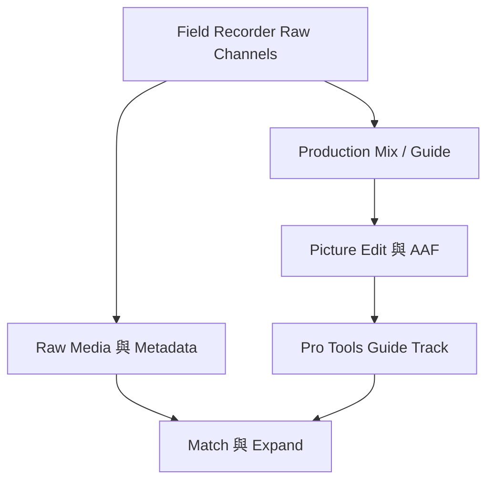

# Ch62a — FieldRecorder素材與Metadata

> Field Recorder 工作流程能保留畫面剪輯又換回原始多麥素材，前提是從拍攝到交接都保住正確 Metadata。

來源：[[Pro_Tools_Reference_Guide_2023.3.pdf#page=1441|原書 p. 1409–1417／PDF p. 1441–1449]]。內容以 2023.3 為準；工程情境與自繪圖為本筆記的教學補充。

## Production Mix不是全部原始錄音

本章特殊 Field Recorder 功能屬 Ultimate。現場錄音師可能同時錄 boom、數支 lav 與其他來源，再選一兩軌或混成 Production Sound Mix 給 picture editor 剪。後製拿到的剪好 guide 若只含那份 mix，不能以為剩下的原始麥克風也已在 AAF 裡。

| 資料 | 誰通常提供 | 用途 |
|---|---|---|
| AAF／OMF edited sequence | Picture editor | 哪段素材在 Timeline 哪個位置、剪接與 fade |
| Production Sound Mix／Guide | 現場 mix 後供剪輯 | 讓 picture 剪輯可參考聲音 |
| Raw Production Source | Production Sound Mixer | 原始多麥 isolated channels |
| Metadata／Sound Log | 現場與流程交接 | 把 guide 找回相同錄音的其他 channel |

BWF 仍是`.wav`，但內有 BEXT，可能還有 iXML。Metadata 可帶 Scene、Take、Channel Name／Number、Sound Roll、Timecode 等；它不是只靠檔名就能完整重建的資訊。原書列 field recorder 可存 Mono 或 Polyphonic 檔案，能力與設定依設備而異。

## Tape與Sound Roll不要混成一欄

Avid 影片流程中的 Tape 可能指 Telecine videotape；錄音 BWF 裡的 Tape 卻可能表示 Sound Roll。Pro Tools 會保留各自對應欄位以避免衝突。Shoot Date 若空白，匯入時可能從原 file Creation Date 補上；因此日期能幫助匹配，但來源不一定是現場人員手輸的日期。

| 欄位／內容 | 為什麼重要 | 可能陷阱 |
|---|---|---|
| Scene＋Take | 指向同一表演 | 不同拍攝日可能重複編號 |
| Sound Roll／Tape | 辨認來源媒體 | T001、T01、T0001 不是相同字串 |
| Channel Name | Boom／Lav 等識別 | 有人可能沒填或換命名 |
| Original Time Stamp／Sound Roll TC | 找同時錄製片段 | 真實 frame rate 要一致 |
| Shoot Date／Creation Date | 避免撞名 | Creation Date 未必等於拍攝日 |

多個 metadata 來源值衝突時，原書優先次序是 Avid OMF-wrapped／MXF，其次 iXML，最後 BEXT。這表示你在 BWF 看到的欄位，不一定最後成為 Session 內顯示的那個值。

> [!tip] 實務連結
> 開工前要求一段小樣本 AAF 與幾個原始 BWF，試一次能否找到相同 take 的 boom 和 lav。這比等整部片交付後才發現 roll 名稱中途改過更省事。

## 把Metadata看出來，才能核對

Timeline 可在 `View > Clip`顯示 Channel Name、Scene and Take；Clips List 的 Show 也有對應項。Workspace 可右鍵 column header，把 Scene、Take、Sound Roll、Timecode、User Bits、Tape ID、Circled 等欄位顯示。不要把可見欄位太少誤判成 Metadata 不在檔案。

BWF 的 Channel Name 可在 Workspace 改，但括號內輸入的內容會被丟棄，channel number 本身保留。這裡要改的是 channel 識別名稱，不是把新數字寫進括號就能重定義錄音 channel。

## 交接有兩種：資料都在Timeline，或仍需另外收原始音

若 Picture editor 把 auto-synced 的 production source 全部放進 Timeline，再匯 AAF，Pro Tools 可以直接取得需要的 tracks。若 raw source 只存在 Avid Bin，AAF 不會自動把它全帶出來，仍需另外交付 source audio。

| 交接情況 | Pro Tools 端要做什麼 | 核對 |
|---|---|---|
| AAF 含已放 Timeline 的所有來源 | Import Session Data 選對 Tracks | channels 是否完整、剪輯是否正確 |
| AAF 只含 edited mix，raw 另交 | 匯入 AAF，再匯 raw 或指定外部 search areas | metadata 與 timecode 能否 match |
| 素材只在 Picture editor 的 Bin | 請對方另外交 source | 不要只拿 AAF 檔案就認為齊全 |

開 AAF／OMF 可用 File > Open Session，設定 WAV、I/O 等後在 Import Session Data 選 media 方式與 track destination；既有 Session 則走 Import Session Data。純 raw 可 Import Audio 或拖 Clips List，資料量大時不必全匯，可讓 Field Recorder 搜尋外部資料夾。

## Half-frame錯位與48.048kHz特殊流程

原始 production audio 未經 Avid 匯出時，可能與 AAF 內音訊差到 half frame，原因是 Avid frame-accurate 與 Pro Tools sample-accurate timestamp 對接。手冊列可手動 offset 或用專用工具處理；不能看到小差異就任意剪掉檔頭，破壞所有來源一致性。

48.048kHz 有時是為後續 pull-down 到 48kHz 而錄。Processing Preferences 的 Don’t Convert Sample Rates on Import 可配合此流程讓它即時以 48kHz 走，而非一般 sample rate convert。這不是「任何不想轉檔都勾」的通用省事選項，會改變速度／時間關係，應先核對現場設計。

## 指定Field Recorder Guide Track

右鍵 Mono guide Track 名稱，選 Field Recorder Guide Track；可先多選 Track 再設定。原書要求每個要使用特殊 Field Recorder 功能的 Mono Track 都需指定，讓 Pro Tools 只對這些軌做額外 metadata 管理。取消亦從同選單解除。這個設計能避免大型 Session 對所有一般 Audio Track 都做昂貴搜尋。

> [!abstract] Takeaway
> 先收齊 edited sequence 與 raw sources，再驗證 roll／scene／take／timecode，最後指定 Guide Track。功能的可靠程度，取決於整條交接鏈有沒有保住資料。

## 觀念圖

![[PT-Ch62-concept.png]]

圖為本筆記依原文觀念自繪的示意，不是官方接線圖或產品畫面。

## 相關

%% PT-NAV-BEGIN %%

上一篇：[[PT-Ch61b-TrackArming與Remote錄製]]

下一篇：[[PT-Ch62b-FieldRecorder匹配與Conform]]

按任務閱讀：[[PT-00-工作流程導航]]

%% PT-NAV-END %%

同章其他篇：[[PT-Ch62b-FieldRecorder匹配與Conform]]

[[PT-00-索引]] · [[PT-00-功能目錄]] · [[PT-00-Mac快捷鍵]]

[[PT-00-功能目錄#Ch61 — Pro Tools MachineControl]]

[[PT-00-功能目錄#Ch63 — Working with Video in Pro Tools]]

標籤： #pro-tools #audio #study-note
