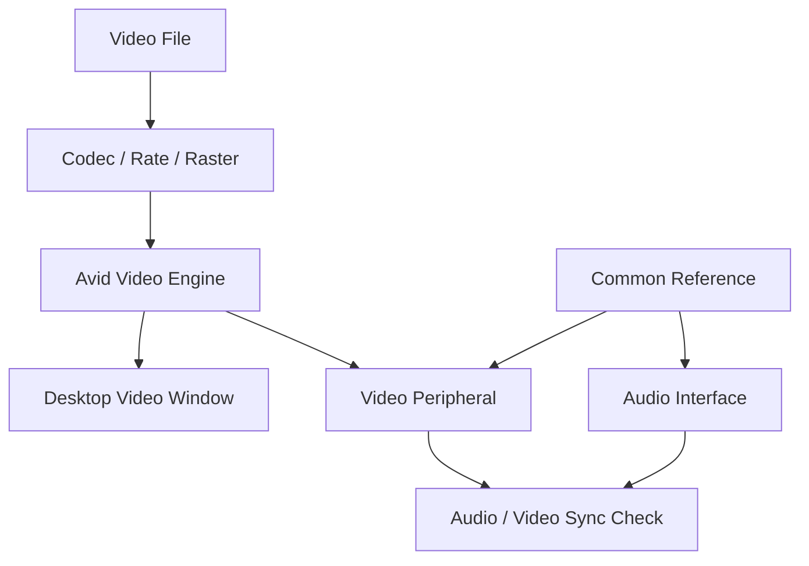

# Ch63a — Video匯入與AVE設定

> Pro Tools 裡能看見影片，還不代表它以正確 frame rate、正確同步基準與合適效能播放。

來源：[[Pro_Tools_Reference_Guide_2023.3.pdf#page=1463|原書 p. 1431–1449／PDF p. 1463–1481]]。內容以 2023.3 為準；工程情境與自繪圖為本筆記的教學補充。

## 先認識版本能做的事

2023.3 的 Video 由 Avid Video Engine（AVE）處理；先到 `Setup > Playback Engine`啟用 Video Engine。Artist 不支援 Video；Studio 與 Ultimate 的能力差別不只 Track 數，也包含剪輯與管理方式。

| 版本 | 本章列出的核心能力 | 限制方向 |
|---|---|---|
| Artist | 不支援 Video | 不能照本章操作 |
| Studio | 單一 Video Track、基本播放與 Audio 抽取 | 一般匯入限一個 video file／playlist；不能做 Ultimate 完整 Video edit |
| Ultimate | 最多 64 Video Tracks、多 clip、多 playlist 及基本 video editing | 一次仍只播 main video track |

Online 的 Video Track 稱 main video track。其他 Video Track 可以存在，但不會同時疊成一個多畫面 video mixer。Video Online 藍色是 online，灰色 offline；offline 可讓 Audio 繼續播而不播 Video，跟外部同步 Transport Online 也不是同一開關。

## 檔案容器與Codec分開問

MOV、MP4、M4V、MXF 是 file／container 層；H.264、H.265、DNxHD／DNxHR 等是 codec 層。兩個檔都叫`.mov`，效能和支援也可能不同。原書建議 timeline 工作優先用 Intra Frame codec，例如 DNxHD／DNxHR；Long GOP 如 H.264 需不同的解碼工作，不能只因檔案小就推定最好剪。

| 交接前詢問 | 為什麼問 | 例子 |
|---|---|---|
| 真實 Frame Rate | Audio 尺與 Video 要對齊 | 23.976 不要寫成 24 |
| Raster Size | 影像尺寸與處理負擔 | 1920×1080 或高解析來源 |
| Codec 與來源軟體 | 解碼與相容性 | 先拿 sample file 測 |
| Timecode Burn-in | 判斷實際畫面位置 | 能直接看畫面 TC |
| 素材存放 | 大型 video 與 audio 爭 disk bandwidth | 高需求時分開 drive |

手冊一處概述至 60fps 與 4096×3112，後文又描述更高 rate 素材與硬體降階選擇；這類支援範圍須按實際 codec／hardware／OS 查兼容資料，不可只用一個概述數字推定所有組合。這份筆記只教 2023.3 操作架構，不把年代舊的格式表冒充現行保證。

## 匯入時決定放哪裡，不要事後猜Timecode

`File > Import > Video`，Mac 可用`Command+Option+Shift+I`。也可從 Finder／Workspace 拖入，或用 Import Session Data 從其他 Session／AAF 帶入。Video Import Options 設定 Destination 與 Location，兩者要分開看。

| Destination | 放到哪裡 | 條件 |
|---|---|---|
| Main Video Track | 現在 online 或最後 online 的軌 | 依目前 main track 狀態 |
| New Track | 每個檔案新軌 | 多軌屬 Ultimate 能力 |
| Clips List | 先放素材清單 | Ultimate |

| Location | 以什麼時間放置 | 適用 |
|---|---|---|
| Session Start | Session 開始 | 檔頭就是工程起點 |
| Song Start | Song Start 位置 | 有明確音樂定位 |
| Selection | 當前 insertion／selection | 已先定位 |
| Spot | 精確輸入位置 | 對 Timecode 或其他 Time Scale |
| Original Time Stamp | 原始 timestamp | Avid Video |

第一次匯入決定 Video Engine Rate，之後加入影片需相同 frame rate；不同 resolution 可以共存。Main Video Track 上的 file-rate indicator 變紅，表示與 Session Timecode Rate 不符，或 Video Pull 造成差異。改 Timecode Rate 不會把源影像真的轉成另一個 fps。

`Import Audio from File`可把對應 Audio 抽成新軌；即使當初沒抽，也可右鍵 clip 選 Import Audio From Movie。抽出的 Audio 若 rate 不同會做 sample rate conversion，品質在 Processing Preferences 的 Conversion Quality 設定。`Option-drag`可跳過 Import Options，把 video 按目前 edit mode 丟到 drop 位置；熟悉前先正常開對話框。

> [!warning] 三個 Remove 選項影響不同
> Remove Existing Video Tracks 移除既有軌；Remove Existing Video Clips 清 Timeline 與 Clips List 但不刪 disk file；Clear Main Video Track Playlist 只清當前 main playlist。換 picture 版本前先 duplicate／保存 Session，別用名字相似的選項誤清其他版本。

## Engine Rate、Timecode Rate、Video Reference各有責任

Engine Frame Rate／Raster 決定 AVE 如何處理輸出；Session Timecode Rate 決定尺、grid 與 counter 怎麼數 frame；外部 Video Reference 讓硬體 clock 與 frame edge 對齊。桌面 Video Window 能顯示，不等於外接 hardware 支援同一 rate／raster 組合；`hardware n/a`就是提醒該組合不適用硬體。

| 組態 | 起播／長段同步表現（依原文） | 用途理解 |
|---|---|---|
| HD 同步器與 Video peripheral 共用正確 ref | 同 frame edge 起播，避免漂移 | 要求精準的 post 環境 |
| Audio／Video 外部 clock 同源但無完整 frame edge 控制 | 起播可能±1frame，但不再持續漂 | 需理解起播誤差 |
| 各用 Internal clock | 可逐漸漂移，AVE 以 drop／duplicate frame 追上 | 不是精準同步的替代 |

> [!tip] 實務連結
> 若畫面每次開始差一點，但整段不再越來越偏，和「播越久越偏」是不同問題。前者查 frame edge 與起播，後者查 clock 一致性；固定 Video Sync Offset 只能修固定 monitor chain 延遲。

## Playback Quality與Color Space要配合工作目的

Full Quality 處理完整影像，8-bit；Full Quality 10-bit 需連 video hardware，且高品質 HDR 等工作會需要更多資源。Draft 用約 1/4 資訊，Best Performance 約 1/16 資訊。縮減品質是降低 AVE 負擔，不是重寫原 video 檔。

Video Track Color Space 管 engine 處理，Video Window Color Space 管桌面顯示，外接螢幕則要看硬體 control panel。Color Adapters 預設關閉，需要混合不同 source 色域並對到單一 space 時再啟用。不要只因桌面一邊比較亮，就隨意改整條工程的處理 space。

> [!abstract] Takeaway
> 接收 video 先核對 rate、raster、codec 與 timecode，再選匯入位置。Engine rate、Session 尺與硬體 reference 是三層；把它們對齊，才有可靠的 picture edit 與 mix。

## 觀念圖

![[PT-Ch63-concept.png]]

圖為本筆記依原文觀念自繪的示意，不是官方接線圖或產品畫面。

## 相關

%% PT-NAV-BEGIN %%

上一篇：[[PT-Ch62b-FieldRecorder匹配與Conform]]

下一篇：[[PT-Ch63b-Video剪輯效能與MOV交付]]

按任務閱讀：[[PT-00-工作流程導航]]

%% PT-NAV-END %%

同章其他篇：[[PT-Ch63b-Video剪輯效能與MOV交付]]

[[PT-00-索引]] · [[PT-00-功能目錄]] · [[PT-00-Mac快捷鍵]]

[[PT-00-功能目錄#Ch62 — Working with Field Recorders in Pro Tools]]

[[PT-00-功能目錄#Ch64 — Satellite Link]]

標籤： #pro-tools #audio #study-note
