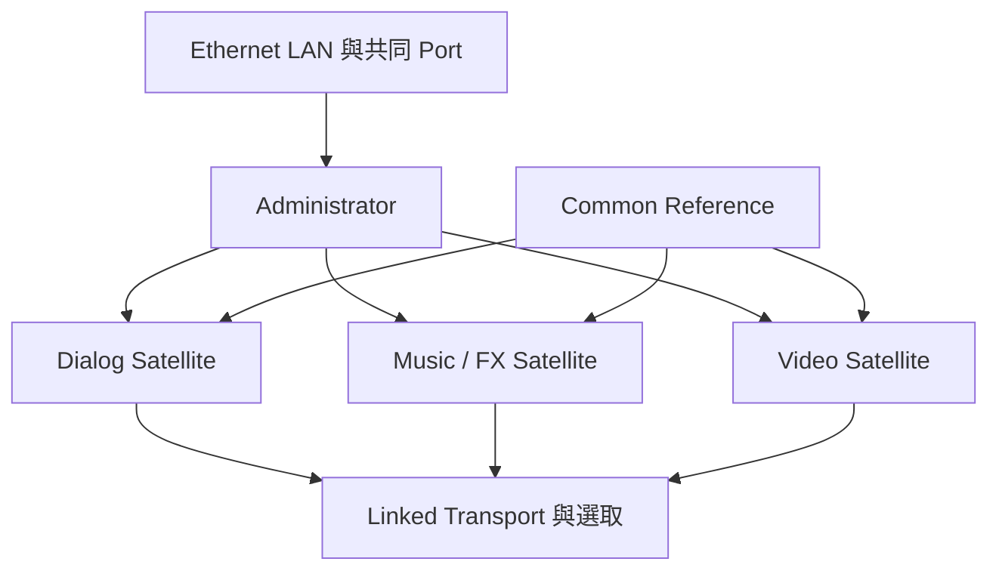

# Ch64 — SatelliteLink多機同步

> Satellite Link 讓多台工作站一起 Cue、Play、Stop 與 Solo，但 Ethernet 送的是控制，精準同步仍要靠共同 reference。

來源：[[Pro_Tools_Reference_Guide_2023.3.pdf#page=1499|原書 p. 1467–1475／PDF p. 1499–1507]]。內容以 2023.3 為準；工程情境與自繪圖為本筆記的教學補充。

## 不同角色的權限不同

2023.3 的 Satellite network 有一個 Administrator，依配置最多再接 11 個 member，總數 12 台。不能把這個最大值理解成任意 12 台普通 Mac 裝 Pro Tools 就能達成全部能力。

| 角色 | 可送 Transport | 可收 Transport | Solo 資料 | 重要條件 |
|---|---|---|---|---|
| Satellite Administrator | 可 | 可 | 可送收 | Ultimate；整網唯一管理者 |
| Pro Tools Satellite | 可 | 可 | 可送收 | Ultimate＋HD 硬體與同步器用於 near sample-accurate |
| Pro Tools Video Satellite | 不送 | 可 | 不送收 | 一台 Studio 影片機，見 Ch65 |
| Media Composer Video Satellite | 單一 Pro Tools 連接時可送 | 可 | 不是 Audio Solo member | 直接播 sequence，見 Ch66 |

Administrator 無 HD 硬體時只可 claim 一台額外 Video Satellite，無同步器所以約 near frame-accurate；有 HD 硬體可管理到 11 台，near sample-accurate 仍需同步 peripheral。Satellite 不是把每台 CPU/RAM 合成一台更大的 computer，也不會自動把 Audio streams 合併。

> [!tip] 實務連結
> 大型 dub stage 可把 Dialog、Music、FX 各放一台，另有 Recorder 與 Video；Satellite 把工作定位連在一起，Audio 如何進總 mix 則是另一套實際路由設計。

## 先Connected，再Declared，最後Linked

Ethernet LAN 建議同 subnet、同 switch 以降低反應時間。多網卡電腦要在 `Setup > Peripherals > Satellites > Advanced Network Settings`選正確 Interface。所有成員用相同 TCP/UDP port，預設 28282，可用範圍 1024–65534；換 port 也可把同 LAN 分成不同 Satellite network。

1. 各 member 輸入 System Name，Mode 設 Satellite，或對應 Video Satellite 模式。
2. Administrator 輸入名稱並設 Administrator，System 1 選自己。
3. 在 Administrator 的 System 2–12 宣告要加入的系統。
4. `View > Transport > Synchronization`與 Expanded 顯示 Link controls。
5. 點 Link button 讓本機加入，點各 Satellite button 加入其他機器。

| 層次 | 代表什麼 | 不代表什麼 |
|---|---|---|
| LAN 可見 | 找到同 network／port 系統 | 已被本 Administrator 宣告 |
| Declared | 已加入這個 Satellite network 清單 | 每次播放都一定跟隨 |
| Linked | 現在跟其他 linked systems 聯動 | 所有 reference／Audio 路由已自動正確 |

## Selection與Solo可以分開決定方向

Transmit Play Selections 把本機 Edit selection 送其他機器；Receive Play Selections 決定是否接收。多人操作常讓 Dialog／FX／Music 送，Recorder／Video 只收；單人跨機操作可讓所有機器雙向送收。這個設計避免某人改選取範圍，意外把另一個操作者工作狀態改掉。

| 選項 | 影響 | 例子 |
|---|---|---|
| Transmit／Receive Play Selections | 播放範圍跟隨 | Recorder 只收工作站決定的 range |
| Transmit／Receive Solos | 跨機 Solo 狀態 | 聽整個 Dialog stem 時其他機器避讓 |
| Solo Independent of Linked State | 未 link Transport 仍可送 Solo | 外部 synchronizer 管走帶，Satellite 只管 Solo |
| Solo Safe | 保留每軌原本安全狀態 | 效果 return 仍可保留 |

Solo in Place 的 Latch 或 X-OR 行為依發送方決定，會影響其他接收系統；AFL／PFL Solo 不會以同樣方式影響其他機器。原文提醒 AFL-soloed Track 仍可能被另一台 Solo in Place 靜音，該情境可考慮 PFL。先確認自己要的是獨聽控制還是真正監聽路由，再設定。

## 播放中可加入，但要注意錯誤與Modal Dialog

系統可 join in play；若兩台都在播放，新加入者會 Cue 到發起 link 那台的位置。Link 亮表示已連，remote button 紅色表示對方遇 error 或 modal dialog。把 mouse 放上看 tooltip，Mac `Shift-click`對方 Satellite button 可關閉對方 error dialog。

| 狀況 | 預設／行為 | 管理方式 |
|---|---|---|
| 某台 AAE error 停住 | 其他系統預設可繼續 | 需一起停時設 AAE Errors Stop All Linked Systems |
| 某台開 I/O／Hardware／Playback Engine modal dialog | Linked 系統會停止或無法起播 | 要調設定先 unlink 該機 |
| 整網不穩 | 可 Reset Network | 設定窗口或對 Link 按 Command+Option+Control-click |
| 兩台同時想透過 MachineControl online | 只容一台 linked machine online | 新 online 者會讓舊者 offline |

## 常用Mac控制與控制面

`Option+Shift+L`切本機 Link；`Option-click` Link 或 Satellite Link 可一次切所有宣告系統。ICON／C|24 與 EUCON 可提供對應控制，但不同 control surface 按法與支援要看專用 Guide，不用一般鍵盤快捷鍵直接推定。

> [!warning] Reset 不是修時鐘
> 重新建立 network 能處理通訊狀態，不能修不相容 frame rate、不同 clock 或錯接 Audio。重設前先判斷是「找不到機器」還是「找到但不同步」。

> [!abstract] Takeaway
> 衛星網路先分清角色，再設定 member、Administrator 與 Link。Transport、Selection、Solo 都可各自管理；共同 reference 與 Audio routing 仍要另外建立。

## 觀念圖

![[PT-Ch64-concept.png]]

圖為本筆記依原文觀念自繪的示意，不是官方接線圖或產品畫面。

## 相關

%% PT-NAV-BEGIN %%

上一篇：[[PT-Ch63b-Video剪輯效能與MOV交付]]

下一篇：[[PT-Ch65-ProToolsVideoSatellite獨立影片機]]

按任務閱讀：[[PT-00-工作流程導航]]

%% PT-NAV-END %%

[[PT-00-索引]] · [[PT-00-功能目錄]] · [[PT-00-Mac快捷鍵]]

[[PT-00-功能目錄#Ch63 — Working with Video in Pro Tools]]

[[PT-00-功能目錄#Ch65 — Pro Tools Video Satellite]]

標籤： #pro-tools #audio #study-note
