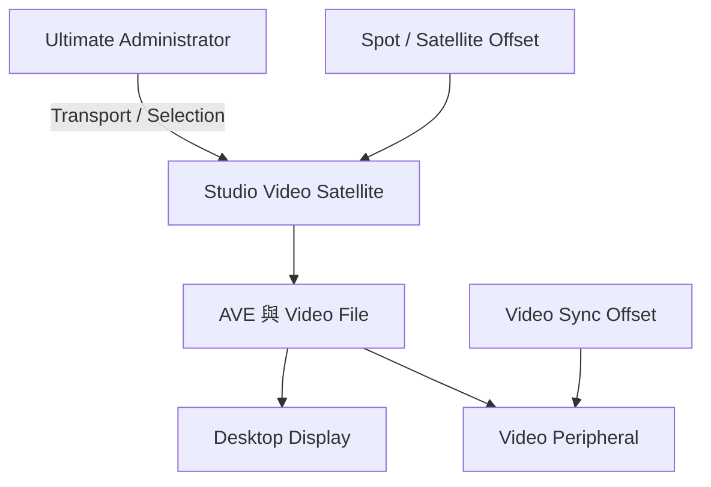

# Ch65 — ProToolsVideoSatellite獨立影片機

> 把 Video 搬到另一台電腦，是分擔影片解碼與顯示工作；它不等於得到完整 HD 同步或第二台可任意控制整網的工作站。

來源：[[Pro_Tools_Reference_Guide_2023.3.pdf#page=1509|原書 p. 1477–1480／PDF p. 1509–1512]]。內容以 2023.3 為準；工程情境與自繪圖為本筆記的教學補充。

## 一台Studio影片機的定位

本章的 Pro Tools Video Satellite 使用獨立電腦跑 Pro Tools Studio，由 Ultimate Administrator 控制。Network 只允許一台這類 Video Satellite。它可以用受支援 non-HD interface，手冊例子含 Carbon 或 Core Audio Dolby Audio Bridge；也可由 desktop display 或支援 video peripheral 出畫面。

最重要限制是本章配置不能用 Pro Tools video reference，精度不及正確配置的 Media Composer Video Satellite。若有 video peripheral，本身可能仍需 black burst／tri-level generator，但不能因此宣稱整個 non-HD Audio/Video 系統已取得與 HD 同步器相同的 frame-edge 關係。

| 這台影片機能做什麼 | 不能因此推定什麼 |
|---|---|
| 接收 Administrator 的 Transport | 能反向控制 Administrator 起播 |
| 接收播放 selection | 影片機改 selection 會回傳主機 |
| 自己 unlink 後獨立操作 | unlink 仍等同同步播放 |
| 替主 Audio 機分擔 Video | CPU／RAM 直接併入主機 |
| 使用支援 video peripheral 顯示 | 自動得到 near sample-accurate 同步 |

> [!tip] 實務連結
> 若 Audio Session 本身已很重，影片機可以讓 Audio 機少做解碼與畫面處理。但在投入第二套系統前，先用 Ch63 的方法減少 codec／raster 負擔；分機是工作架構選擇，不是任何卡頓的唯一解。

## 設定順序與日常控制

主機依 Ch64 設 Administrator，影片機在 Peripherals > Satellites 啟用 Satellite 模式、命名並確認 Interface／port，再由主機 declare。顯示 Transport 的 Synchronization 與 Expanded，讓 Link 與 remote buttons 可見。

Mac `Option+Shift+L`切本機 link；點另一系統 button 可切遠端 link，`Option-click`切所有宣告成員。可在 Administrator 正在播放時加入 link，之後影片機會同步跟上。影片機 unlink 後，Transport 回到一般本機 Pro Tools 行為。

| 問題 | 先查 | 原因方向 |
|---|---|---|
| 主機看不到影片機 | LAN、Interface、同 port、Satellite mode | 通訊／宣告 |
| 看得到但不跟 Play | Link 狀態、modal dialog | 工作狀態 |
| 影片機按 Play 主機不動 | 本章本來是單向 Transport | 不是故障 |
| 聲畫固定錯位 | clip 位置、start offset、monitor delay | 位置／延遲 |
| 越播越偏 | clock 與本架構精度限制 | 不要只調固定 offset |

## Clip Spot、Satellite Offset、Monitor Delay三層

先把 Video clip 放到正確 Timecode 或 Feet+Frames 位置，確保它在影片機 Session 內的座標本來正確。若兩台 Session 起點刻意不同，再設定 Session Setup 中的 Satellite Offset。最後才補償顯示器造成的固定 delay。

| 要修正的事情 | 設定位置 | 原書方向 |
|---|---|---|
| 影片 clip 在錯 Timecode | 影片機 Timeline Spot | 直接放到應有座標 |
| 影片 Session／主機起點不同 | 影片機 Session Setup 的 Satellite Offset | Video start 比主機早填正值；比主機晚填負值 |
| monitor 顯示慢幾 frame | 影片機 `Setup > Video Sync Offset` | 以對應正值提前 Video output |

> [!warning] 別把同一份 delay 補兩次
> 用 Satellite Offset 修 Session 起點，用 Video Sync Offset 修螢幕鏈延遲。若兩邊都靠試錯隨意加值，很容易只在某個起點看似正確，換片段或換機器又失準。

## Errors和Modal Dialog如何影響聯動

影片機出 AAE error 時，其 button 在另一台亮紅，可 hover 看訊息、`Shift-click`清 error dialog。主機可設 AAE Errors Stop All Linked Systems 決定是否一起停。開 I/O、Hardware Setup 或 Playback Engine 等 modal dialog 會讓 linked playback 停止；要在另一台繼續工作，先 unlink 再調。

> [!abstract] Takeaway
> Pro Tools Video Satellite 是單一 Studio 影片機，接收主機控制來分擔播放。依序核對 clip 座標、Satellite Offset 與 monitor delay；不要拿 fixed offset 修走速漂移。

## 觀念圖

![[PT-Ch65-concept.png]]

圖為本筆記依原文觀念自繪的示意，不是官方接線圖或產品畫面。

## 相關

%% PT-NAV-BEGIN %%

上一篇：[[PT-Ch64-SatelliteLink多機同步]]

下一篇：[[PT-Ch66a-MediaComposerSatellite與同步設定]]

按任務閱讀：[[PT-00-工作流程導航]]

%% PT-NAV-END %%

[[PT-00-索引]] · [[PT-00-功能目錄]] · [[PT-00-Mac快捷鍵]]

[[PT-00-功能目錄#Ch64 — Satellite Link]]

[[PT-00-功能目錄#Ch66 — Media Composer Video Satellite]]

標籤： #pro-tools #audio #study-note
