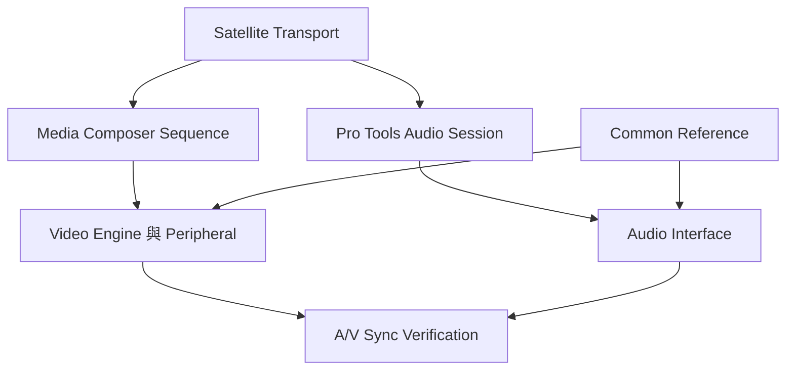

# Ch66a — MediaComposerSatellite與同步設定

> Media Composer Video Satellite 可以直接播放剪輯中的 sequence，讓 Pro Tools 專心做 Audio，而不必每次先輸出一支扁平影片。

來源：[[Pro_Tools_Reference_Guide_2023.3.pdf#page=1513|原書 p. 1481–1491／PDF p. 1513–1523]]。內容以 2023.3 為準；工程情境與自繪圖為本筆記的教學補充。

## 與Pro Tools Video Satellite差在哪裡

本章使用獨立 Media Composer 電腦，透過 Satellite Link 接 Ultimate Administrator。Media Composer 可播放完整 sequence，也能配合 capture 與 conversion；若要高品質 frame-edge aligned 輸出，需合格 video peripheral，並讓它和 Pro Tools 同步器共用正確 reference。

| 架構 | 播放材料 | 定位優點 | 要付出的管理 |
|---|---|---|---|
| Pro Tools Video Satellite | Pro Tools 內的 Video 檔 | 分擔 AVE 與畫面工作 | Studio 影片機的單向控制與精度限制 |
| Media Composer Video Satellite | 原生 sequence 與媒體 | 不必先 Video Mixdown | Project Type、Edit Play Rate、clock 與 reference 要匹配 |
| 主機直接播 Video | 同 Session 的 Video Track | 簡單、少一套系統 | Audio／Video 共用電腦資源 |

只用電腦 monitor fullscreen 輸出，螢幕 refresh rate 可能與 video frame rate 不同，導致 tearing／stutter 與每 frame 略有變化的 A/V offset。Flip On Vertical Sync 可改善其中部分問題，不會把普通顯示卡輸出變成受 house reference 鎖定的專業 video peripheral。

> [!tip] 實務連結
> Picture editor 還在調整的廣告或節目，可以直接接 sequence，少一次反覆 Video Mixdown；但先用穩定的測試 sequence 核對同步與機器效能，再接正式工作。

## 建立連線：同網段、同Interface、同Port

Media Composer 要完全啟動、開正確 project／sequence，在 Project Settings 裡啟用 Video Satellite Mode。Pro Tools 的 Peripherals > Satellites 選到同 LAN 網卡，port 與 Media Composer 一致，預設 28282、允許 1024–65534，再由 Administrator 宣告並 link。

| 看不到／不播放的狀況 | 先核對 |
|---|---|
| Satellite 沒出現在選單 | Media Composer 是否已完全啟動且 Satellite Mode 開啟 |
| 多網卡找錯網路 | 兩邊 Interface 是否真的接同一網 |
| 找到卻連不上 | TCP/UDP port、防火牆／網路阻擋 |
| 連上仍不播放 | Pro Tools 有 Session、Media Composer 有 sequence 且是 active application |
| 開始後突然停 | 任一端 modal dialog 或 error |
| 狀態異常持續 | 核對基本條件後再 Reset Network |

Pro Tools 退出會釋放它管理的 Video Satellite，重啟則嘗試回連。Linked Video Satellite 時不支援追 MTC／MMC；不要同時把另一套 MIDI chase 當成第二個 Transport 來源。

## 四個速度設定要一起匹配

Media Composer 的 Project Type、Edit Play Rate，與 Pro Tools 的 Timecode Rate、Audio Pull Up/Down、Clock Reference、Video Ref Format 相互關聯。最安全的原則是讓 Audio 工程配合已確認的 picture sequence 規格；除非明確做 SD down-convert 等流程，不要為了消掉一個錯誤提示就改 picture project 本質。

| Media Composer 例子 | Edit Play Rate | Pro Tools Timecode | Audio Pull |
|---|---|---|---|
| 23.976p NTSC 原速 | 23.976 | 23.976 | None |
| 23.976p NTSC 改 24 播放 | 24 | 24 | +0.1% |
| 24p NTSC 原速 | 24 | 24 | None |
| 24p NTSC 改 23.976 播放 | 23.976 | 23.976 | −0.1% |
| 24p PAL 以 25 播放 | 25 | 25 | 原文稱 4% Up，數學為 25/24 |
| 25p PAL 以 24 播放 | 24 | 24 | −4% |

這張是原書 p.1486 表的常見節錄，**不是完整硬體 reference 表**。720p、1080i/p、2K/4K/UHD 與高 frame rate 要回 p.1486–1487 核對；表中的 field rate 與 timecode rate 也可能不同，例如 1080i/50 的 Pro Tools timecode 是 25。100／119.88／120fps 在 Media Composer Satellite 配置下可用但 video hardware 會被停用，不能只看 Frame Rate 數字就推定硬體也能出。

> [!warning] Project 標 24p，預設播放不一定真是 24
> 原文提醒 24p PAL 預設 Edit Play Rate 可為 25，24p NTSC 可為 23.976。要進 Film and 24P 設定看實際值，不能只讀 project 名字。

## Drop Frame與Non-Drop Frame也必須一致

Pro Tools Timecode Rate 後帶 DF 表示 Drop Frame。Media Composer 的 Starting TC 可用分號分隔表示 DF、冒號表示 NDF；Sequence Report 可以核對。某些 23.976p NTSC、24p NTSC、720p/23.976 project 在兩邊支援方式不同，原書說即使 Media Composer 設 DF，傳給 Pro Tools 可能仍是 NDF；這類特殊情境按表與對話框實測確認，不自行推導。

Session Start 與 Sequence Starting TC 不必完全相同，例如 picture 從 01:00:00:00 開始，Audio Session 留五秒空間從 00:59:55:00 開始。但兩邊相對關係要清楚；如果從 Media Composer 開始的位置比 Pro Tools Session 早太多，原書說有機會失敗，可把 Session 起點往前調。

| 要修的差異 | 設定位置 | 方向原則 |
|---|---|---|
| 兩邊 sequence 座標不同 | Pro Tools Session Setup > Satellite Offset | Video 起點早填正；晚填負 |
| 顯示器固定延遲 | Media Composer Video Satellite Settings 的 Offset | 正值讓 Video 提前相應 frame |
| 播放速度不同 | Edit Play Rate 與 Audio Pull | 不用固定 offset 掩蓋 |

## 控制權與Link

只有一台 Pro Tools 連 Media Composer 時，兩邊可發起支援的 Transport 操作；若網路含多台 Pro Tools，播放要從 Pro Tools 端發起。Mac `Option+Shift+L`切本機 Link；remote error 使對應 button 變紅，hover 看訊息，Shift-click 清對話框。

Media Composer 的 J/K/L shuttle 不同速度不表示 Pro Tools 會以同樣方式播 Audio；原文說 Audio 只在 1x forward 正常播放，不支援該情境的 reverse／其他速度。Trim、Color Correction、Effects modes 不屬本 Satellite 工作模式支援範圍；高 bandwidth 或 unrendered effects 的 sequence，可用 Play Preparation Delay／Loop Preparation Delay 增加穩定性。

> [!abstract] Takeaway
> Media Composer Satellite 的價值在直接跑 sequence；可靠度則靠真正匹配 Project／Play Rate／Timecode／Clock。先建立速度與座標關係，再處理 monitor 固定延遲。

## 觀念圖

![[PT-Ch66-concept.png]]

圖為本筆記依原文觀念自繪的示意，不是官方接線圖或產品畫面。

## 相關

%% PT-NAV-BEGIN %%

上一篇：[[PT-Ch65-ProToolsVideoSatellite獨立影片機]]

下一篇：[[PT-Ch66b-Satellite擷取與DigitalCut]]

按任務閱讀：[[PT-00-工作流程導航]]

%% PT-NAV-END %%

同章其他篇：[[PT-Ch66b-Satellite擷取與DigitalCut]]

[[PT-00-索引]] · [[PT-00-功能目錄]] · [[PT-00-Mac快捷鍵]]

[[PT-00-功能目錄#Ch65 — Pro Tools Video Satellite]]

標籤： #pro-tools #audio #study-note
